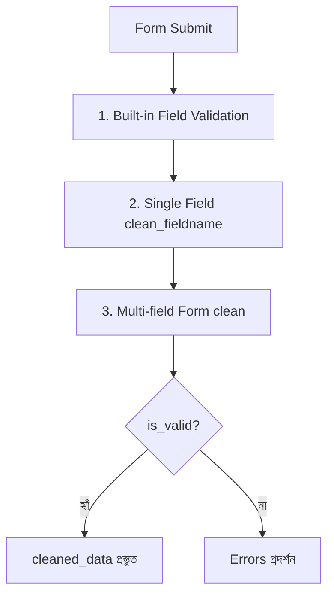

# Django Forms ও ModelForms 📝

ওয়েব অ্যাপ্লিকেশনে ব্যবহারকারীর কাছ থেকে তথ্য নেওয়ার সবচেয়ে প্রধান মাধ্যম হলো **Form**। Django-তে Form হ্যান্ডেল করার জন্য অত্যন্ত শক্তিশালী ও সিকিউর সিস্টেম রয়েছে — **Django Forms** এবং **Django ModelForms**।

এই গাইডে আমরা জানব সাধারণ HTML Form-এর বদলে Django Form কেন ব্যবহার করব, `forms.Form` এবং `forms.ModelForm`-এর মধ্যে পার্থক্য কী, কীভাবে ভ্যালিডেশন, স্টাইলিং ও ফাইল আপলোড হ্যান্ডেল করতে হয়।

---

## ১. সাধারণ HTML Form বনাম Django Form

### সাধারণ HTML Form-এর সমস্যা:
1. **ম্যানুয়াল ভ্যালিডেশন:** ইনপুট সঠিক কিনা (যেমন: ইমেইল ফরম্যাট, পাসওয়ার্ডের দৈর্ঘ্য) প্রতিটির জন্য প্রচুর ম্যানুয়াল কোড বা JavaScript লিখতে হয়।
2. **নিরাপত্তা ঝুঁকি:** CSRF (Cross-Site Request Forgery), XSS অ্যাটাকের ঝুঁকি থাকে যদি নিজে থেকে সিকিউরিটি হ্যান্ডেল না করা হয়।
3. **টাইপ কনভার্সন:** ইনপুট সবসময় স্ট্রিং আকারে আসে; পাইথনের ডেটাটাইপে (যেমন: Integer, Date, Boolean) রূপান্তর নিজে করতে হয়।
4. **ভুল ডেটা ধরে রাখা:** ইউজার ভুল সাবমিট করলে পেজ রিলোড হয়ে সব টাইপ করা ডেটা মুছে যায়, যা খারাপ UX।

### Django Form-এর সুবিধা:
- 🚀 **Auto HTML Rendering:** পাইথন কোড লিখলেই অটোমেটিক HTML ফর্ম তৈরি হয়ে যায়।
- 🛡️ **Built-in Security:** CSRF সুরক্ষা এবং ডেটা স্যানিটাইজেশন বিল্ট-ইন থাকে।
- ✅ **Automatic Validation:** ফিল্ডের ডেটা স্বয়ংক্রিয়ভাবে যাচাই (Validate) ও পাইথন অবজেক্টে কনভার্ট (`cleaned_data`) হয়।
- 🔄 **Error Handling:** কোন ফিল্ডে কী ভুল হয়েছে তা চমৎকারভাবে ইউজারের সামনে তুলে ধরে এবং আগের ইনপুট করা ডেটা রেখে দেয়।

---

## ২. Django Forms (`forms.Form`)

`forms.Form` হলো একটি সাধারণ ফর্ম ক্লাস যা কোনো ডেটাবেজ মডেলের সাথে সরাসরি সংযুক্ত থাকে না। এটি সাধারণ ইনপুট যেমন: **Contact Form, Search Box, Login Form, Feedback Form** ইত্যাদি তৈরিতে ব্যবহার করা হয়।

### ধাপ ১: `forms.py` তৈরি করা

অ্যাপ ডিরেক্টরিতে `forms.py` নামের একটি ফাইল তৈরি করতে হয়:

```python
# blog/forms.py (অথবা আপনার app/forms.py)
from django import forms

class ContactForm(forms.Form):
    name = forms.CharField(
        max_length=100, 
        label="আপনার নাম",
        widget=forms.TextInput(attrs={'placeholder': 'পুরো নাম লিখুন'})
    )
    email = forms.EmailField(
        label="ইমেইল অ্যাড্রেস",
        widget=forms.EmailInput(attrs={'placeholder': 'name@example.com'})
    )
    subject = forms.CharField(
        max_length=200, 
        label="বিষয়", 
        required=False
    )
    message = forms.CharField(
        label="আপনার বার্তা",
        widget=forms.Textarea(attrs={'rows': 4, 'placeholder': 'এখানে লিখুন...'})
    )
    subscribe = forms.BooleanField(
        required=False, 
        initial=True, 
        label="নিউজলেটারে সাবস্ক্রাইব করতে চান?"
    )
```

---

### বহুল ব্যবহৃত Form Fields ও Widgets

| Field Type | কাজ | ডিফল্ট HTML Widget |
| :--- | :--- | :--- |
| `CharField` | টেক্সট ইনপুট | `<input type="text">` |
| `EmailField` | ইমেইল যাচাইসহ ইনপুট | `<input type="email">` |
| `IntegerField` | পূর্ণসংখ্যা ইনপুট | `<input type="number">` |
| `FloatField` / `DecimalField` | ভগ্নাংশ সংখ্যা | `<input type="number" step="any">` |
| `BooleanField` | চেকবক্স (হ্যাঁ/না) | `<input type="checkbox">` |
| `DateField` | তারিখ ইনপুট | `<input type="text">` (Widget দিয়ে Date picker করা যায়) |
| `DateTimeField` | তারিখ ও সময় | `<input type="text">` |
| `ChoiceField` | ড্রপডাউন মেনু | `<select>` |
| `MultipleChoiceField` | একাধিক অপশন সিলেক্ট | `<select multiple>` |
| `FileField` | ফাইল আপলোড | `<input type="file">` |
| `ImageField` | ছবি আপলোড | `<input type="file">` |

> 💡 **Field vs Widget:**
> - **Field:** ডেটা কীভাবে ভ্যালিডেট হবে এবং পাইথনে কনভার্ট হবে তা ঠিক করে।
> - **Widget:** ব্রাউজারে HTML হিসেবে কীভাবে রেন্ডার হবে (যেমন `TextInput`, `Textarea`, `PasswordInput`, `RadioSelect`) তা নির্ধারণ করে।

---

### ধাপ ২: View-এ Form হ্যান্ডেল করা

একটি সাধারণ ফর্ম ভিউতে দুটি রিকোয়েস্ট আসে:
1. **GET Request:** ইউজার প্রথমবার পেজে ঢুকলে একটি খালি ফর্ম দেখানো।
2. **POST Request:** ইউজার বাটনে ক্লিক করে ডেটা সাবমিট করলে তা ভ্যালিডেট ও প্রসেস করা।

```python
# blog/views.py
from django.shortcuts import render, redirect
from django.contrib import messages
from .forms import ContactForm

def contact_view(request):
    if request.method == "POST":
        # ১. সাবমিট করা ডেটা দিয়ে ফর্ম ইনস্ট্যান্স তৈরি
        form = ContactForm(request.POST)
        
        # ২. ফর্ম ভ্যালিডেট করা
        if form.is_valid():
            # ৩. ভ্যালিড ও নিরাপদ ডেটা রিড করা
            name = form.cleaned_data['name']
            email = form.cleaned_data['email']
            subject = form.cleaned_data['subject']
            message = form.cleaned_data['message']
            subscribe = form.cleaned_data['subscribe']
            
            # এখানে ইমেইল পাঠানো বা অন্য কাজ করা যায়
            print(f"Message from {name} ({email}): {message}")
            
            messages.success(request, "ধন্যবাদ! আপনার বার্তা সফলভাবে পাঠানো হয়েছে।")
            return redirect('contact')
    else:
        # GET রিকোয়েস্ট হলে খালি ফর্ম পাঠানো
        form = ContactForm()

    return render(request, "contact.html", {"form": form})
```

> ⚠️ **গুরুত্বপূর্ণ:** `form.is_valid()` কল করার পরেই কেবল `form.cleaned_data` ডিকশনারি পাওয়া যায়। এর আগে এটি অ্যাক্সেস করলে `AttributeError` আসবে।

---

### ধাপ ৩: Template-এ Form রেন্ডার করা

```html
<!-- templates/contact.html -->
<!DOCTYPE html>
<html lang="bn">
<head>
    <meta charset="UTF-8">
    <title>যোগাযোগ করুন</title>
</head>
<body>
    <h2>যোগাযোগ ফর্ম</h2>

    
        
            <p style="color: green;">{{ message }}</p>
        
    

    <form method="POST" action="">
         <!-- সিকিউরিটির জন্য এটি থাকা বাধ্যতামূলক! -->
        
        <!-- সবচেয়ে সহজ শর্টকাট রেন্ডারিং -->
        {{ form.as_p }}
        
        <button type="submit">বার্তা পাঠান</button>
    </form>
</body>
</html>
```

#### বিল্ট-ইন রেন্ডারিং শর্টকাট:
- `{{ form.as_p }}`: প্রতিটি ফিল্ডকে `<p>` ট্যাগে রেন্ডার করে।
- `{{ form.as_table }}`: `<tr><th>...</th><td>...</td></tr>` ফরম্যাটে টেবিল রো তৈরি করে।
- `{{ form.as_ul }}`: `<li>` এলিমেন্ট হিসেবে রেন্ডার করে।

---

### ম্যানুয়াল বা কাস্টম HTML রেন্ডারিং

আপনি চাইলে সম্পূর্ণ নিয়ন্ত্রণের জন্য প্রতিটি ফিল্ড আলাদা করে বা লুপের মাধ্যমে রেন্ডার করতে পারেন:

```html
<form method="POST">
    

    <!-- ফিল্ড ধরে ধরে রেন্ডার -->
    <div class="form-group">
        <label for="{{ form.name.id_for_label }}">{{ form.name.label }}</label>
        {{ form.name }}
        
            <span class="error">{{ form.name.errors }}</span>
        
    </div>

    <!-- অথবা লুপ ব্যবহার করে -->
    
        <div class="field-wrapper">
            {{ field.label_tag }}
            {{ field }}
            
                <small class="help">{{ field.help_text }}</small>
            
            
                <p class="text-danger">{{ error }}</p>
            
        </div>
    

    <button type="submit">Submit</button>
</form>
```

---

## ৩. Django ModelForms (`forms.ModelForm`)

ওয়েব অ্যাপ্লিকেশনের ৯০% ক্ষেত্রে আমাদের কোনো ডেটাবেজ **Model**-এ ডেটা সেভ বা এডিট করতে ফর্ম তৈরি করতে হয় (যেমন: নতুন ব্লগ পোস্ট তৈরি, প্রোফাইল আপডেট, প্রডাক্ট যুক্ত করা ইত্যাদি)।

মডেলের ফিল্ডগুলো আবার নতুন করে `forms.Form`-এ না লিখে, Django-র **ModelForm** ব্যবহার করা হয়। এটি সরাসরি Model ক্লাস থেকে স্বয়ংক্রিয়ভাবে ফর্ম তৈরি করে ফেলে।

### ধাপ ১: Model তৈরি করা

ধরা যাক আমাদের একটি `Post` মডেল আছে:

```python
# blog/models.py
from django.db import models
from django.contrib.auth.models import User

class Category(models.Model):
    name = models.CharField(max_length=50)

    def __str__(self):
        return self.name

class Post(models.Model):
    STATUS_CHOICES = [
        ('draft', 'Draft'),
        ('published', 'Published'),
    ]

    title = models.CharField(max_length=200)
    category = models.ForeignKey(Category, on_delete=models.CASCADE)
    content = models.TextField()
    status = models.CharField(max_length=10, choices=STATUS_CHOICES, default='draft')
    author = models.ForeignKey(User, on_delete=models.CASCADE)
    created_at = models.DateTimeField(auto_now_add=True)

    def __str__(self):
        return self.title
```

---

### ধাপ ২: `ModelForm` তৈরি করা

`forms.ModelForm` ইনহেরিট করে ভেতরে একটি `Meta` ক্লাস লিখতে হয়:

```python
# blog/forms.py
from django import forms
from .models import Post

class PostForm(forms.ModelForm):
    class Meta:
        model = Post
        # কোন কোন ফিল্ড ফর্মে থাকবে তা নির্ধারণ করা:
        fields = ['title', 'category', 'content', 'status']
        
        # অথবা সব ফিল্ড রাখতে চাইলে (author ও created_at বাদে কাস্টমাইজেশন ভালো):
        # fields = '__all__'
        
        # অথবা বাদ দিতে চাইলে:
        # exclude = ['author', 'created_at']

        # কাস্টম লেবেল ও উইজেট:
        labels = {
            'title': 'পোস্টের শিরোনাম',
            'category': 'ক্যাটাগরি সিলেক্ট করুন',
            'content': 'মূল বিষয়বস্তু',
            'status': 'অবস্থা',
        }
        widgets = {
            'title': forms.TextInput(attrs={'class': 'form-control', 'placeholder': 'টাইটেল দিন'}),
            'content': forms.Textarea(attrs={'class': 'form-control', 'rows': 6}),
            'category': forms.Select(attrs={'class': 'form-select'}),
            'status': forms.Select(attrs={'class': 'form-select'}),
        }
```

---

### ধাপ ৩: ModelForm দিয়ে নতুন ডেটা তৈরি (Create View)

ModelForm-এর সবচেয়ে বড় সুবিধা হলো `form.save()` মেথড। এটি ভ্যালিড ডেটাকে সরাসরি ডেটাবেজে ইনসার্ট করে দেয়!

```python
# blog/views.py
from django.shortcuts import render, redirect
from django.contrib.auth.decorators import login_required
from .forms import PostForm

@login_required
def post_create(request):
    if request.method == "POST":
        form = PostForm(request.POST)
        if form.is_valid():
            # commit=False দিয়ে অবজেক্ট তৈরি করা হয়, কিন্তু সাথে সাথে DB-তে সেভ হয় না
            post = form.save(commit=False)
            
            # লগইন করা ইউজারকে author হিসেবে যুক্ত করা
            post.author = request.user
            
            # এখন চূড়ান্তভাবে ডেটাবেজে সেভ করুন
            post.save()
            return redirect('post_detail', pk=post.pk)
    else:
        form = PostForm()
        
    return render(request, "post_form.html", {"form": form, "title": "নতুন পোস্ট লিখুন"})
```

> 🎯 **`commit=False` কেন ব্যবহার করা হয়?**
> যখন ফর্মের ফিল্ডগুলো ছাড়া অতিরিক্ত কোনো ডেটা কোড থেকে যোগ করতে হয় (যেমন: `author = request.user`, আইপি অ্যাড্রেস বা স্লাগ জেনারেট করা), তখন `commit=False` ব্যবহার করে অবজেক্টে মান বসিয়ে তারপর `post.save()` কল করতে হয়।

---

### ধাপ ৪: ModelForm দিয়ে ডেটা এডিট / আপডেট (Update View)

ডেটা এডিট করার সময় শুধু বিদ্যমান মডেল অবজেক্টটিকে `instance` হিসেবে ফর্মে পাস করতে হয়:

```python
# blog/views.py
from django.shortcuts import render, redirect, get_object_or_404
from .models import Post
from .forms import PostForm

def post_edit(request, pk):
    post = get_object_or_404(Post, pk=pk)

    if request.method == "POST":
        # instance=post দেওয়ায় Django নতুন রেকর্ড না বানিয়ে এই রেকর্ডটিকে আপডেট করবে
        form = PostForm(request.POST, instance=post)
        if form.is_valid():
            form.save()
            return redirect('post_detail', pk=post.pk)
    else:
        # GET রিকোয়েস্টে বিদ্যমান পোস্টের ডেটা ফর্মে প্রি-ফিল হয়ে থাকবে
        form = PostForm(instance=post)

    return render(request, "post_form.html", {"form": form, "title": "পোস্ট সম্পাদনা করুন"})
```

---

## ৪. Form Validation (কাস্টম ভ্যালিডেশন)

Django-তে ৩ স্তরে ভ্যালিডেশন করা যায়:



### ১. ফিল্ড-লেভেল Built-in Validators

Django-র বিল্ট-ইন ভ্যালিডেটর ব্যবহার করা:

```python
from django import forms
from django.core.validators import MinLengthValidator, MaxValueValidator

class ReviewForm(forms.Form):
    comment = forms.CharField(
        validators=[MinLengthValidator(10, message="মন্তব্য কমপক্ষে ১০ অক্ষরের হতে হবে!")]
    )
    rating = forms.IntegerField(
        validators=[MaxValueValidator(5, message="রেটিং সর্বোচ্চ ৫ হতে পারে!")]
    )
```

---

### ২. নির্দিষ্ট ফিল্ডের জন্য কাস্টম ভ্যালিডেশন (`clean_<fieldname>`)

মেথডের নাম হতে হবে `clean_ফিল্ডের_নাম`:

```python
from django import forms
from django.core.exceptions import ValidationError

class RegistrationForm(forms.Form):
    username = forms.CharField(max_length=50)
    email = forms.EmailField()

    def clean_username(self):
        username = self.cleaned_data.get('username')
        
        # শর্ত ১: ইউজারনেমে স্পেস থাকতে পারবে না
        if " " in username:
            raise ValidationError("ইউজারনেমে কোনো স্পেস রাখা যাবে না!")
            
        # শর্ত ২: নির্দিষ্ট শব্দ নিষিদ্ধ
        forbidden_words = ["admin", "root", "superuser"]
        if username.lower() in forbidden_words:
            raise ValidationError("এই ইউজারনেমটি ব্যবহার করা যাবে না!")
            
        return username  # সর্বদা cleaned ভ্যালু রিটার্ন করতে হবে!

    def clean_email(self):
        email = self.cleaned_data.get('email')
        if not email.endswith("@gmail.com"):
            raise ValidationError("শুধুমাত্র Gmail অ্যাকাউন্ট গ্রহণযোগ্য!")
        return email
```

---

### ৩. একাধিক ফিল্ড মিলে ভ্যালিডেশন (`clean()` মেথড)

যেমন: পাসওয়ার্ড এবং কনফার্ম পাসওয়ার্ড মিলেছে কিনা তা পরীক্ষা করা:

```python
from django import forms
from django.core.exceptions import ValidationError

class PasswordChangeForm(forms.Form):
    new_password = forms.CharField(widget=forms.PasswordInput)
    confirm_password = forms.CharField(widget=forms.PasswordInput)

    def clean(self):
        # প্যারেন্ট ক্লাসের clean মেথড কল করে বেসিক ভ্যালিডেশন সম্পন্ন করা
        cleaned_data = super().clean()
        password = cleaned_data.get("new_password")
        confirm_password = cleaned_data.get("confirm_password")

        if password and confirm_password and password != confirm_password:
            raise ValidationError("পাসওয়ার্ড দুটি মিলছে না! আবার চেষ্টা করুন।")

        return cleaned_data
```

---

## ৫. ফর্মে CSS / Bootstrap স্টাইল যুক্ত করার প্রফেশনাল টেকনিক

ম্যানুয়ালি প্রতিটি ফিল্ডে ক্লাস না লিখে, ফর্ম ক্লাসের `__init__` মেথড ওভাররাইড করে একবারে সব ফিল্ডে CSS ক্লাস যুক্ত করা সবচেয়ে জনপ্রিয় ও ক্লিন পদ্ধতি:

```python
# blog/forms.py
from django import forms
from .models import Post

class StyledPostForm(forms.ModelForm):
    class Meta:
        model = Post
        fields = ['title', 'category', 'content', 'status']

    def __init__(self, *args, **kwargs):
        super().__init__(*args, **kwargs)
        
        # সব ফিল্ডের ভেতর লুপ চালিয়ে Bootstrap ক্লাস এবং placeholder বসানো
        for field_name, field in self.fields.items():
            # চেকবক্স বাদে সাধারণ ইনপুটগুলোতে form-control ক্লাস দেওয়া
            if isinstance(field.widget, forms.CheckboxInput):
                field.widget.attrs.update({'class': 'form-check-input'})
            elif isinstance(field.widget, forms.Select):
                field.widget.attrs.update({'class': 'form-select'})
            else:
                field.widget.attrs.update({'class': 'form-control'})
```

এখন টেমপ্লেটে শুধুমাত্র `{{ form.as_p }}` লিখলেই সবগুলো ফিল্ড স্বয়ংক্রিয়ভাবে সুন্দর বুটস্ট্র্যাপ স্টাইল পেয়ে যাবে!

---

## ৬. File এবং Image Upload হ্যান্ডেল করা

ফর্ম দিয়ে ছবি বা ডকুমেন্ট আপলোড করতে হলে দুটি জিনিস অবশ্যই মনে রাখতে হবে:
1. HTML ফর্ম ট্যাগে `enctype="multipart/form-data"` থাকতে হবে।
2. View-তে ফর্ম ইনস্ট্যান্স করার সময় `request.FILES` পাস করতে হবে।

### Model:
```python
# blog/models.py
class Profile(models.Model):
    user = models.OneToOneField(User, on_delete=models.CASCADE)
    avatar = models.ImageField(upload_to='avatars/')
```

### Form:
```python
# blog/forms.py
class ProfileForm(forms.ModelForm):
    class Meta:
        model = Profile
        fields = ['avatar']
```

### View:
```python
# blog/views.py
def upload_avatar(request):
    if request.method == "POST":
        # request.POST এর সাথে request.FILES দেওয়া আবশ্যক!
        form = ProfileForm(request.POST, request.FILES, instance=request.user.profile)
        if form.is_valid():
            form.save()
            return redirect('profile')
    else:
        form = ProfileForm(instance=request.user.profile)
    return render(request, "upload.html", {"form": form})
```

### Template:
```html
<form method="POST" enctype="multipart/form-data">
    
    {{ form.as_p }}
    <button type="submit">আপলোড করুন</button>
</form>
```

---

## ৭. Django Forms বনাম ModelForms: তুলনামূলক পার্থক্য

| বৈশিষ্ট্য | `forms.Form` | `forms.ModelForm` |
| :--- | :--- | :--- |
| **মূল ভিত্তি** | সাধারণ পাইথন ফর্ম ক্লাস | Django Model-এর সরাসরি প্রতিরূপ |
| **Model নির্ভরশীলতা** | কোনো মডেলের প্রয়োজন নেই | অবশ্যই একটি `model` নির্দিষ্ট করতে হয় |
| **Field তৈরি** | ম্যানুয়ালি প্রতিটি ফিল্ড লিখতে হয় | মডেল থেকে অটোমেটিক তৈরি হয় |
| **ডেটা সেভ** | কোনো `.save()` মেথড নেই, ম্যানুয়ালি মডেল বানিয়ে সেভ করতে হয় | বিল্ট-ইন `.save()` মেথড আছে |
| **ব্যবহারের ক্ষেত্র** | Contact Form, Login, Search, Feedback, Multi-step wizard | Blog Post, User Profile, E-commerce Product, CRUD অপারেশন |
| **কোডের পরিমাণ** | তুলনামূলক বেশি লিখতে হয় | অনেক কম কোডে কাজ সম্পন্ন হয় (DRY) |

---

## 🎯 আজকের Key Takeaways

1. **Django Form** ডেটা ভ্যালিডেশন, সিকিউরিটি (CSRF) ও এরর হ্যান্ডেলিংকে অত্যন্ত সহজ ও নিরাপদ করে।
2. ডেটাবেজে সরাসরি সেভ করার প্রয়োজন না থাকলে `forms.Form` ব্যবহার করুন।
3. কোনো Model-এর সাথে ডেটা ক্রিয়েট বা আপডেট করতে চাইলে `forms.ModelForm` ব্যবহার করুন।
4. টেমপ্লেটে ফর্ম ট্যাগের ভেতরে `` দেওয়া আবশ্যক।
5. ভিউতে ডেটা সাবমিট হলে প্রথমে `form.is_valid()` চেক করতে হবে, এরপর `form.cleaned_data` ব্যবহার করতে হবে।
6. ModelForm-এ অবজেক্ট ইনস্ট্যান্স DB-তে সেভ করার আগে কাস্টম ডেটা যোগ করতে `form.save(commit=False)` ব্যবহার করুন।
7. এডিট/আপডেট পেজে বিদ্যমান অবজেক্টকে `instance=obj` হিসেবে পাস করতে হয়।
8. ফাইল বা ছবি আপলোড করার সময় টেমপ্লেটে `enctype="multipart/form-data"` এবং ভিউতে `request.FILES` পাস করতে হয়।

---

## ❓ অনুশীলনী প্রশ্ন

1. Django Forms ব্যবহারের প্রধান সুবিধাগুলো কী কী?
2. `forms.Form` এবং `forms.ModelForm`-এর মধ্যে প্রধান পার্থক্য কী?
3. `` কী এবং কেন এটি ফর্মে ব্যবহার না করলে Forbidden (403) এরর দেয়?
4. `form.is_valid()` মেথড আসলে কী কাজ করে এবং `form.cleaned_data` কখন পাওয়া যায়?
5. `form.save(commit=False)` কেন এবং কখন ব্যবহার করা হয়?
6. একটি ফিল্ডে কাস্টম ভ্যালিডেশন যোগ করার জন্য মেথডের নামকরণের নিয়ম কী?
7. পাসওয়ার্ড ও কনফার্ম পাসওয়ার্ড মেলাতে কোন মেথড ওভাররাইড করতে হয়?
8. ফর্মে ছবি আপলোড করার জন্য HTML ফর্ম ট্যাগে কোন অ্যাট্রিবিউট যোগ করতে হয় এবং ভিউতে কী পাস করতে হয়?
9. ModelForm দিয়ে কোনো অবজেক্ট আপডেট করার সময় `instance` আর্গুমেন্টের ভূমিকা কী?
10. `fields = '__all__'` ব্যবহারের সুবিধা এবং সম্ভাব্য ঝুঁকি কী?
