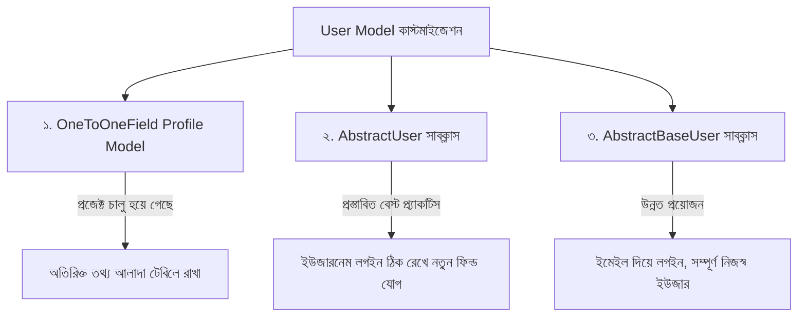

# Django User Model 👤🔐

ওয়েব অ্যাপ্লিকেশনে ইউজারদের রেজিস্টার, লগইন, প্রোফাইল ম্যানেজমেন্ট ও পারমিশন নিয়ন্ত্রণের কেন্দ্রবিন্দু হলো **User Model**। Django-তে শুরু থেকেই একটি অত্যন্ত শক্তিশালী ও সিকিউর বিল্ট-ইন ইউজার মডেল সিস্টেম দেওয়া থাকে — `django.contrib.auth`।

এই লেসনে আমরা শিখব Django-র Built-in User Model কীভাবে কাজ করে, কীভাবে পাসওয়ার্ড হ্যাশ হয়, কীভাবে OneToOneField দিয়ে প্রোফাইল মডেল বানাতে হয় এবং বাস্তব জীবনে সবচেয়ে গুরুত্বপূর্ণ — **Custom User Model (AbstractUser ও AbstractBaseUser)** কীভাবে তৈরি করতে হয়।

---

## ১. Built-in User Model কী?

Django-র `django.contrib.auth.models` মডিউলে একটি তৈরি করা `User` মডেল থাকে। এটি ইনস্টল করা অ্যাপস (`django.contrib.auth`)-এর মাধ্যমে ডেটাবেজে `auth_user` টেবিল তৈরি করে।

### Built-in User Model-এর প্রধান ফিল্ডসমূহ:

| Field Name | Type | কাজ |
| :--- | :--- | :--- |
| `username` | CharField (150 chars) | ইউনিক আইডেন্টিফায়ার (লগইনের জন্য) |
| `password` | CharField (128 chars) | হ্যাশ করা পাসওয়ার্ড সংরক্ষণ করে |
| `email` | EmailField | ইউজারের ইমেইল অ্যাড্রেস |
| `first_name` | CharField (150 chars) | প্রথম নাম (ঐচ্ছিক) |
| `last_name` | CharField (150 chars) | শেষ নাম (ঐচ্ছিক) |
| `is_active` | BooleanField (Default: True) | অ্যাকাউন্ট সক্রিয় কিনা (ডিলিটের বদলে False করা হয়) |
| `is_staff` | BooleanField (Default: False) | Django Admin প্যানেলে ঢুকতে পারবে কিনা |
| `is_superuser` | BooleanField (Default: False) | সকল পারমিশন স্বয়ংক্রিয়ভাবে পাবে কিনা |
| `date_joined` | DateTimeField | অ্যাকাউন্ট তৈরির সময় |
| `last_login` | DateTimeField | সর্বশেষ লগইনের সময় |

---

### Built-in User Model-এর প্রধান মেথড ও প্রপার্টি:

```python
user = User.objects.get(username="rahim")

# ১. নাম পাওয়ার মেথড
user.get_full_name()   # "Rahim Ahmed"
user.get_short_name()  # "Rahim"

# ২. অথেনটিকেশন চেক
user.is_authenticated  # লগইন করা থাকলে True, অন্যথায় False
user.is_anonymous      # লগইন না থাকলে True

# ৩. পাসওয়ার্ড পরিচালনা
user.set_password("new_secure_pass123")  # পাসওয়ার্ড হ্যাশ করে সেট করে
user.check_password("raw_pass123")       # পাসওয়ার্ড মিললে True রিটার্ন করে

# ৪. পারমিশন যাচাই
user.has_perm('blog.add_post')           # নির্দিষ্ট পারমিশন আছে কিনা
```

---

## ২. User তৈরি ও অথেনটিকেশন ফ্লো

### ⚠️ মারাত্মক ভুল বনাম সঠিক নিয়ম:

```python
# ❌ ভুল পদ্ধতি (কখনোই করবেন না!):
User.objects.create(username="tizul", password="mypassword123")
# এতে পাসওয়ার্ড সাধারণ প্লেইন টেক্সট হিসেবে সেভ হবে এবং ইউজার কখনোই লগইন করতে পারবে না!

# ✅ সঠিক পদ্ধতি:
User.objects.create_user(
    username="tizul", 
    email="tizul@example.com", 
    password="mypassword123"
)
# create_user() পাসওয়ার্ডকে শক্তিশালী অ্যালগরিদম (PBKDF2-SHA256) দিয়ে হ্যাশ করে সেভ করে।
```

### Superuser তৈরি করা:

```python
User.objects.create_superuser(
    username="admin", 
    email="admin@example.com", 
    password="adminpassword123"
)
```

---

### Views-এ User Login ও Logout হ্যান্ডেল করা:

Django-র বিল্ট-ইন ফাংশন `authenticate()`, `login()`, ও `logout()` ব্যবহার করা হয়:

```python
# views.py
from django.shortcuts import render, redirect
from django.contrib.auth import authenticate, login, logout
from django.contrib import messages

def user_login(request):
    if request.method == "POST":
        u_name = request.POST.get("username")
        p_word = request.POST.get("password")

        # ১. ইউজার ও পাসওয়ার্ড যাচাই করা
        user = authenticate(request, username=u_name, password=p_word)

        if user is not None:
            # ২. সেশনে লগইন করানো
            login(request, user)
            messages.success(request, f"স্বাগতম, {user.username}!")
            return redirect("dashboard")
        else:
            messages.error(request, "ইউজারনেম বা পাসওয়ার্ড সঠিক নয়!")

    return render(request, "login.html")

def user_logout(request):
    logout(request)
    messages.info(request, "আপনি সফলভাবে লগআউট করেছেন।")
    return redirect("login")
```

---

## ৩. User Model কাস্টমাইজ বা বাড়ানোর ৩টি উপায়

বাস্তব প্রজেক্টে প্রায়ই ব্যবহারকারীর ফোন নম্বর, ঠিকানা, জন্মতারিখ বা প্রোফাইল ছবি যুক্ত করতে হয়। এটি ৩ ভাবে করা যায়:



---

### পদ্ধতি ১: OneToOneField দিয়ে Profile Model তৈরি (Profile Pattern)

যদি আপনার প্রজেক্ট ইতোমধ্যে লাইভ হয়ে থাকে এবং বিল্ট-ইন ইউজার পরিবর্তন করা ঝুঁকিপূর্ণ হয়, তবে একটি আলাদা `Profile` মডেল তৈরি করে `User`-এর সাথে লিঙ্ক করাই সবচেয়ে নিরাপদ।

```python
# models.py
from django.db import models
from django.contrib.auth.models import User
from django.db.models.signals import post_save
from django.dispatch import receiver

class Profile(models.Model):
    user = models.OneToOneField(User, on_delete=models.CASCADE, related_name='profile')
    phone = models.CharField(max_length=15, blank=True)
    bio = models.TextField(blank=True)
    avatar = models.ImageField(upload_to='profiles/', default='default.png')
    date_of_birth = models.DateField(null=True, blank=True)

    def __str__(self):
        return f"{self.user.username}-এর প্রোফাইল"

# 🚀 Signal: নতুন User তৈরি হলেই যেন স্বয়ংক্রিয়ভাবে Profile তৈরি হয়ে যায়
@receiver(post_save, sender=User)
def create_user_profile(sender, instance, created, **kwargs):
    if created:
        Profile.objects.create(user=instance)

@receiver(post_save, sender=User)
def save_user_profile(sender, instance, **kwargs):
    instance.profile.save()
```

#### অ্যাক্সেস করার উপায়:
```python
# টেমপ্লেটে:
# {{ request.user.profile.phone }}
# {{ request.user.profile.avatar.url }}

# ভিউতে:
user = request.user
user_phone = user.profile.phone
```

---

### পদ্ধতি ২: `AbstractUser` সাবক্লাস করে কাস্টম ইউজার মডেল (শিল্পের সেরা চর্চা 🏆)

Django অফিসিয়ালি পরামর্শ দেয় — **প্রতিটি নতুন প্রজেক্ট শুরু করার সময়ই একটি Custom User Model দিয়ে শুরু করা উচিত**, এমনকি শুরুতে কোনো নতুন ফিল্ডের দরকার না হলেও!

`AbstractUser` ব্যবহার করলে Django-র সব ফিচার (যেমন: username, password, groups, permissions) অক্ষুণ্ণ থাকে, শুধু আপনার বাড়তি ফিল্ডগুলো একই টেবিলে যুক্ত হয়।

#### ধাপ ১: `models.py`-এ Custom User তৈরি

```python
# accounts/models.py
from django.contrib.auth.models import AbstractUser
from django.db import models

class CustomUser(AbstractUser):
    phone_number = models.CharField(max_length=15, unique=True, null=True, blank=True)
    address = models.TextField(blank=True)
    avatar = models.ImageField(upload_to='avatars/', blank=True, null=True)
    is_verified = models.BooleanField(default=False)

    def __str__(self):
        return self.username
```

#### ধাপ ২: `settings.py`-এ Django-কে জানিয়ে দেওয়া

```python
# config/settings.py
AUTH_USER_MODEL = 'accounts.CustomUser'
```

> ⚠️ **অত্যন্ত সতর্কবাণী:** `AUTH_USER_MODEL` সেটিংটি প্রজেক্টের প্রথম `makemigrations` এবং `migrate` চালানোর **আগেই** করতে হয়। মাঝপথে প্রজেক্টে এটি পরিবর্তন করতে গেলে আগের Foreign Key রেফারেন্সের কারণে জটিল ডেটাবেজ কনফ্লিক্ট দেখা দিতে পারে।

#### ধাপ ৩: `admin.py`-এ রেজিস্টার করা

```python
# accounts/admin.py
from django.contrib import admin
from django.contrib.auth.admin import UserAdmin
from .models import CustomUser

class CustomUserAdmin(UserAdmin):
    # নতুন ফিল্ডগুলো অ্যাডমিন প্যানেলে দেখানোর জন্য fieldsets বর্ধিত করা
    fieldsets = UserAdmin.fieldsets + (
        ("অতিরিক্ত তথ্য", {"fields": ("phone_number", "address", "avatar", "is_verified")}),
    )
    add_fieldsets = UserAdmin.add_fieldsets + (
        ("অতিরিক্ত তথ্য", {"fields": ("phone_number", "address", "avatar", "is_verified")}),
    )
    list_display = ("username", "email", "phone_number", "is_staff", "is_verified")

admin.site.register(CustomUser, CustomUserAdmin)
```

---

### পদ্ধতি ৩: `AbstractBaseUser` — সম্পূর্ণ কাস্টম ইউজার (Email দিয়ে লগইন)

যদি আপনার সিস্টেমে কোনো `username` ফিল্ডই না থাকে এবং শুধুমাত্র **Email** ও **Password** দিয়েই ইউজার লগইন করাতে চান, তখন `AbstractBaseUser` ও একটি কাস্টম `BaseUserManager` তৈরি করতে হয়।

```python
# accounts/models.py
from django.contrib.auth.models import AbstractBaseUser, BaseUserManager, PermissionsMixin
from django.db import models

# ১. কাস্টম ইউজার ম্যানেজার তৈরি
class CustomUserManager(BaseUserManager):
    def create_user(self, email, password=None, **extra_fields):
        if not email:
            raise ValueError("ইমেইল অ্যাড্রেস দেওয়া বাধ্যতামূলক!")
        
        email = self.normalize_email(email)
        user = self.model(email=email, **extra_fields)
        user.set_password(password)  # পাসওয়ার্ড হ্যাশ করা
        user.save(using=self._db)
        return user

    def create_superuser(self, email, password=None, **extra_fields):
        extra_fields.setdefault('is_staff', True)
        extra_fields.setdefault('is_superuser', True)
        extra_fields.setdefault('is_active', True)

        if extra_fields.get('is_staff') is not True:
            raise ValueError('Superuser-এর is_staff=True হতে হবে!')
        if extra_fields.get('is_superuser') is not True:
            raise ValueError('Superuser-এর is_superuser=True হতে হবে!')

        return self.create_user(email, password, **extra_fields)

# ২. কাস্টম ইউজার মডেল
class CustomUser(AbstractBaseUser, PermissionsMixin):
    email = models.EmailField(unique=True, verbose_name="ইমেইল অ্যাড্রেস")
    full_name = models.CharField(max_length=150)
    phone = models.CharField(max_length=20, blank=True)
    is_active = models.BooleanField(default=True)
    is_staff = models.BooleanField(default=False)
    date_joined = models.DateTimeField(auto_now_add=True)

    objects = CustomUserManager()

    # ইউজারনেম ফিল্ড হিসেবে ইমেইল নির্ধারণ:
    USERNAME_FIELD = 'email'
    # createsuperuser চালানোর সময় অতিরিক্ত কোন ফিল্ডগুলো চাওয়া হবে:
    REQUIRED_FIELDS = ['full_name']

    def __str__(self):
        return self.email
```

---

## ৪. অন্যান্য মডেলে User Model রেফার করার সঠিক উপায়

কখনোই অন্য কোনো মডেলে সরাসরি `from django.contrib.auth.models import User` আমদানি করে ForeignKey দেওয়া উচিত নয়, কারণ ভবিষ্যতে Custom User ব্যবহার করলে সেটি ভেঙে যাবে।

### ✅ সঠিক মডেল রেফারেন্সের নিয়ম:

```python
# blog/models.py
from django.db import models
from django.conf import settings  # ✅ settings ইমপোর্ট করুন

class Post(models.Model):
    # settings.AUTH_USER_MODEL স্ট্রিং হিসেবে দিন
    author = models.ForeignKey(
        settings.AUTH_USER_MODEL, 
        on_delete=models.CASCADE,
        related_name="posts"
    )
    title = models.CharField(max_length=200)
    content = models.TextField()
```

### ✅ Views বা Forms-এ রেফারেন্সের নিয়ম:

```python
# views.py
from django.contrib.auth import get_user_model

# get_user_model() কল করলে প্রজেক্টের বর্তমান অ্যাক্টিভ ইউজার মডেল ক্লাসটি পাওয়া যায়
User = get_user_model()

def user_list(request):
    users = User.objects.all()
    return render(request, "users.html", {"users": users})
```

---

## ৫. ৩টি পদ্ধতির তুলনামূলক বিশ্লেষণ

| বৈশিষ্ট্য | OneToOne Profile | `AbstractUser` | `AbstractBaseUser` |
| :--- | :--- | :--- | :--- |
| **কখন ব্যবহার করবেন?** | বিদ্যমান লাইভ প্রজেক্টে নতুন তথ্য যোগ করতে | নতুন প্রজেক্টে ইউজারনেমসহ বাড়তি ফিল্ড যোগ করতে | যখন ইউজারনেম বাদ দিয়ে ইমেইল ভিত্তিক লগইন দরকার |
| **টেবিলের সংখ্যা** | ২টি (`auth_user` + `profile`) | ১টি মাত্র টেবিল | ১টি মাত্র টেবিল |
| **কোডের জটিলতা** | সহজ | মাঝারি (সহজ ও পরিচ্ছন্ন) | জটিল (কাস্টম ম্যানেজার লিখতে হয়) |
| **Database Queries** | প্রোফাইল ডেটার জন্য JOIN বা অতিরিক্ত কোয়েরি লাগে | কোনো অতিরিক্ত কোয়েরি লাগে না | কোনো অতিরিক্ত কোয়েরি লাগে না |
| **Django Admin সাপোর্ট** | Profile আলাদা ইনলাইন করতে হয় | `UserAdmin` সহজে মানিয়ে যায় | সম্পূর্ণ নতুন অ্যাডমিন কনফিগারেশন দরকার |

---

## 🎯 আজকের Key Takeaways

1. Django-তে পাসওয়ার্ড কখনো প্লেইন টেক্সট হিসেবে সেভ হয় না; এটি **PBKDF2-SHA256** অ্যালগরিদমে হ্যাশ হয়।
2. কোড থেকে ইউজার তৈরির জন্য সর্বদা `User.objects.create_user()` ব্যবহার করুন, সাধারণ `create()` নয়।
3. ব্যবহারকারী যাচাই করতে `authenticate()` এবং সেশনে তথ্য সংরক্ষণ করতে `login(request, user)` ব্যবহার করুন।
4. প্রতিটি নতুন Django প্রজেক্ট শুরু করার সময় শুরুতেই `AbstractUser` দিয়ে একটি Custom User তৈরি করা Django-র অফিশিয়াল রিকমেন্ডেশন।
5. অন্য কোনো মডেলে ইউজারকে ForeignKey করতে `settings.AUTH_USER_MODEL` ব্যবহার করুন।
6. ভিউ, ফর্ম বা টেস্টে ইউজারের ক্লাস পেতে `get_user_model()` ব্যবহার করুন।

---

## ❓ অনুশীলনী প্রশ্ন

1. Django-র বিল্ট-ইন User মডেলের ডিফল্ট ফিল্ডগুলো কী কী?
2. `User.objects.create()` এবং `User.objects.create_user()`-এর মধ্যে পার্থক্য কী?
3. `authenticate()` ফাংশন কী রিটার্ন করে যখন ইউজারনেম বা পাসওয়ার্ড ভুল হয়?
4. `user.set_password()` কেন ব্যবহার করতে হয় এবং এটি কীভাবে কাজ করে?
5. `OneToOneField` ব্যবহার করে Profile মডেল তৈরির সুবিধা ও সীমাবদ্ধতা কী?
6. `AbstractUser` এবং `AbstractBaseUser`-এর মূল পার্থক্য কী?
7. নতুন প্রজেক্টের শুরুতেই Custom User Model সেটআপ করা কেন অত্যন্ত গুরুত্বপূর্ণ?
8. `settings.py`-এ Custom User মডেল সক্রিয় করতে কোন সেটিংটি পরিবর্তন করতে হয়?
9. অন্য কোনো মডেলে User-এর ForeignKey ডিক্লেয়ার করার জন্য কেন `settings.AUTH_USER_MODEL` ব্যবহার করা উচিত?
10. `get_user_model()` ফাংশনটি কী করে এবং এটি কোথায় ব্যবহার করা উচিত?
