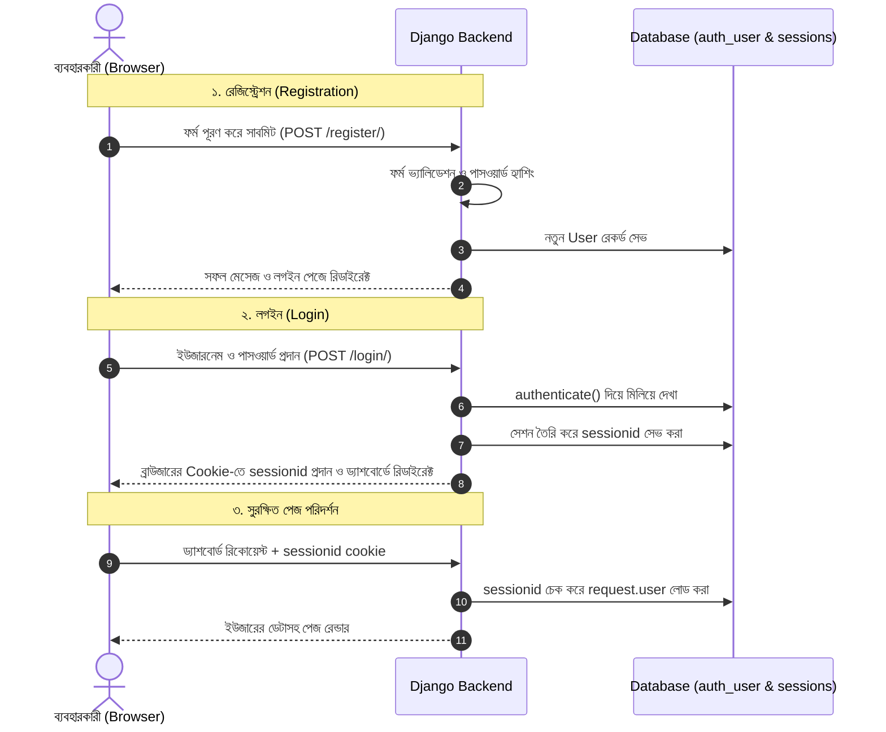

# Django Registration ও Login (Authentication System) 🔐🚪

ওয়েব অ্যাপ্লিকেশনে ব্যবহারকারীদের সাইনআপ (Registration), সাইনইন (Login), সেশন ম্যানেজমেন্ট এবং সাইনআউট (Logout) করার সম্পূর্ণ প্রক্রিয়াকে **User Authentication System** বলা হয়।

Django-তে একটি সম্পূর্ণ, বিশ্বমানের এবং অত্যন্ত নিরাপদ অথেনটিকেশন ফ্রেমওয়ার্ক বিল্ট-ইন থাকে। এই লেসনে আমরা শিখব কীভাবে স্ক্র্যাচ থেকে অথবা Django-র বিল্ট-ইন টুলস ব্যবহার করে একটি সম্পূর্ণ রেজিস্ট্রেশন ও লগইন সিস্টেম তৈরি করতে হয়।

---

## ১. Authentication ফ্লো কীভাবে কাজ করে?

Django ব্যবহার করে **Session-based Authentication**:



---

## ২. ইউজার রেজিস্ট্রেশন (Registration)

Django-তে রেজিস্ট্রেশন ফর্ম তৈরির জন্য বিল্ট-ইন `UserCreationForm` রয়েছে। তবে বাস্তব প্রজেক্টে সাধারণত ইউজারনেম ও পাসওয়ার্ডের পাশাপাশি ইমেইল, নাম বা ফোন নম্বর চাওয়া হয়। তাই আমরা একটি **Custom Registration Form** তৈরি করব।

### ধাপ ১: `forms.py` তৈরি করা

```python
# accounts/forms.py
from django import forms
from django.contrib.auth.forms import UserCreationForm
from django.contrib.auth import get_user_model

User = get_user_model()

class CustomUserRegistrationForm(UserCreationForm):
    first_name = forms.CharField(max_length=50, required=True, label="নামের প্রথম অংশ")
    last_name = forms.CharField(max_length=50, required=True, label="নামের শেষ অংশ")
    email = forms.EmailField(required=True, label="ইমেইল অ্যাড্রেস")

    class Meta:
        model = User
        fields = ['username', 'first_name', 'last_name', 'email']

    # ইমেইল ইউনিক কিনা যাচাই করা
    def clean_email(self):
        email = self.cleaned_data.get('email')
        if User.objects.filter(email=email).exists():
            raise forms.ValidationError("এই ইমেইলটি দিয়ে ইতিমধ্যে একটি অ্যাকাউন্ট খোলা হয়েছে!")
        return email

    # ফিল্ডগুলোতে সুন্দর Bootstrap ক্লাস যোগ করার জন্য
    def __init__(self, *args, **kwargs):
        super().__init__(*args, **kwargs)
        for field_name, field in self.fields.items():
            field.widget.attrs.update({'class': 'form-control'})
```

> 💡 **নোট:** `UserCreationForm` স্বয়ংক্রিয়ভাবে পাসওয়ার্ড হ্যাশিং, পাসওয়ার্ড কনফার্মেশন ও পাসওয়ার্ডের জটিলতা (যেমন: সহজে অনুমানযোগ্য কিনা, সংখ্যার মিশ্রণ আছে কিনা) যাচাই করে।

---

### ধাপ ২: রেজিস্ট্রেশন ভিউ (`views.py`)

```python
# accounts/views.py
from django.shortcuts import render, redirect
from django.contrib import messages
from django.contrib.auth import login
from .forms import CustomUserRegistrationForm

def register_view(request):
    # ইউজার ইতোমধ্যে লগইন করা থাকলে ড্যাশবোর্ডে পাঠিয়ে দেওয়া
    if request.user.is_authenticated:
        return redirect('dashboard')

    if request.method == "POST":
        form = CustomUserRegistrationForm(request.POST)
        if form.is_valid():
            user = form.save()
            
            # 🚀 অপশন ১: রেজিস্ট্রেশনের সাথে সাথেই স্বয়ংক্রিয় লগইন করানো
            login(request, user)
            messages.success(request, f"স্বাগতম {user.first_name}! আপনার অ্যাকাউন্ট সফলভাবে তৈরি হয়েছে।")
            return redirect('dashboard')

            # 🚀 অপশন ২: অথবা লগইন পেজে পাঠিয়ে দেওয়া
            # messages.success(request, "অ্যাকাউন্ট তৈরি হয়েছে! এখন লগইন করুন।")
            # return redirect('login')
    else:
        form = CustomUserRegistrationForm()

    return render(request, "accounts/register.html", {"form": form})
```

---

### ধাপ ৩: রেজিস্ট্রেশন টেমপ্লেট (`register.html`)

```html
<!-- templates/accounts/register.html -->
<!DOCTYPE html>
<html lang="bn">
<head>
    <meta charset="UTF-8">
    <title>রেজিস্ট্রেশন করুন</title>
    <link href="https://cdn.jsdelivr.net/npm/bootstrap@5.3.0/dist/css/bootstrap.min.css" rel="stylesheet">
</head>
<body class="bg-light">
<div class="container mt-5">
    <div class="row justify-content-center">
        <div class="col-md-6">
            <div class="card shadow p-4">
                <h3 class="text-center mb-4">নতুন অ্যাকাউন্ট তৈরি করুন</h3>

                <!-- অ্যালার্ট মেসেজ -->
                
                    
                        <div class="alert alert-{{ message.tags }}">{{ message }}</div>
                    
                

                <form method="POST" novalidate>
                    
                    
                    
                        <div class="mb-3">
                            <label class="form-label">{{ field.label }}</label>
                            {{ field }}
                            
                                <small class="text-muted d-block">{{ field.help_text }}</small>
                            
                            
                                <span class="text-danger small">{{ error }}</span>
                            
                        </div>
                    

                    <button type="submit" class="btn btn-primary w-100">রেজিস্টার করুন</button>
                </form>

                <p class="text-center mt-3">
                    ইতিমধ্যে অ্যাকাউন্ট আছে? <a href="">লগইন করুন</a>
                </p>
            </div>
        </div>
    </div>
</div>
</body>
</html>
```

---

## ৩. ইউজার লগইন (Login)

লগইনের জন্য Django-র বিল্ট-ইন `AuthenticationForm` ব্যবহার করা যায়, যা সঠিক ইউজারনেম ও পাসওয়ার্ড চেক করে স্বয়ংক্রিয়ভাবে ইউজার ইনস্ট্যান্স যাচাই করে দেয়।

### ধাপ ১: লগইন ভিউ (`views.py`)

```python
# accounts/views.py
from django.shortcuts import render, redirect
from django.contrib.auth import authenticate, login
from django.contrib.auth.forms import AuthenticationForm
from django.contrib import messages

def login_view(request):
    if request.user.is_authenticated:
        return redirect('dashboard')

    if request.method == "POST":
        form = AuthenticationForm(request, data=request.POST)
        if form.is_valid():
            # ভ্যালিড ইউজার অবজেক্ট বের করা
            user = form.get_user()
            
            # সেশনে লগইন করানো
            login(request, user)
            messages.success(request, f"স্বাগতম, {user.username}!")

            # ইউজার কোনো নির্দিষ্ট সুরক্ষিত পেজে যেতে চাইলে সেখানে পাঠানো (next প্যারামিটার)
            next_url = request.GET.get('next')
            if next_url:
                return redirect(next_url)
            return redirect('dashboard')
        else:
            messages.error(request, "ভুল ইউজারনেম অথবা পাসওয়ার্ড দিয়েছেন!")
    else:
        form = AuthenticationForm()

    return render(request, "accounts/login.html", {"form": form})
```

---

### ধাপ ২: লগইন টেমপ্লেট (`login.html`)

```html
<!-- templates/accounts/login.html -->
<!DOCTYPE html>
<html lang="bn">
<head>
    <meta charset="UTF-8">
    <title>লগইন করুন</title>
    <link href="https://cdn.jsdelivr.net/npm/bootstrap@5.3.0/dist/css/bootstrap.min.css" rel="stylesheet">
</head>
<body class="bg-light">
<div class="container mt-5">
    <div class="row justify-content-center">
        <div class="col-md-5">
            <div class="card shadow p-4">
                <h3 class="text-center mb-4">অ্যাকাউন্টে লগইন করুন</h3>

                
                    
                        <div class="alert alert-{{ message.tags }}">{{ message }}</div>
                    
                

                <form method="POST">
                    

                    <div class="mb-3">
                        <label class="form-label">ইউজারনেম</label>
                        <input type="text" name="username" class="form-control" placeholder="ইউজারনেম দিন" required>
                    </div>

                    <div class="mb-3">
                        <label class="form-label">পাসওয়ার্ড</label>
                        <input type="password" name="password" class="form-control" placeholder="পাসওয়ার্ড দিন" required>
                    </div>

                    <button type="submit" class="btn btn-success w-100">লগইন</button>
                </form>

                <p class="text-center mt-3">
                    নতুন ব্যবহারকারী? <a href="">রেজিস্টার করুন</a>
                </p>
            </div>
        </div>
    </div>
</div>
</body>
</html>
```

---

## ৪. ইউজার লগআউট (Logout)

Django-তে ইউজার লগআউট করার জন্য `django.contrib.auth.logout(request)` মেথড ব্যবহৃত হয়।

### ধাপ ১: লগআউট ভিউ

```python
# accounts/views.py
from django.contrib.auth import logout
from django.shortcuts import redirect
from django.contrib import messages

def logout_view(request):
    if request.method == "POST":
        logout(request)
        messages.info(request, "আপনি সফলভাবে লগআউট করেছেন।")
        return redirect('login')
    
    # GET রিকোয়েস্টে সরাসরি লগআউট না করে কনফার্মেশন পেজ বা রিডাইরেক্ট করা ভালো
    return redirect('dashboard')
```

> ⚠️ **গুরুত্বপূর্ণ নিরাপত্তা আপডেট (Django 5.0+):**
> পূর্বে সাধারণ GET রিকোয়েস্ট দিয়েই (`<a href="/logout/">`) লগআউট করা যেত। কিন্তু এটি CSRF আক্রমণের ঝুঁকি তৈরি করে। তাই আধুনিক Django-তে লগআউট সর্বদা **POST** মেথডে একটি বাটনের মাধ্যমে ফর্ম সাবমিট করে করা উচিত:
>
> ```html
> <form action="" method="POST" style="display:inline;">
>     
>     <button type="submit" class="btn btn-outline-danger btn-sm">লগআউট</button>
> </form>
> ```

---

## ৫. সুরক্ষিত পেজ ও ড্যাশবোর্ড (`@login_required`)

কোনো ভিউ যেন লগইন করা ব্যবহারকারী ছাড়া অন্য কেউ দেখতে না পারে, সেজন্য `@login_required` ডেকোরেটর ব্যবহার করা হয়:

```python
# accounts/views.py
from django.contrib.auth.decorators import login_required
from django.shortcuts import render

@login_required
def dashboard_view(request):
    # request.user এর মাধ্যমে লগইন করা ইউজারের সকল তথ্য পাওয়া যায়
    current_user = request.user
    return render(request, "accounts/dashboard.html", {"user": current_user})
```

### ড্যাশবোর্ড টেমপ্লেট (`dashboard.html`):

```html
<!-- templates/accounts/dashboard.html -->
<!DOCTYPE html>
<html lang="bn">
<head>
    <meta charset="UTF-8">
    <title>ড্যাশবোর্ড</title>
    <link href="https://cdn.jsdelivr.net/npm/bootstrap@5.3.0/dist/css/bootstrap.min.css" rel="stylesheet">
</head>
<body class="p-5">
<div class="container">
    <div class="card p-4">
        <h2>স্বাগতম, {{ user.first_name }} {{ user.last_name }} ({{ user.username }})! 👋</h2>
        <p><strong>ইমেইল:</strong> {{ user.email }}</p>
        <p><strong>অ্যাকাউন্ট তৈরি:</strong> {{ user.date_joined|date:"d M, Y" }}</p>

        <hr>

        <form action="" method="POST">
            
            <button type="submit" class="btn btn-danger">লগআউট করুন</button>
        </form>
    </div>
</div>
</body>
</html>
```

---

## ৬. `settings.py`-এর গুরুত্বপূর্ণ কনফিগারেশন

যখন কোনো ভিজিটর লগইন ছাড়া `@login_required` দেওয়া পেজে ঢোকার চেষ্টা করে, তখন Django তাকে কোথায় পাঠাবে এবং লগইন করার পর সে কোথায় যাবে — তা `settings.py`-এ ঠিক করে দিতে হয়:

```python
# config/settings.py

# লগইন না করা থাকলে কোন URL-এ পাঠাবে:
LOGIN_URL = 'login'

# সফল লগইনের পর ডিফল্ট কোথায় যাবে (যদি কোনো ?next= না থাকে):
LOGIN_REDIRECT_URL = 'dashboard'

# লগআউটের পর কোথায় যাবে:
LOGOUT_REDIRECT_URL = 'login'
```

---

## ৭. টেমপ্লেটে Navbar-এ শর্তাধীন বাটন দেখানো

যেকোনো টেমপ্লেটে ইউজার লগইন আছে কি নেই তা খুব সহজে যাচাই করা যায়:

```html
<nav class="navbar navbar-expand-lg navbar-dark bg-dark px-4">
    <a class="navbar-brand" href="/">আমার ওয়েবসাইট</a>
    <div class="ms-auto">
        
            <!-- লগইন করা থাকলে -->
            <span class="text-white me-3">হ্যালো, {{ user.username }}!</span>
            <a href="" class="btn btn-outline-light btn-sm me-2">ড্যাশবোর্ড</a>
            <form action="" method="POST" class="d-inline">
                
                <button type="submit" class="btn btn-danger btn-sm">লগআউট</button>
            </form>
        
            <!-- লগইন না করা থাকলে -->
            <a href="" class="btn btn-outline-light btn-sm me-2">লগইন</a>
            <a href="" class="btn btn-primary btn-sm">রেজিস্টার</a>
        
    </div>
</nav>
```

---

## ৮. সম্পূর্ণ URL কনফিগারেশন (`urls.py`)

```python
# accounts/urls.py
from django.urls import path
from . import views

urlpatterns = [
    path('register/', views.register_view, name='register'),
    path('login/', views.login_view, name='login'),
    path('logout/', views.logout_view, name='logout'),
    path('dashboard/', views.dashboard_view, name='dashboard'),
]
```

---

## 🎯 আজকের Key Takeaways

1. Django-র অথেনটিকেশন সিস্টেম সেশন-ভিত্তিক (Session-based), যেখানে ব্রাউজারে `sessionid` কুকি জমা থাকে।
2. রেজিস্ট্রেশন ফর্মে সবসময় `UserCreationForm` অথবা তার সাবক্লাস ব্যবহার করুন, যা নিরাপদ পাসওয়ার্ড হ্যাশিং নিশ্চিত করে।
3. লগইন যাচাই করতে `authenticate()` এবং সেশন শুরু করতে `login(request, user)` ব্যবহার করা হয়।
4. লগআউট করতে `logout(request)` ব্যবহার করুন এবং সর্বদা এটি **POST** মেথডে ফর্ম সাবমিট হিসেবে রাখুন।
5. প্রাইভেট পেজ বা ভিউ সুরক্ষিত রাখতে `@login_required` ডেকোরেটর ব্যবহার করুন।
6. `settings.py`-এ `LOGIN_URL`, `LOGIN_REDIRECT_URL`, ও `LOGOUT_REDIRECT_URL` কনফিগার করুন।
7. টেমপ্লেটে ইউজার স্টেট জানতে `user.is_authenticated` শর্ত ব্যবহার করুন।

---

## ❓ অনুশীলনী প্রশ্ন

1. Django-র Session-based Authentication কীভাবে কাজ করে?
2. `UserCreationForm` ব্যবহারে কী কী নিরাপত্তা সুবিধা স্বয়ংক্রিয়ভাবে পাওয়া যায়?
3. `authenticate()` এবং `login()` ফাংশন দুটির আলাদা আলাদা কাজ কী?
4. লগইনের সময় URL-এ `?next=/dashboard/` প্যারামিটার কেন আসে এবং এটি কীভাবে কাজ করে?
5. কেন আধুনিক Django-তে (Django 5.0+) GET রিকোয়েস্ট দিয়ে লগআউট করা নিষিদ্ধ এবং POST ব্যবহার করতে বলা হয়?
6. `@login_required` ডেকোরেটরের কাজ কী? কোনো অননুমোদিত ইউজার ঢুকলে কী ঘটে?
7. `LOGIN_REDIRECT_URL` এবং `LOGIN_URL` সেটিংস দুটির কাজ কী?
8. টেমপ্লেটে লগইন থাকা এবং না-থাকা ইউজারের জন্য আলাদা Navbar আইটেম কীভাবে শর্ত দিয়ে দেখাতে হয়?
9. রেজিস্ট্রেশন ফর্ম সফলভাবে পূরণ হওয়ার পরপরই ইউজারকে লগইন পেজে না পাঠিয়ে সরাসরি লগইন করানোর উপায় কী?
10. রেজিস্ট্রেশনের সময় ইউজার একই ইমেইল দিয়ে একাধিক অ্যাকাউন্ট যাতে না খুলতে পারে, তা কীভাবে `clean_email()` দিয়ে রোধ করবেন?
