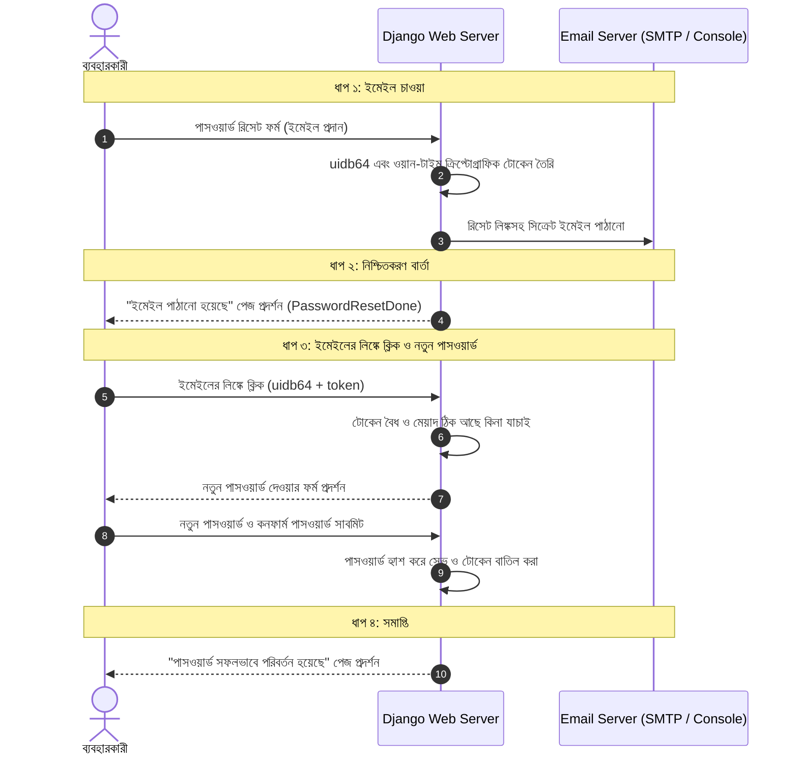

# Django Logout ও Password Reset 🔒📧

ওয়েব অ্যাপ্লিকেশনে অ্যাকাউন্ট নিরাপত্তার জন্য সাইনআউট (**Logout**), লগইন থাকা অবস্থায় পাসওয়ার্ড পরিবর্তন (**Password Change**) এবং পাসওয়ার্ড ভুলে গেলে ইমেইলের মাধ্যমে পুনরুদ্ধার (**Password Reset**) অত্যন্ত গুরুত্বপূর্ণ ফিচার।

Django-তে এই সবগুলো ফিচারের জন্য সম্পূর্ণ রেডিমেড ও ক্রিপ্টোগ্রাফিকভাবে সুরক্ষিত সিস্টেম বিল্ট-ইন দেওয়া থাকে। এই লেসনে আমরা প্রতিটি ফিচারের মেকানিজম, কনফিগারেশন ও কাস্টমাইজেশন বিস্তারিতভাবে শিখব।

---

## ১. Password Change বনাম Password Reset

প্রথমে এই দুটি ধারণার পার্থক্য পরিষ্কার করে নেওয়া যাক:

| বৈশিষ্ট্য | Password Change | Password Reset |
| :--- | :--- | :--- |
| **পরিস্থিতি** | ইউজার লগইন করা আছেন এবং বর্তমান পাসওয়ার্ড জানেন | ইউজার পাসওয়ার্ড ভুলে গেছেন বা লগইন করতে পারছেন না |
| **প্রয়োজনীয় তথ্য** | পুরোনো পাসওয়ার্ড + নতুন পাসওয়ার্ড | শুধুমাত্র অ্যাকাউন্টের রেজিস্টার্ড ইমেইল |
| **কাজের মাধ্যম** | ব্রাউজারের ফর্ম থেকে সরাসরি | ইমেইলে সিক্রেট ওয়ান-টাইম টোকেন ও লিঙ্ক পাঠিয়ে |
| **Built-in Form** | `PasswordChangeForm` | `PasswordResetForm` + `SetPasswordForm` |

---

## ২. Logout মেকানিজম ও আধুনিক নিরাপত্তা (Django 5+)

### `logout()` ব্যাকএন্ডে কীভাবে কাজ করে?
যখন `django.contrib.auth.logout(request)` কল করা হয়:
1. ইউজারের বর্তমান সেশনের সকল ডেটা ডেটাবেজ (`django_session`) থেকে মুছে ফেলা হয় (`request.session.flush()`)।
2. ব্রাউজারের `sessionid` কুকি বাতিল (Expire) করে দেওয়া হয়।
3. পরবর্তী রিকোয়েস্টে `request.user` হয়ে যায় `AnonymousUser`।

---

### ⚠️ কেন Django 5.0+ এ GET রিকোয়েস্টে Logout নিষিদ্ধ?

অতীতে সাধারণ লিংকে `<a href="/logout/">Logout</a>` লিখে লগআউট করা হতো। আধুনিক ওয়েব সিকিউরিটিতে এটি দুটি মারাত্মক সমস্যার সৃষ্টি করে:
1. **CSRF Attack:** হ্যাকার কোনো থার্ড-পার্টি ওয়েবসাইটে `` এম্বেড করে দিলে ইউজার না বুঝেই আপনার সাইট থেকে লগআউট হয়ে যেত।
2. **Browser Prefetching:** আধুনিক ব্রাউজারগুলো দ্রুত লোড করার জন্য পেজের লিঙ্কগুলো আগে থেকেই প্রি-ফেচ (Pre-fetch) করে রাখে। ফলে ইউজার ক্লিক না করতেই ব্রাউজার গোপনে লগআউট লিংকে রিকোয়েস্ট পাঠিয়ে ইউজারকে লগআউট করে দিত!

### ✅ সঠিক ও সুরক্ষিত Logout বাস্তবায়ন:

#### ভিউ (`views.py`):
```python
from django.contrib.auth import logout
from django.shortcuts import redirect
from django.contrib import messages

def custom_logout(request):
    if request.method == "POST":
        logout(request)
        messages.info(request, "আপনি সফলভাবে লগআউট করেছেন।")
        return redirect('login')
    
    # GET রিকোয়েস্ট আসলে সরাসরি লগআউট না করে কনফার্মেশন চাওয়া বা ড্যাশবোর্ডে রাখা
    return redirect('dashboard')
```

#### টেমপ্লেটে বাটন (`navbar.html`):
```html
<form action="" method="POST" style="display:inline;">
    
    <button type="submit" class="btn btn-outline-danger btn-sm">লগআউট</button>
</form>
```

---

## ৩. Password Change (লগইন থাকা অবস্থায় পাসওয়ার্ড বদল)

লগইন থাকা ইউজার নিজের পাসওয়ার্ড পরিবর্তন করতে চাইলে Django-র বিল্ট-ইন `PasswordChangeView` বা ফাংশন-ভিত্তিক ভিউ ব্যবহার করা যায়।

### 💡 অতি গুরুত্বপূর্ণ কনসেপ্ট: `update_session_auth_hash`

স্বাভাবিকভাবে Django-তে পাসওয়ার্ড পরিবর্তন করার সাথে সাথে ডেটাবেজে পাসওয়ার্ডের হ্যাশ বদলে যায়। এর ফলে ব্রাউজারের বর্তমান সেশনটি অবৈধ হয়ে যায় এবং ইউজার সাথে সাথে স্বয়ংক্রিয়ভাবে লগআউট হয়ে যায়!

ইউজার যেন লগআউট না হয়ে লগইন অবস্থায় থাকে, সেজন্য `update_session_auth_hash(request, user)` কল করতে হয়।

```python
# accounts/views.py
from django.shortcuts import render, redirect
from django.contrib.auth.forms import PasswordChangeForm
from django.contrib.auth import update_session_auth_hash
from django.contrib.auth.decorators import login_required
from django.contrib import messages

@login_required
def change_password_view(request):
    if request.method == "POST":
        # PasswordChangeForm-এর প্রথম আর্গুমেন্ট হিসেবে request.user দিতে হয়
        form = PasswordChangeForm(request.user, request.POST)
        if form.is_valid():
            user = form.save()
            
            # 🔥 সবচেয়ে গুরুত্বপূর্ণ লাইন: সেশন আপডেট করে ইউজারকে লগইন রাখা
            update_session_auth_hash(request, user)
            
            messages.success(request, "আপনার পাসওয়ার্ড সফলভাবে পরিবর্তন করা হয়েছে!")
            return redirect('dashboard')
        else:
            messages.error(request, "পাসওয়ার্ড পরিবর্তনের তথ্যে ভুল আছে। নিচে দেখুন।")
    else:
        form = PasswordChangeForm(request.user)

    return render(request, "accounts/change_password.html", {"form": form})
```

---

## ৪. Password Reset (পাসওয়ার্ড ভুলে গেলে ৪-ধাপের প্রক্রিয়া)

Django-তে পাসওয়ার্ড রিসেট পুরো প্রক্রিয়াটি **৪টি সুনির্দিষ্ট ধাপে** সম্পন্ন হয়:



---

## ৫. Password Reset-এর জন্য URL কনফিগারেশন

Django-র `django.contrib.auth.views` মডিউলে এই ৪টি ধাপের জন্য রেডিমেড ক্লাস রয়েছে:

```python
# accounts/urls.py
from django.urls import path
from django.contrib.auth import views as auth_views
from . import views

urlpatterns = [
    # ১. পাসওয়ার্ড রিসেট শুরুর পেজ (ইমেইল ইনপুট)
    path(
        'password-reset/', 
        auth_views.PasswordResetView.as_view(
            template_name='accounts/password_reset.html',
            email_template_name='accounts/password_reset_email.html',
            subject_template_name='accounts/password_reset_subject.txt'
        ), 
        name='password_reset'
    ),

    # ২. ইমেইল পাঠানোর পর যে পেজ দেখাবে
    path(
        'password-reset/done/', 
        auth_views.PasswordResetDoneView.as_view(
            template_name='accounts/password_reset_done.html'
        ), 
        name='password_reset_done'
    ),

    # ৩. ইমেইলের লিঙ্কে ক্লিক করার পর নতুন পাসওয়ার্ড দেওয়ার পেজ
    path(
        'password-reset-confirm/<uidb64>/<token>/', 
        auth_views.PasswordResetConfirmView.as_view(
            template_name='accounts/password_reset_confirm.html'
        ), 
        name='password_reset_confirm'
    ),

    # ৪. পাসওয়ার্ড রিসেট সফল হওয়ার পেজ
    path(
        'password-reset-complete/', 
        auth_views.PasswordResetCompleteView.as_view(
            template_name='accounts/password_reset_complete.html'
        ), 
        name='password_reset_complete'
    ),
]
```

> ⚠️ **মনে রাখুন:** এই ৪টি URL-এর `name` অবশ্যই হুবহু `password_reset`, `password_reset_done`, `password_reset_confirm`, এবং `password_reset_complete` হতে হবে, কারণ Django-র ইন্টারনাল ভিউগুলো এই নামগুলোতে রিডাইরেক্ট করে।

---

## ৬. Email Backend কনফিগারেশন (`settings.py`)

ইমেইল পাঠানোর জন্য Django-কে জানাতে হবে ইমেইল কোথায় পাঠানো হবে:

### ১. লোকাল ডেভেলপমেন্ট ও টেস্টিংয়ের জন্য (সবচেয়ে সহজ):
ইমেইল সত্যিই কোনো ইনবক্সে না গিয়ে আপনার ভিএস কোডের **টার্মিনাল বা কনসোলে প্রিন্ট হবে**:

```python
# config/settings.py
EMAIL_BACKEND = 'django.core.mail.backends.console.EmailBackend'
```

---

### ২. প্রোডাকশনে আসল ইমেইল পাঠাতে (Gmail SMTP উদাহরণ):

```python
# config/settings.py
import os

EMAIL_BACKEND = 'django.core.mail.backends.smtp.EmailBackend'
EMAIL_HOST = 'smtp.gmail.com'
EMAIL_PORT = 587
EMAIL_USE_TLS = True
EMAIL_HOST_USER = os.environ.get('EMAIL_USER', 'your-email@gmail.com')
# জিমেইলের ক্ষেত্রে এটি আপনার সাধারণ পাসওয়ার্ড নয়, Google Account-এর App Password:
EMAIL_HOST_PASSWORD = os.environ.get('EMAIL_PASS', 'your-16-digit-app-password')
DEFAULT_FROM_EMAIL = 'আপনার ওয়েবসাইটের নাম <your-email@gmail.com>'
```

---

## ৭. প্রয়োজনীয় টেমপ্লেটসমূহ

### টেমপ্লেট ১: `accounts/password_reset.html` (ইমেইল চাওয়ার পেজ)

```html


<div class="col-md-5 mx-auto mt-5">
    <div class="card p-4 shadow">
        <h4>পাসওয়ার্ড ভুলে গেছেন?</h4>
        <p class="text-muted">আপনার অ্যাকাউন্টের ইমেইল দিন, আমরা একটি রিসেট লিঙ্ক পাঠাব।</p>
        <form method="POST">
            
            {{ form.as_p }}
            <button type="submit" class="btn btn-primary w-100">রিসেট লিঙ্ক পাঠান</button>
        </form>
    </div>
</div>

```

---

### টেমপ্লেট ২: `accounts/password_reset_done.html` (নোটিফিকেশন পেজ)

```html


<div class="col-md-6 mx-auto mt-5">
    <div class="alert alert-info shadow">
        <h4>📨 ইমেইল পাঠানো হয়েছে!</h4>
        <p>আমরা আপনার ইমেইলে পাসওয়ার্ড রিসেট করার একটি লিঙ্ক পাঠিয়েছি। অনুগ্রহ করে আপনার ইনবক্স অথবা স্প্যাম ফোল্ডার চেক করুন।</p>
        <a href="" class="btn btn-outline-primary btn-sm">লগইন পেজে ফিরে যান</a>
    </div>
</div>

```

---

### টেমপ্লেট ৩: `accounts/password_reset_email.html` (ইমেইলের মূল বডি)

ব্যবহারকারী তার জিমেইল ইনবক্সে যে টেক্সট দেখতে পাবেন:

```text
প্রিয় {{ user.get_username }},

আপনি আপনার পাসওয়ার্ড রিসেট করার অনুরোধ করেছেন। নিচের লিঙ্কে ক্লিক করে নতুন পাসওয়ার্ড সেট করুন:

{{ protocol }}://{{ domain }}

আপনি যদি এই অনুরোধ না করে থাকেন, তবে এই ইমেইলটি উপেক্ষা করুন। আপনার পাসওয়ার্ড নিরাপদ থাকবে।
```

---

### টেমপ্লেট ৪: `accounts/password_reset_confirm.html` (নতুন পাসওয়ার্ড দেওয়ার ফর্ম)

```html


<div class="col-md-5 mx-auto mt-5">
    <div class="card p-4 shadow">
        
            <h4>নতুন পাসওয়ার্ড সেট করুন</h4>
            <form method="POST">
                
                {{ form.as_p }}
                <button type="submit" class="btn btn-success w-100">পাসওয়ার্ড পরিবর্তন করুন</button>
            </form>
        
            <div class="alert alert-danger">
                <h4>⚠️ লিঙ্কটি অবৈধ বা মেয়াদোত্তীর্ণ!</h4>
                <p>এই পাসওয়ার্ড রিসেট লিঙ্কটি ইতিমধ্যে ব্যবহার করা হয়েছে অথবা এর সময় পার হয়ে গেছে।</p>
                <a href="" class="btn btn-primary btn-sm">আবার চেষ্টা করুন</a>
            </div>
        
    </div>
</div>

```

---

### টেমপ্লেট ৫: `accounts/password_reset_complete.html` (সফলতার পেজ)

```html


<div class="col-md-6 mx-auto mt-5">
    <div class="alert alert-success shadow">
        <h4>🎉 অভিনন্দন!</h4>
        <p>আপনার পাসওয়ার্ড সফলভাবে রিসেট হয়েছে। এখন আপনি নতুন পাসওয়ার্ড দিয়ে লগইন করতে পারেন।</p>
        <a href="" class="btn btn-success">লগইন করুন</a>
    </div>
</div>

```

---

## ৮. সিকিউরিটি অ্যানালিসিস: `uidb64` ও `token` কীভাবে কাজ করে?

লিঙ্কের ভেতরের দুটি প্যারামিটার লক্ষ্য করুন:
`/password-reset-confirm/<uidb64>/<token>/`

1. **`uidb64` (Base64 User ID):**
   - ইউজারের প্রাইমারি কী (যেমন: ইউজার ID 15) কে Base64 দিয়ে এনকোড করা হয় (`MTU`).
   - ফলে URL-এ সরাসরি ইউজারের আসল ID দৃশ্যমান থাকে না।

2. **`token` (ওয়ান-টাইম ক্রিপ্টোগ্রাফিক টোকেন):**
   - টোকেনটি তৈরি হয়: `User ID` + `বর্তমান পাসওয়ার্ডের হ্যাশ` + `সর্বশেষ লগইনের সময়` + `টাইমস্ট্যাম্প` মিলিয়ে।
   - **ম্যাজিক:** ইউজার একবার পাসওয়ার্ড বদলে ফেললেই তার পাসওয়ার্ডের হ্যাশ বদলে যায়। ফলে আগের টোকেনটি **স্বয়ংক্রিয়ভাবে অবৈধ** হয়ে যায়! দ্বিতীয়বার কেউ সেই লিংকে ক্লিক করলে তা কাজ করবে না।
   - ডিফল্টভাবে এই টোকেনটি **৩ দিন** কার্যকর থাকে (`PASSWORD_RESET_TIMEOUT = 259200` সেকেন্ড)।

---

## 🎯 আজকের Key Takeaways

1. আধুনিক Django-তে (Django 5.0+) CSRF আক্রমণ ও প্রিফেচিং বন্ধ করতে সর্বদা **POST** মেথডে ফর্ম সাবমিট করে লগআউট করতে হয়।
2. লগইন থাকা অবস্থায় পাসওয়ার্ড বদলালে ইউজার যাতে স্বয়ংক্রিয়ভাবে লগআউট না হয়ে যায়, সেজন্য `update_session_auth_hash(request, user)` কল করা আবশ্যক।
3. Password Reset পুরো প্রক্রিয়াটি ৪টি বিল্ট-ইন ভিউয়ের সমন্বয়ে গঠিত এবং এর URL Name-গুলো পরিবর্তন করা যাবে না।
4. লোকাল টেস্টিংয়ের সময় আসল ইমেইল না পাঠিয়ে `console.EmailBackend` দিয়ে টার্মিনালেই ইমেইল ও রিসেট লিঙ্ক দেখা যায়।
5. রিসেট লিঙ্কটি সম্পূর্ণ সুরক্ষিত — একবার ব্যবহার করলে বা মেয়াদ শেষ হলে ক্রিপ্টোগ্রাফিক টোকেনের কারণে লিঙ্কটি স্বয়ংক্রিয়ভাবে বাতিল হয়ে যায়।

---

## ❓ অনুশীলনী প্রশ্ন

1. Django 5.0+ এ GET রিকোয়েস্ট দিয়ে লগআউট করা কেন অনিরাপদ বিবেচনা করা হয়?
2. `logout(request)` ফাংশনটি কল করলে সেশন এবং কুকির মধ্যে কী কী পরিবর্তন ঘটে?
3. পাসওয়ার্ড পরিবর্তনের পর ইউজার যাতে লগআউট না হয়ে যায়, সেজন্য কোন ফাংশনটি ব্যবহার করা হয় এবং কেন?
4. Password Reset প্রক্রিয়ার ৪টি সুনির্দিষ্ট ধাপের নাম কী কী?
5. Password Reset URL-এ `uidb64` এবং `token`-এর কাজ কী?
6. একবার পাসওয়ার্ড রিসেট করার পর সেই একই ইমেইল লিঙ্কে আবার ক্লিক করলে কেন কাজ করে না?
7. লোকাল ডেভেলপমেন্টে টার্মিনালে ইমেইল দেখতে `settings.py`-এ কোন সেটিংটি করতে হয়?
8. Password Reset টোকেনের ডিফল্ট মেয়াদ কতদিন থাকে এবং কোন সেটিং দিয়ে এটি পরিবর্তন করা যায়?
9. জিমেইল দিয়ে প্রোডাকশনে ইমেইল পাঠাতে কেন সাধারণ পাসওয়ার্ডের বদলে Google App Password ব্যবহার করতে হয়?
10. `validlink` ভেরিয়েবলটি `password_reset_confirm.html` টেমপ্লেটে কী ভূমিকা পালন করে?
