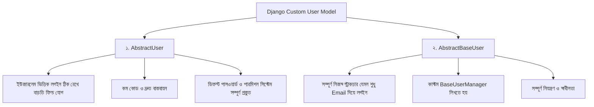

# Django Custom User Model 👤⚙️

Django-র ডিফল্ট `auth_user` মডেলটি চমৎকার, কিন্তু বাস্তব জীবনের অধিকাংশ ওয়েব অ্যাপ্লিকেশনে আমাদের অতিরিক্ত ফিল্ড (যেমন: ফোন নম্বর, প্রোফাইল ছবি, ইউজার রোল) অথবা ইউজারনেমের বদলে **ইমেইল দিয়ে লগইন** করার প্রয়োজন হয়।

Django অফিশিয়াল ডকুমেন্টেশনের সবচেয়ে গুরুত্বপূর্ণ পরামর্শ হলো:
> **"For new projects, creating a custom user model is strongly recommended, even if the default User model is sufficient for now."**

এই গাইডে আমরা জানব কেন প্রজেক্টের শুরুতেই কাস্টম ইউজার মডেল তৈরি করা উচিত, `AbstractUser` ও `AbstractBaseUser`-এর গভীর পার্থক্য, কাস্টম `UserManager` লেখার নিয়ম, অ্যাডমিন প্যানেল কনফিগারেশন এবং কাস্টম অথেনটিকেশন ফর্ম তৈরি।

---

## ১. Custom User Model কেন প্রয়োজন?

ডিফল্ট `django.contrib.auth.models.User`-এর কিছু সীমাবদ্ধতা:
1. **ইউজারনেম বাধ্যতামূলক:** ডিফল্ট মডেলে লগইনের জন্য `username` আবশ্যক, কিন্তু আধুনিক অ্যাপগুলো (Uber, Netflix, Facebook) ইমেইল বা ফোন নম্বর দিয়ে লগইন পছন্দ করে।
2. **অতিরিক্ত ফিল্ডের অভাব:** প্রোফাইল পিকচার, ফোন নম্বর, ঠিকানা, জন্মতারিখ, এনআইডি ইত্যাদির জন্য কোনো ফিল্ড থাকে না।
3. **রোল বা ইউজার টাইপ:** ই-কমার্স বা মার্কেটপ্লেস অ্যাপে ক্রেতা (Customer), বিক্রেতা (Vendor) বা অ্যাডমিনের জন্য রোল ম্যানেজমেন্ট বিল্ট-ইন থাকে না।
4. **ভবিষ্যতের জটিলতা:** প্রজেক্ট বড় হওয়ার পর ডিফল্ট ইউজার থেকে কাস্টমাইজ করতে গেলে মাইগ্রেশন ও ফরেন-কি কনফ্লিক্টের কারণে ডেটাবেজ ভেঙে যাওয়ার মারাত্মক ঝুঁকি থাকে।

---

## ২. Custom User Model তৈরির দুটি প্রধান পদ্ধতি



---

## ৩. পদ্ধতি ১: `AbstractUser` (সহজ ও বহুল ব্যবহৃত)

আপনি যদি ডিফল্ট ইউজারনেম, পাসওয়ার্ড এবং পারমিশন সিস্টেম অক্ষুণ্ণ রাখতে চান এবং কেবল কিছু নতুন ফিল্ড (যেমন: `phone_number`, `avatar`, `bio`, `role`) যুক্ত করতে চান, তবে `AbstractUser` সেরা সমাধান।

### ধাপ ১: `models.py`-এ মডেল তৈরি

```python
# accounts/models.py
from django.contrib.auth.models import AbstractUser
from django.db import models

class CustomUser(AbstractUser):
    # রোল নির্ধারণের জন্য Choices
    ROLE_CHOICES = (
        ('admin', 'Admin'),
        ('teacher', 'Teacher'),
        ('student', 'Student'),
    )

    phone_number = models.CharField(max_length=15, unique=True, null=True, blank=True)
    avatar = models.ImageField(upload_to='avatars/', null=True, blank=True)
    bio = models.TextField(blank=True)
    role = models.CharField(max_length=10, choices=ROLE_CHOICES, default='student')
    date_of_birth = models.DateField(null=True, blank=True)

    def __str__(self):
        return f"{self.username} ({self.get_role_display()})"
```

---

### ধাপ ২: `settings.py`-এ কনফিগার করা

Django-কে জানিয়ে দিতে হবে যে ডিফল্ট ইউজারের বদলে আমাদের কাস্টম ইউজার ব্যবহার করা হবে:

```python
# config/settings.py
AUTH_USER_MODEL = 'accounts.CustomUser'
```

---

### ধাপ ৩: Custom Forms তৈরি করা (`forms.py`)

ডিফল্ট `UserCreationForm` এবং `UserChangeForm` বিল্ট-ইন `auth.User` মডেলের সাথে হার্ডকোড করা থাকে। তাই কাস্টম ইউজারের জন্য এদেরকে ওভাররাইড করতে হবে:

```python
# accounts/forms.py
from django.contrib.auth.forms import UserCreationForm, UserChangeForm
from .models import CustomUser

class CustomUserCreationForm(UserCreationForm):
    class Meta:
        model = CustomUser
        fields = ('username', 'email', 'phone_number', 'role')

class CustomUserChangeForm(UserChangeForm):
    class Meta:
        model = CustomUser
        fields = ('username', 'email', 'phone_number', 'avatar', 'bio', 'role')
```

---

### ধাপ ৪: Django Admin প্যানেলে রেজিস্টার করা (`admin.py`)

কাস্টম ফিল্ডগুলো যেন Django Admin প্যানেলে সুন্দরভাবে দেখা যায় ও এডিট করা যায়:

```python
# accounts/admin.py
from django.contrib import admin
from django.contrib.auth.admin import UserAdmin
from .models import CustomUser
from .forms import CustomUserCreationForm, CustomUserChangeForm

@admin.register(CustomUser)
class CustomUserAdmin(UserAdmin):
    add_form = CustomUserCreationForm
    form = CustomUserChangeForm
    model = CustomUser

    # ইউজার লিস্ট পেজে কোন কলামগুলো দেখাবে
    list_display = ('username', 'email', 'phone_number', 'role', 'is_staff', 'is_active')
    list_filter = ('role', 'is_staff', 'is_active')
    search_fields = ('username', 'email', 'phone_number')

    # এডিট পেজে ফিল্ড বিন্যাস
    fieldsets = UserAdmin.fieldsets + (
        ('অতিরিক্ত তথ্য', {'fields': ('phone_number', 'avatar', 'bio', 'role', 'date_of_birth')}),
    )

    # নতুন ইউজার তৈরির পেজে ফিল্ড বিন্যাস
    add_fieldsets = UserAdmin.add_fieldsets + (
        ('অতিরিক্ত তথ্য', {'fields': ('phone_number', 'role')}),
    )
```

---

## ৪. পদ্ধতি ২: `AbstractBaseUser` (Email দিয়ে লগইন — সম্পূর্ণ কাস্টম)

বাস্তব প্রজেক্টে সবচেয়ে জনপ্রিয় রিকোয়ারমেন্ট হলো: **"আমাদের সিস্টেমে কোনো ইউজারনেম থাকবে না; ইউজার ইমেইল ও পাসওয়ার্ড দিয়ে লগইন করবে।"**

এটি বাস্তবায়নের জন্য `AbstractBaseUser`, `PermissionsMixin` এবং একটি কাস্টম `BaseUserManager` তৈরি করতে হয়।

### ধাপ ১: `BaseUserManager` তৈরি করা

`BaseUserManager` নির্ধারণ করে ইউজার ও সুপারইউজার কীভাবে তৈরি হবে (পাসওয়ার্ড হ্যাশিং, ইমেইল নরমালাইজেশন ইত্যাদি)।

```python
# accounts/managers.py
from django.contrib.auth.base_user import BaseUserManager

class CustomUserManager(BaseUserManager):
    """
    কাস্টম ইউজার ম্যানেজার যেখানে ইমেইল হলো অনন্য আইডেন্টিফায়ার।
    """
    def create_user(self, email, password=None, **extra_fields):
        if not email:
            raise ValueError('ইমেইল অ্যাড্রেস দেওয়া বাধ্যতামূলক!')
        
        # ইমেইলের ডোমেইন অংশকে ছোট হাতের অক্ষরে রূপান্তর (Normalize)
        email = self.normalize_email(email)
        user = self.model(email=email, **extra_fields)
        user.set_password(password)  # ক্রিপ্টোগ্রাফিকভাবে পাসওয়ার্ড হ্যাশ করা
        user.save(using=self._db)
        return user

    def create_superuser(self, email, password=None, **extra_fields):
        extra_fields.setdefault('is_staff', True)
        extra_fields.setdefault('is_superuser', True)
        extra_fields.setdefault('is_active', True)

        if extra_fields.get('is_staff') is not True:
            raise ValueError('Superuser-এর is_staff=True হতে হবে!')
        if extra_fields.get('is_superuser') is not True:
            raise ValueError('Superuser-এর is_superuser=True হতে হবে!')

        return self.create_user(email, password, **extra_fields)
```

---

### ধাপ ২: `AbstractBaseUser` মডেল তৈরি করা

```python
# accounts/models.py
from django.db import models
from django.contrib.auth.models import AbstractBaseUser, PermissionsMixin
from django.utils import timezone
from .managers import CustomUserManager

class CustomUser(AbstractBaseUser, PermissionsMixin):
    email = models.EmailField(unique=True, verbose_name="ইমেইল অ্যাড্রেস")
    first_name = models.CharField(max_length=50, blank=True)
    last_name = models.CharField(max_length=50, blank=True)
    phone = models.CharField(max_length=15, blank=True, null=True)
    avatar = models.ImageField(upload_to='avatars/', blank=True, null=True)
    
    # পারমিশন ও স্ট্যাটাস ফ্ল্যাগ
    is_staff = models.BooleanField(default=False)
    is_active = models.BooleanField(default=True)
    date_joined = models.DateTimeField(default=timezone.now)

    # কাস্টম ম্যানেজার যুক্ত করা
    objects = CustomUserManager()

    # 🔥 লগইনের জন্য মূল ফিল্ড নির্ধারণ:
    USERNAME_FIELD = 'email'

    # createsuperuser চালানোর সময় অতিরিক্ত কোন ফিল্ডগুলো ইনপুট দিতে হবে:
    REQUIRED_FIELDS = ['first_name', 'last_name']

    def __str__(self):
        return self.email

    def get_full_name(self):
        return f"{self.first_name} {self.last_name}".strip()
```

> 💡 **নোট:** `PermissionsMixin` ইনহেরিট করার কারণে Django-র বিল্ট-ইন গ্রুপ (`Group`) ও পারমিশন (`Permission`) সিস্টেম স্বয়ংক্রিয়ভাবে কাজ করে।

---

### ধাপ ৩: Email-ভিত্তিক Custom User Admin

```python
# accounts/admin.py
from django.contrib import admin
from django.contrib.auth.admin import UserAdmin
from .models import CustomUser

class CustomUserAdmin(UserAdmin):
    model = CustomUser
    list_display = ('email', 'first_name', 'last_name', 'phone', 'is_staff', 'is_active')
    list_filter = ('is_staff', 'is_active')
    ordering = ('email',)
    search_fields = ('email', 'first_name', 'last_name')

    fieldsets = (
        (None, {'fields': ('email', 'password')}),
        ('ব্যক্তিগত তথ্য', {'fields': ('first_name', 'last_name', 'phone', 'avatar')}),
        ('অনুমতি ও পারমিশন', {'fields': ('is_active', 'is_staff', 'is_superuser', 'groups', 'user_permissions')}),
        ('গুরুত্বপূর্ণ তারিখ', {'fields': ('last_login', 'date_joined')}),
    )

    add_fieldsets = (
        (None, {
            'classes': ('wide',),
            'fields': ('email', 'first_name', 'last_name', 'password', 'is_staff', 'is_active'),
        }),
    )

admin.site.register(CustomUser, CustomUserAdmin)
```

---

## ৫. অন্যান্য মডেলে User রেফার করার নিয়ম (Golden Rules)

কখনোই মডেলে সরাসরি `from accounts.models import CustomUser` বা `from django.contrib.auth.models import User` ইমপোর্ট করবেন না!

### ১. মডেলে Foreign Key ডিক্লেয়ার করতে:
সর্বদা `settings.AUTH_USER_MODEL` ব্যবহার করুন:

```python
# blog/models.py
from django.db import models
from django.conf import settings

class Post(models.Model):
    author = models.ForeignKey(
        settings.AUTH_USER_MODEL,  # ✅ সঠিক
        on_delete=models.CASCADE,
        related_name='posts'
    )
    title = models.CharField(max_length=200)
    content = models.TextField()
```

### ২. Views, Forms বা Tests-এ ইউজার ক্লাস রেফার করতে:
সর্বদা `get_user_model()` ব্যবহার করুন:

```python
# views.py
from django.contrib.auth import get_user_model

User = get_user_model()  # ✅ বর্তমান সক্রিয় ইউজার মডেলকে রিটার্ন করবে

def user_profile(request, user_id):
    user = User.objects.get(pk=user_id)
    ...
```

---

## ৬. মাঝপথে Custom User মডেলে রূপান্তর করার চ্যালেঞ্জ

যদি কোনো প্রজেক্টে ইতোমধ্যে `makemigrations` এবং `migrate` চালিয়ে ডেটা তৈরি করা হয়ে থাকে, তাহলে মাঝপথে `AUTH_USER_MODEL` পরিবর্তন করা অত্যন্ত ঝুঁকিপূর্ণ।

### কেন এটি জটিল?
1. ডেটাবেজে ইতিমধ্যে `auth_user` টেবিল তৈরি থাকে।
2. `django_admin_log`, `authtoken`, এবং অন্যান্য টেবিলগুলো পুরানো `auth_user`-এর সাথে Foreign Key রিলেশনে আবদ্ধ থাকে।

### সমাধানের উপায়:
- **বিকল্প ১ (নতুন প্রজেক্ট হলে):** ডেটাবেজ মুছে ফেলা (`db.sqlite3` ডিলিট), সব `migrations` ফোল্ডারের ফাইল মুছে আবার নতুন করে `makemigrations` ও `migrate` চালানো।
- **বিকল্প ২ (লাইভ প্রজেক্ট হলে):** `CustomUser`-এ হাত না দিয়ে `OneToOneField` ব্যবহার করে একটি `UserProfile` মডেল তৈরি করা। এটি ১০০% নিরাপদ।

---

## ৭. AbstractUser বনাম AbstractBaseUser তুলনামূলক সারণী

| বৈশিষ্ট্য | `AbstractUser` | `AbstractBaseUser` |
| :--- | :--- | :--- |
| **মূল উদ্দেশ্য** | ইউজারনেম রেখে নতুন ফিল্ড যোগ করা | সম্পূর্ণ নিজস্ব ইউজার মডেল তৈরি (যেমন: ইমেইল লগইন) |
| **কাস্টম ম্যানেজার** | প্রয়োজন নেই (ডিফল্ট ম্যানেজারই কাজ করে) | বাধ্যতামূলক (`BaseUserManager` লিখতে হয়) |
| **`USERNAME_FIELD`** | ডিফল্টভাবে `username` | নিজের ইচ্ছেমতো (`email`, `phone`) সেট করা যায় |
| **কোডের জটিলতা** | খুব কম ও সহজ | মাঝারি থেকে বেশি |
| **লগইন ফ্লো** | সাধারণ ইউজারনেম + পাসওয়ার্ড | ইমেইল + পাসওয়ার্ড |
| **উপযুক্ততা** | সাধারণ ব্লগের লেখক, ছাত্র-শিক্ষক পোর্টাল | আন্তর্জাতিক SaaS, ফিনটেক, ই-কমার্স |

---

## 🎯 আজকের Key Takeaways

1. প্রতিটি নতুন Django প্রজেক্ট শুরু করার সময় প্রথম মাইগ্রেশনের আগেই একটি **Custom User Model** তৈরি করে নেওয়া Django-র অফিশিয়াল বেস্ট প্র্যাকটিস।
2. শুধুমাত্র অতিরিক্ত ফিল্ড যোগ করতে `AbstractUser` ব্যবহার করুন।
3. ইউজারনেম বাদ দিয়ে ইমেইল ভিত্তিক লগইন সিস্টেম তৈরি করতে `AbstractBaseUser` এবং কাস্টম `BaseUserManager` ব্যবহার করুন।
4. `BaseUserManager`-এ ইমেইল নরমালাইজ করতে `self.normalize_email()` এবং পাসওয়ার্ড হ্যাশ করতে `user.set_password()` ব্যবহার করুন।
5. অন্য কোনো মডেলে ForeignKey দিতে `settings.AUTH_USER_MODEL` এবং ভিউ/ফর্মে ইউজার ক্লাস পেতে `get_user_model()` ব্যবহার করুন।
6. কাস্টম ইউজারের জন্য `UserCreationForm` ও `UserChangeForm` ক্লাসের `Meta.model` অবশ্যই কাস্টম ইউজার দিয়ে ওভাররাইড করতে হয়।

---

## ❓ অনুশীলনী প্রশ্ন

1. Django-তে ডিফল্ট User মডেল থাকা সত্ত্বেও কেন নতুন প্রজেক্টের শুরুতে Custom User Model তৈরি করার পরামর্শ দেওয়া হয়?
2. `AbstractUser` এবং `AbstractBaseUser`-এর মধ্যে মূল পার্থক্য কী কী?
3. `BaseUserManager`-এ `normalize_email()` মেথডের ভূমিকা কী?
4. `USERNAME_FIELD` এবং `REQUIRED_FIELDS` অ্যাট্রিবিউট দুটির কাজ কী?
5. কেন `PermissionsMixin` ক্লাসটি `AbstractBaseUser`-এর সাথে ইনহেরিট করা জরুরি?
6. কাস্টম ইউজার মডেল তৈরি করার পর ডিফল্ট `UserCreationForm` সরাসরি ব্যবহার করলে কী সমস্যা হতে পারে?
7. অন্য কোনো মডেলে ইউজারকে ForeignKey করার জন্য সরাসরি `CustomUser` ইমপোর্ট না করে কেন `settings.AUTH_USER_MODEL` ব্যবহার করা উচিত?
8. `get_user_model()` ফাংশনটির কাজ কী এবং কেন এটি ব্যবহার করা নিরাপদ?
9. একটি প্রজেক্টে ডেটা মাইগ্রেশন সম্পন্ন হওয়ার পর মাঝপথে Custom User মডেলে যেতে চাইলে কী ধরনের সমস্যা হতে পারে?
10. ই-কমার্স অ্যাপে ক্রেতা (Customer) ও বিক্রেতা (Vendor)-এর জন্য আলাদা ভূমিকা (Role) কীভাবে কাস্টম ইউজার মডেলে যুক্ত করা যায়?
