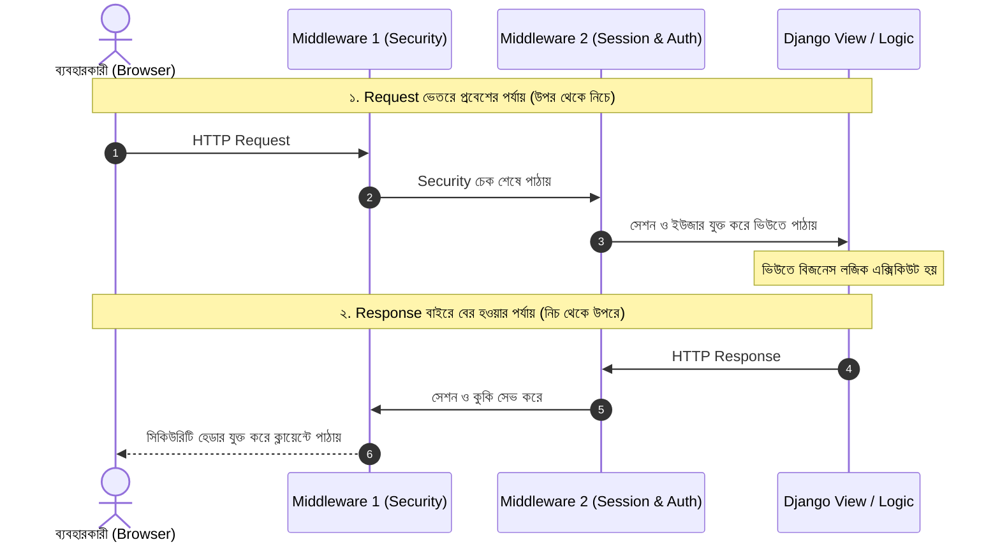

# Django Middleware 🧅🛡️

Django ওয়েব অ্যাপ্লিকেশনে ক্লায়েন্টের পাঠানো **Request** এবং সার্ভারের পাঠানো **Response**-এর মাঝামাঝি স্তরে কাজ করার শক্তিশালী ও কেন্দ্রীয় প্লাগইন ফ্রেমওয়ার্ক হলো **Middleware**।

এটি একটি "পেঁয়াজের খোসা" (Onion Architecture)-এর মতো কাজ করে, যেখানে প্রতিটি স্তর রিকোয়েস্ট ভেতরে প্রবেশ করার সময় এবং রেসপন্স বাইরে বের হওয়ার সময় নির্দিষ্ট নিরাপত্তা, সেশন বা লগিং যাচাই সম্পন্ন করে।

এই গাইডে আমরা শিখব Middleware কীভাবে কাজ করে, Django-র বিল্ট-ইন মিডলওয়্যারগুলোর কাজ, ক্রমানুসারের গুরুত্ব এবং বাস্তব জীবনের একাধিক কাস্টম মিডলওয়্যার তৈরি।

---

## ১. Middleware কীভাবে কাজ করে? (Request-Response Life Cycle)



> 🧅 **পেঁয়াজের উপমা (The Onion Model):**
> রিকোয়েস্ট যখন আসে, তখন মিডলওয়্যারগুলো `settings.py`-এর তালিকার **উপর থেকে নিচে (Top to Bottom)** ক্রমানুসারে এক্সিকিউট হয়।
> কিন্তু ভিউ থেকে রেসপন্স যখন ফেরত যায়, তখন এটি ঠিক বিপরীতভাবে **নিচ থেকে উপরে (Bottom to Top)** হয়ে ফেরত যায়!

---

## ২. Django-র বিল্ট-ইন Middleware ও তাদের কাজের ক্রম

`config/settings.py` ফাইলে ডিফল্টভাবে নিচের মিডলওয়্যারগুলো থাকে:

```python
MIDDLEWARE = [
    'django.middleware.security.SecurityMiddleware',
    'django.contrib.sessions.middleware.SessionMiddleware',
    'django.middleware.common.CommonMiddleware',
    'django.middleware.csrf.CsrfViewMiddleware',
    'django.contrib.auth.middleware.AuthenticationMiddleware',
    'django.contrib.messages.middleware.MessageMiddleware',
    'django.middleware.clickjacking.XFrameOptionsMiddleware',
]
```

### এদের কাজের গুরুত্ব ও ক্রমানুসার:

1. **`SecurityMiddleware`:** SSL/HTTPS রিডাইরেকশন, HSTS হেডার, XSS সুরক্ষা ও `X-Content-Type-Options` যুক্ত করে। এটি সবার উপরে থাকা আবশ্যক।
2. **`SessionMiddleware`:** প্রতিটি রিকোয়েস্টে সেশন চালু করে এবং `request.session` অবজেক্ট যুক্ত করে।
3. **`CommonMiddleware`:** ভাঙা URL-এ ট্রেইলিং স্ল্যাশ (`/`) যোগ করা এবং ইউজার-এজেন্ট ফিল্টার করা।
4. **`CsrfViewMiddleware`:** POST রিকোয়েস্টে CSRF টোকেন ভ্যালিডেট করে ক্রস-সাইট অ্যাটাক ঠেকায়।
5. **`AuthenticationMiddleware`:** সেশন আইডি ব্যবহার করে ডেটাবেজ থেকে ইউজার বের করে `request.user`-এ সেট করে।
   > ⚠️ **লক্ষ্য করুন:** `AuthenticationMiddleware` অবশ্যই `SessionMiddleware`-এর **নিচে** থাকতে হবে, কারণ সেশন ছাড়া ইউজার বের করা অসম্ভব!
6. **`MessageMiddleware`:** কুকি বা সেশন ভিত্তিক ফ্ল্যাশ মেসেজ (`messages.success`, `messages.error`) হ্যান্ডেল করে।
7. **`XFrameOptionsMiddleware`:** আপনার সাইটকে অন্য কেউ যেন `<iframe>`-এ প্রদর্শন করে Clickjacking অ্যাটাক করতে না পারে তা নিশ্চিত করে।

---

## ৩. কাস্টম Middleware তৈরির নিয়ম

Django-তে কাস্টম মিডলওয়্যার দুইভাবে লেখা যায়:
1. **ফাংশন-ভিত্তিক (Function-based Middleware)**
2. **ক্লাস-ভিত্তিক (Class-based Middleware — বহুল ব্যবহৃত ও স্ট্যান্ডার্ড)**

---

### ক. ক্লাস-ভিত্তিক Middleware-এর বেসিক স্ট্রাকচার:

একটি নতুন ফাইল তৈরি করুন: `accounts/middleware.py` (বা আপনার যেকোনো অ্যাপে):

```python
# accounts/middleware.py

class SimpleCustomMiddleware:
    def __init__(self, get_response):
        # সার্ভার চালু হওয়ার সময় ১ বার মাত্র রান হয়
        self.get_response = get_response

    def __call__(self, request):
        # 🟢 ১. ভিউ কল হওয়ার পূর্বে এই কোড রান হয় (Request Phase)
        # print("Request আসছে:", request.path)

        response = self.get_response(request)  # 👈 ভিউতে রিকোয়েস্ট পাঠানো হলো

        # 🔵 ২. ভিউ থেকে রেসপন্স তৈরি হওয়ার পর এই কোড রান হয় (Response Phase)
        # print("Response ফিরে যাচ্ছে:", response.status_code)

        return response
```

---

### খ. Middleware-এর বিশেষ হুক মেথডস (Hooks)

ক্লাস-ভিত্তিক মিডলওয়্যারে প্রয়োজন অনুযায়ী ৩টি বিশেষ মেথড যোগ করা যায়:

```python
class AdvancedMiddleware:
    def __init__(self, get_response):
        self.get_response = get_response

    def __call__(self, request):
        return self.get_response(request)

    # ১. ভিউ ফাংশন কল হওয়ার ঠিক আগ মুহূর্তে রান হয়:
    def process_view(self, request, view_func, view_args, view_kwargs):
        # None রিটার্ন করলে ভিউ স্বাভাবিকভাবে চলবে।
        # HttpResponse রিটার্ন করলে ভিউ আর এক্সিকিউটই হবে না, এখান থেকেই রেসপন্স যাবে!
        return None

    # ২. ভিউতে কোনো এক্সেপশন বা ক্র্যাশ ঘটলে এটি রান হয়:
    def process_exception(self, request, exception):
        # কোনো ত্রুটি হলে কাস্টম এরর রেসপন্স বা ইমেইল পাঠানোর জন্য ব্যবহৃত হয়
        return None

    # ৩. টেমপ্লেট রেন্ডার হওয়ার ঠিক পূর্বে রান হয় (TemplateResponse হলে):
    def process_template_response(self, request, response):
        return response
```

---

## ৪. বাস্তব জীবনের ৫টি প্র্যাকটিক্যাল Custom Middleware

### উদাহরণ ১: রিকোয়েস্ট এক্সিকিউশন টাইম মাপার Middleware ⏱️

প্রতিটি পেজ লোড হতে কত মিলিসেকেন্ড সময় নিচ্ছে তা মেপে রেসপন্স হেডারে যুক্ত করা:

```python
# accounts/middleware.py
import time

class PerformanceTimerMiddleware:
    def __init__(self, get_response):
        self.get_response = get_response

    def __call__(self, request):
        start_time = time.time()

        # ভিউ এক্সিকিউট হওয়া
        response = self.get_response(request)

        duration = round((time.time() - start_time) * 1000, 2)  # মিলিসেকেন্ডে রূপান্তর
        
        # রেসপন্সের কাস্টম হেডারে সময় যুক্ত করা
        response['X-Page-Duration-ms'] = str(duration)
        print(f"⚡ [{request.method}] {request.path} সম্পন্ন হতে সময় লেগেছে: {duration} ms")

        return response
```

---

### উদাহরণ ২: IP ব্লকলিস্ট বা ব্যান মিডলওয়্যার 🚫

ক্ষতিকর কোনো আইপি অ্যাড্রেস থেকে রিকোয়েস্ট আসলে সরাসরি 403 Forbidden রিটার্ন করা:

```python
# accounts/middleware.py
from django.http import HttpResponseForbidden

class BlockIPMiddleware:
    BANNED_IPS = [
        '192.168.1.100',
        '10.0.0.99',
    ]

    def __init__(self, get_response):
        self.get_response = get_response

    def __call__(self, request):
        # ইউজারের রিয়েল আইপি নেওয়া
        ip = request.META.get('REMOTE_ADDR')
        
        if ip in self.BANNED_IPS:
            return HttpResponseForbidden("<h1>403 Forbidden</h1><p>আপনার আইপি থেকে এই সাইট ব্লক করা হয়েছে।</p>")

        return self.get_response(request)
```

---

### উদাহরণ ৩: মেইনটেন্যান্স মোড (Maintenance Mode) মিডলওয়্যার 🚧

সাইটে রক্ষণাবেক্ষণের কাজ চললে অ্যাডমিন ছাড়া বাকি সাধারণ ভিজিটরদের নোটিশ পেজে পাঠানো:

```python
# accounts/middleware.py
from django.shortcuts import render

class MaintenanceModeMiddleware:
    IS_MAINTENANCE_ACTIVE = False  # কাজ শেষে False করে দিলে সাইট লাইভ হবে

    def __init__(self, get_response):
        self.get_response = get_response

    def __call__(self, request):
        # যদি মেইনটেন্যান্স অন থাকে এবং রিকোয়েস্ট admin প্যানেলের জন্য না হয়:
        if self.IS_MAINTENANCE_ACTIVE and not request.path.startswith('/admin/'):
            return render(request, "maintenance.html", status=503)

        return self.get_response(request)
```

---

### উদাহরণ ৪: ইউজারের শেষ সক্রিয় সময় (Last Active) ট্র্যাক করা 🕒

ইউজার কখন সর্বশেষ সাইটে অ্যাক্টিভ ছিলেন তা ডেটাবেজে সংরক্ষণ করা:

```python
# accounts/middleware.py
from django.utils import timezone

class UpdateLastActiveMiddleware:
    def __init__(self, get_response):
        self.get_response = get_response

    def __call__(self, request):
        response = self.get_response(request)

        # AuthenticationMiddleware-এর পরে বসালে request.user পাওয়া যাবে
        if request.user.is_authenticated:
            # প্রতি মিনিটে বা প্রতিটি অ্যাকশনে ইউজারের last_login বা last_active আপডেট করা
            request.user.last_login = timezone.now()
            request.user.save(update_fields=['last_login'])

        return response
```

---

### উদাহরণ ৫: অপ্রত্যাশিত ত্রুটি লগার (Exception Logger) 🚨

```python
# accounts/middleware.py
import logging

logger = logging.getLogger(__name__)

class ExceptionLoggingMiddleware:
    def __init__(self, get_response):
        self.get_response = get_response

    def __call__(self, request):
        return self.get_response(request)

    def process_exception(self, request, exception):
        # কোনো ভিউতে আনহ্যান্ডেলড এরর ঘটলে লগ ফাইলে সংরক্ষণ করা
        logger.error(f"❌ এরর ঘটেছে URL: {request.path} এ! এরর বিবরণ: {exception}", exc_info=True)
        return None  # None দিলে Django স্বাভাবিক 500 পেজ দেখাবে
```

---

## ৫. `settings.py`-এ Middleware সক্রিয় করার নিয়ম

তৈরি করা কাস্টম মিডলওয়্যার কাজ করানোর জন্য `settings.py`-এর `MIDDLEWARE` লিস্টে পাথ যোগ করতে হয়:

```python
# config/settings.py

MIDDLEWARE = [
    'django.middleware.security.SecurityMiddleware',
    'django.contrib.sessions.middleware.SessionMiddleware',
    'django.middleware.common.CommonMiddleware',
    'django.middleware.csrf.CsrfViewMiddleware',
    'django.contrib.auth.middleware.AuthenticationMiddleware',
    'django.contrib.messages.middleware.MessageMiddleware',
    'django.middleware.clickjacking.XFrameOptionsMiddleware',

    # 🚀 আমাদের কাস্টম মিডলওয়্যারসমূহ:
    'accounts.middleware.PerformanceTimerMiddleware',
    'accounts.middleware.BlockIPMiddleware',
]
```

> 💡 **কোথায় বসাবেন?**
> * আপনার মিডলওয়্যার যদি `request.user` ব্যবহার করে, তবে অবশ্যই তা `AuthenticationMiddleware`-এর **পরে (নিচে)** বসাতে হবে।
> * আপনার মিডলওয়্যার যদি কোনো আইপিকে শুরুতেই ব্লক করতে চায়, তবে তা তালিকার **সবার শুরুতে (বা SecurityMiddleware-এর ঠিক নিচে)** বসানো বুদ্ধিমানের কাজ, যাতে অপ্রয়োজনীয় সেশন বা অথেনটিকেশন প্রসেস আগেই বন্ধ করা যায়।

---

## ৬. Middleware ব্যবহারের গোল্ডেন রুলস ও পারফরম্যান্স টিপস

1. **ভারী ডেটাবেজ কোয়েরি এড়িয়ে চলুন:** মিডলওয়্যার প্রতিটি একক HTTP রিকোয়েস্টে রান হয় (এমনকি static/media ফাইল এবং favicons এর জন্যও)। মিডলওয়্যারে ভারী ডেটাবেজ কোয়েরি চালালে পুরো সাইট মারাত্মক স্লো হয়ে যাবে।
2. **ক্রমানুসার সতর্কতার সাথে ঠিক করুন:** নির্ভরশীলতার বিষয়টি নিশ্চিত করুন (যেমন: সেশন ছাড়া অথ কাজ করে না)।
3. **ক্যাশ (Cache) ব্যবহার করুন:** আইপি তালিকা বা কনফিগারেশন চেকের জন্য মেমরি ক্যাশ (Redis / Memcached) ব্যবহার করুন।

---

## 🎯 আজকের Key Takeaways

1. **Middleware** হলো ক্লায়েন্টের রিকোয়েস্ট এবং ভিউয়ের রেসপন্সের মাঝখানে থাকা ফিল্টার ফ্রেমওয়ার্ক।
2. রিকোয়েস্ট আসার সময় মিডলওয়্যারগুলো **উপর থেকে নিচে** এবং রেসপন্স যাওয়ার সময় **নিচ থেকে উপরে** কাজ করে।
3. `AuthenticationMiddleware` অবশ্যই `SessionMiddleware`-এর নিচে থাকতে হবে।
4. ক্লাস-ভিত্তিক মিডলওয়্যারে `__init__` সার্ভার স্টার্টের সময় একবার চলে, আর `__call__` প্রতিটি রিকোয়েস্টে রান হয়।
5. বিশেষ হুক মেথডস: `process_view`, `process_exception`, `process_template_response`।
6. পারফরম্যান্স ঠিক রাখতে মিডলওয়্যারে কখনো ভারী প্রসেসিং বা আন-অপ্টিমাইজড ডেটাবেজ কোয়েরি রাখা যাবে না।

---

## ❓ অনুশীলনী প্রশ্ন

1. Django-তে Middleware কী এবং এর কাজের উদ্দেশ্য কী?
2. রিকোয়েস্ট ও রেসপন্স চলার সময় মিডলওয়্যার ক্রমানুসারের দিক (Direction) কেমন থাকে?
3. `SessionMiddleware` কেন `AuthenticationMiddleware`-এর আগে থাকা বাধ্যতামূলক?
4. ক্লাস-ভিত্তিক মিডলওয়্যারের `__init__` এবং `__call__` মেথডের মধ্যকার কাজের পার্থক্য কী?
5. `process_view()` হুক মেথড থেকে যদি কোনো `HttpResponse` রিটার্ন করা হয়, তাহলে কী ঘটবে?
6. `process_exception()` হুক মেথড কখন ট্রিগার হয়?
7. একটি ওয়েবসাইটে প্রতিটি পেজ রেন্ডার হতে কত সময় লাগছে তা ট্র্যাক করতে কোন মিডলওয়্যার প্যাটার্ন ব্যবহার করবেন?
8. মেইনটেন্যান্স মোড মিডলওয়্যারে কেন `/admin/` URL বাদ রাখা জরুরি?
9. মিডলওয়্যারে ভারী ডেটাবেজ কোয়েরি চালানো কেন মারাত্মক ক্ষতিকর?
10. শুধুমাত্র নির্দিষ্ট দেশের বা নির্দিষ্ট আইপির ইউজারদের ব্লক করার জন্য মিডলওয়্যারটি তালিকার কোথায় বসানো উচিত এবং কেন?
