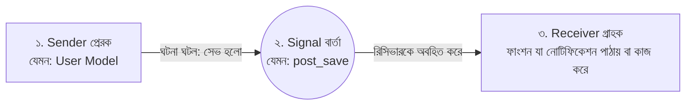

# Django Signals 📡⚡

Django অ্যাপ্লিকেশনে কোনো একটি ঘটনা ঘটলে (যেমন: নতুন ইউজার তৈরি হওয়া, কোনো ডেটা ডিলিট হওয়া বা ভুল পাসওয়ার্ড দিয়ে লগইন চেষ্টা করা) অ্যাপ্লিকেশনের অন্য অংশকে স্বয়ংক্রিয়ভাবে তা জানানোর এবং নির্দিষ্ট কাজ সম্পন্ন করানোর ইভেন্ট-ভিত্তিক সিস্টেম হলো **Django Signals**।

এটি মূলত সফটওয়্যার ইঞ্জিনিয়ারিংয়ের **Observer Pattern (Publisher-Subscriber)** ডিজাইনের বাস্তবায়ন।

এই পূর্ণাঙ্গ গাইডে আমরা শিখব Signals কীভাবে কাজ করে, প্রধান বিল্ট-ইন সিগন্যালসমূহ, সিগন্যাল রেজিস্টার করার সঠিক নিয়ম এবং বাস্তব জীবনের একাধিক ব্যবহারিক উদাহরণ।

---

## ১. Signals কীভাবে কাজ করে?

Signals মূলত ৩টি উপাদানের সমন্বয়ে কাজ করে:



1. **Sender (প্রেরক):** যে অবজেক্ট বা মডেল সিগন্যালটি ট্রিগার করে (যেমন: `User` মডেল বা `Post` মডেল)।
2. **Signal (সিগন্যাল/বার্তা):** নির্দিষ্ট ঘটনার ধরন (যেমন: সেভ হওয়ার আগে `pre_save`, সেভ হওয়ার পরে `post_save`)।
3. **Receiver (গ্রাহক):** একটি পাইথন ফাংশন যা সিগন্যাল পেলে নির্দিষ্ট কাজ সম্পন্ন করে। এটি `@receiver` ডেকোরেটর দিয়ে যুক্ত থাকে।

---

## ২. Django-র প্রধান Built-in Signals

Django-তে আগে থেকেই অনেকগুলো শক্তিশালী সিগন্যাল তৈরি করা থাকে:

### ক. Model Signals (মডেলের জীবনচক্র):
* `pre_save`: কোনো মডেলের `.save()` কল হলে ডেটাবেজে যাওয়ার **ঠিক আগ মুহূর্তে** ট্রিগার হয়।
* `post_save`: মডেল ডেটাবেজে সফলভাবে সেভ হওয়ার **ঠিক পর মুহূর্তে** ট্রিগার হয়।
* `pre_delete`: কোনো অবজেক্ট ডেটাবেজ থেকে মুছে ফেলার **ঠিক আগে** রান হয়।
* `post_delete`: অবজেক্ট ডেটাবেজ থেকে মুছে ফেলার **ঠিক পরে** রান হয়।
* `m2m_changed`: ManyToMany ফিল্ডে কোনো ডেটা যোগ বা বাদ দিলে রান হয়।

### খ. Authentication Signals (লগইন ও নিরাপত্তা):
* `user_logged_in`: ইউজার সফলভাবে লগইন করলে ট্রিগার হয়।
* `user_logged_out`: ইউজার লগআউট করলে ট্রিগার হয়।
* `user_login_failed`: ভুল ইউজারনেম বা পাসওয়ার্ড দিয়ে লগইন চেষ্টা করলে রান হয় (হ্যাকিং প্রতিরোধ ও লগের জন্য দারুণ)।

### গ. Request/Response Signals:
* `request_started` এবং `request_finished`: কোনো HTTP রিকোয়েস্ট শুরু ও শেষ হওয়ার সময়।

---

## ৩. সিগন্যাল লেখার সঠিক প্রজেক্ট স্ট্রাকচার

অনেকেই সিগন্যাল সরাসরি `models.py`-এ লেখেন, যা কোড অগোছালো করে তোলে। প্রফেশনাল পদ্ধতি হলো:
1. অ্যাপের ভেতর আলাদা একটি `signals.py` ফাইল তৈরি করা।
2. অ্যাপের `apps.py`-এর `ready()` মেথডে সিগন্যালটি লোড/ইমপোর্ট করা।

---

### ধাপ ১: `signals.py` তৈরি করা

```python
# accounts/signals.py
from django.db.models.signals import post_save, post_delete, pre_save
from django.dispatch import receiver
from django.contrib.auth import get_user_model
from .models import Profile

User = get_user_model()

# ইউজার তৈরি হলে স্বয়ংক্রিয়ভাবে Profile অবজেক্ট তৈরি করা
@receiver(post_save, sender=User)
def create_or_save_user_profile(sender, instance, created, **kwargs):
    if created:
        # created = True মানে হলো এটি একদম নতুন তৈরি হয়েছে (Update নয়)
        Profile.objects.create(user=instance)
        print(f"🎉 নতুন ইউজারের জন্য প্রোফাইল তৈরি হয়েছে: {instance.username}")
    else:
        # ইউজার আপডেট হলে প্রোফাইলও সেভ করা
        instance.profile.save()
```

---

### ধাপ ২: `apps.py`-এ সিগন্যাল কানেক্ট করা (খুব গুরুত্বপূর্ণ ⚠️)

সিগন্যাল না চলার সবচেয়ে প্রধান কারণ হলো `apps.py`-তে এটি ইমপোর্ট না করা। Django-কে সিগন্যাল সম্পর্কে জানাতে `ready()` মেথড ব্যবহার করুন:

```python
# accounts/apps.py
from django.apps import AppConfig

class AccountsConfig(AppConfig):
    default_auto_field = 'django.db.models.BigAutoField'
    name = 'accounts'

    def ready(self):
        # সার্ভার বুট হওয়ার সময় সিগন্যাল লোড করা
        import accounts.signals
```

---

## ৪. বাস্তব জীবনের ৪টি প্র্যাকটিক্যাল Signals উদাহরণ

### উদাহরণ ১: টাইটেল থেকে স্বয়ংক্রিয় ইউনিক Slug তৈরি (`pre_save`)

ব্লগ পোস্ট সেভ হওয়ার ঠিক আগে টাইটেল থেকে স্লাগ তৈরি করা:

```python
# blog/signals.py
from django.db.models.signals import pre_save
from django.dispatch import receiver
from django.utils.text import slugify
from .models import Post

@receiver(pre_save, sender=Post)
def generate_post_slug(sender, instance, **kwargs):
    # যদি স্লাগ খালি থাকে, তবে টাইটেল থেকে তৈরি করা
    if not instance.slug:
        base_slug = slugify(instance.title)
        slug = base_slug
        counter = 1
        # স্লাগ ইতিমধ্যে অন্য কোনো পোস্টে থাকলে ইউনিক করা (যেমন: post-1, post-2)
        while Post.objects.filter(slug=slug).exclude(pk=instance.pk).exists():
            slug = f"{base_slug}-{counter}"
            counter += 1
        instance.slug = slug
```

---

### উদাহরণ ২: অবজেক্ট ডিলিট হলে সার্ভার থেকে ছবি/ফাইলও মুছে ফেলা (`post_delete`) 🗑️

ডিফল্টভাবে Django ডেটাবেজ থেকে রেকর্ড ডিলিট করলেও মিডিয়া ফোল্ডারে ছবিটি থেকে যায়। সিগন্যাল দিয়ে ফাইল সম্পূর্ণ ক্লিন করা যায়:

```python
# accounts/signals.py
import os
from django.db.models.signals import post_delete
from django.dispatch import receiver
from .models import Profile

@receiver(post_delete, sender=Profile)
def delete_profile_avatar_on_delete(sender, instance, **kwargs):
    # যদি প্রোফাইলে ছবি থাকে এবং ছবিটি ডিফল্ট ছবি না হয়
    if instance.avatar and instance.avatar.name != 'default.png':
        if os.path.isfile(instance.avatar.path):
            os.remove(instance.avatar.path)
            print(f"🗑️ হার্ডডিস্ক থেকে ফাইল ডিলিট হয়েছে: {instance.avatar.path}")
```

---

### উদাহরণ ৩: ব্যর্থ লগইন চেষ্টা ও হ্যাকিং সতর্কতা (`user_login_failed`) 🚨

ভুল পাসওয়ার্ড দিয়ে বারবার লগইনের চেষ্টা হলে সিকিউরিটি লগ রাখা:

```python
# accounts/signals.py
from django.contrib.auth.signals import user_login_failed
from django.dispatch import receiver
import logging

logger = logging.getLogger(__name__)

@receiver(user_login_failed)
def log_failed_login(sender, credentials, request, **kwargs):
    username = credentials.get('username', 'Unknown')
    ip = request.META.get('REMOTE_ADDR')
    logger.warning(f"⚠️ অবৈধ লগইন চেষ্টা! ইউজারনেম: {username}, আইপি: {ip}")
    print(f"🚨 Failed login for '{username}' from IP: {ip}")
```

---

### উদাহরণ ৪: কাস্টম সিগন্যাল তৈরি ও ট্রিগার করা (Custom Signal) 📢

আপনি চাইলে Django-র বাইরের যেকোনো বিশেষ ইভেন্টের জন্য নিজস্ব কাস্টম সিগন্যাল তৈরি করতে পারেন:

#### ক. সিগন্যাল ডিফাইন করা:
```python
# orders/signals.py
import django.dispatch

# কাস্টম সিগন্যাল ডিক্লেয়ার করা
order_completed = django.dispatch.Signal()
```

#### খ. রিসিভার ফাংশন তৈরি:
```python
# notifications/signals.py
from django.dispatch import receiver
from orders.signals import order_completed

@receiver(order_completed)
def send_order_sms_and_email(sender, order, user, **kwargs):
    print(f"📱 এসএমএস পাঠানো হচ্ছে: অর্ডার #{order.id} সম্পন্ন হয়েছে গ্রাহক {user.username}-এর জন্য।")
```

#### গ. ভিউ বা লজিক থেকে সিগন্যাল পাঠানো (`.send()`):
```python
# orders/views.py
from orders.signals import order_completed

def checkout_complete(request, order_id):
    order = Order.objects.get(pk=order_id)
    order.status = 'Paid'
    order.save()

    # 🚀 সিগন্যাল ট্রিগার করা
    order_completed.send(sender=Order, order=order, user=request.user)

    return render(request, "success.html")
```

---

## ৫. Signals ব্যবহারের সুবিধা বনাম সীমাবদ্ধতা (কখন ব্যবহার করবেন না?)

| সুবিধা 👍 | সীমাবদ্ধতা / ঝুঁকি ⚠️ |
| :--- | :--- |
| **ডিকাপলড কোড (Decoupling):** একটি অ্যাপের সাথে আরেকটি অ্যাপের সরাসরি ডিপেন্ডেন্সি কমে। | **লুকানো সাইড-ইফেক্ট (Hidden Side Effects):** কোড পড়লে সরাসরি বোঝা যায় না ব্যাকগ্রাউন্ডে কী ঘটছে, ডিবাগিং জটিল হয়। |
| **অটোমেশন:** কোনো মডেল পরিবর্তনের সাথে সাথে ব্যাকগ্রাউন্ড কাজ নিখুঁতভাবে হয়। | **সিনক্রোনাস এক্সিকিউশন:** সিগন্যাল কিন্তু অ্যাসিঙ্ক্রোনাস নয়! সিগন্যালে দেরি হলে পেজ লোড হতেও দেরি হবে। |
| **থার্ড-পার্টি অ্যাপ:** যখন অন্য কোনো অ্যাপের কোড পরিবর্তন না করে ইভেন্ট শুনতে হয়। | **বাল্ক আপডেটে কাজ করে না:** `bulk_create()` বা `QuerySet.update()` চালালে `post_save` বা `pre_save` সিগন্যাল রান হয় না! |

> 💡 **সেরা বিকল্প:**
> যদি কোনো কাজ সরাসরি একটি নির্দিষ্ট মডেলের ভেতরেই সীমাবদ্ধ থাকে, তবে সিগন্যাল ব্যবহারের চেয়ে মডেলের নিজস্ব `save()` মেথড ওভাররাইড করা বেশি স্পষ্ট এবং ডিবাগ করা সহজ।

---

## 🎯 আজকের Key Takeaways

1. **Signals** হলো Django-র ইভেন্ট-লিসেনার ফ্রেমওয়ার্ক (Publisher-Subscriber প্যাটার্ন)।
2. বহুল ব্যবহৃত সিগন্যাল: `pre_save`, `post_save`, `pre_delete`, `post_delete`, `user_login_failed`।
3. `post_save` সিগন্যালে `created` বুলিয়ান ফ্ল্যাগ নির্দেশ করে রেকর্ডটি নতুন ইনসার্ট হয়েছে (`True`) নাকি আপডেট হয়েছে (`False`)।
4. সিগন্যাল সর্বদা আলাদা `signals.py` ফাইলে লিখুন এবং `apps.py`-এর `ready()` মেথডে লোড করুন।
5. `bulk_create()` এবং `QuerySet.update()` মেথডে মডেল সিগন্যাল ট্রিগার হয় না।
6. সিগন্যালে ভারী কাজ (যেমন ইমেইল পাঠানো) থাকলে তা ব্যাকগ্রাউন্ড টাস্ক (Celery / Redis Queue)-এ পাঠানো বুদ্ধিমানের কাজ।

---

## ❓ অনুশীলনী প্রশ্ন

1. Django Signals কী এবং এটি কোন ডিজাইন প্যাটার্নের ওপর ভিত্তি করে তৈরি?
2. `pre_save` এবং `post_save` সিগন্যালের মধ্যে প্রধান পার্থক্য কী?
3. `post_save` সিগন্যালে `created` আর্গুমেন্টের কাজ কী?
4. সিগন্যাল লেখার পর তা `apps.py`-এর `ready()` মেথডে কেন ইমপোর্ট করতে হয়?
5. একটি মডেল অবজেক্ট ডেটাবেজ থেকে মুছে ফেলার পর তার ইমেজ ফাইল সার্ভারের স্টোরেজ থেকে ডিলিট করতে কোন সিগন্যাল ব্যবহার করবেন?
6. `user_login_failed` সিগন্যালটি কোন ক্ষেত্রে অত্যন্ত কার্যকর?
7. `Post.objects.filter(...).update(...)` চালালে কেন `post_save` সিগন্যাল ফায়ার হয় না?
8. কাস্টম সিগন্যাল কীভাবে তৈরি এবং ভিউ থেকে ট্রিগার করতে হয়?
9. সিগন্যাল ব্যবহারের প্রধান দুটি অসুবিধা বা ক্ষতিকর দিক কী কী?
10. মডেলের `save()` মেথড ওভাররাইড করার সাথে সিগন্যাল ব্যবহারের পার্থক্য কী এবং কখন কোনটি ব্যবহার করা উচিত?
