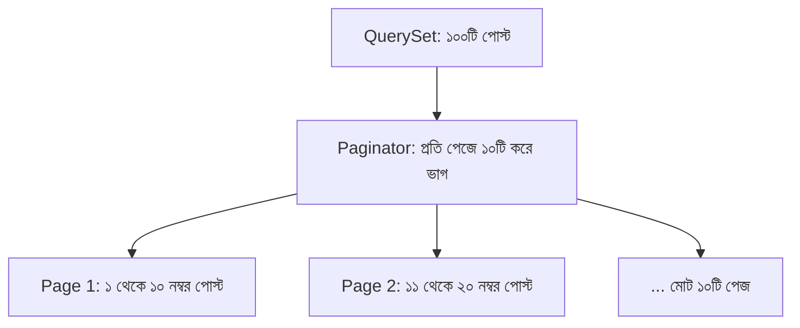

# Django Pagination ও Search 📄🔍

ওয়েবসাইটে যখন হাজার হাজার বা লক্ষ লক্ষ রেকর্ড (যেমন: ব্লগ পোস্ট, ই-কমার্স প্রোডাক্ট বা ইউজার) থাকে, তখন সব ডেটা একসাথে লোড করলে ডেটাবেজ ও ব্রাউজার ক্র্যাশ করতে পারে।

এই সমস্যা সমাধানের জন্য ডেটাকে অল্প অল্প ভাগে ভাগ করে প্রদর্শনের পদ্ধতি হলো **Pagination** এবং ব্যবহারকারী যেন মুহূর্তেই কাঙ্ক্ষিত তথ্য খুঁজে পায় তার জন্য দরকার কার্যকর **Search**।

এই গাইডে আমরা শিখব Django-র বিল্ট-ইন `Paginator`, `Q` অবজেক্ট দিয়ে মাল্টি-ফিল্ড সার্চ, সার্চের সাথে পেজিনেশনের লিঙ্ক ঠিক রাখার কৌশল এবং Bootstrap 5 দিয়ে প্রফেশনাল UI তৈরি।

---

## ১. কেন Pagination এবং Search অপরিহার্য?

1. **সার্ভার ও মেমরি অপ্টিমাইজেশন:** ডেটাবেজে ১০,০০০ পোস্ট থাকলে `Post.objects.all()` চালালে সার্ভারের র‍্যাম অতিরিক্ত খরচ হয়। পেজিনেশন দিয়ে আমরা একবারে মাত্র ১০ বা ২০টি রেকর্ড আনি (SQL `LIMIT` ও `OFFSET` ব্যবহার করে)।
2. **দ্রুত পেজ লোড টাইম:** অল্প ডেটা দ্রুত ব্রাউজারে রেন্ডার হয়, যা ইউজার এক্সপেরিয়েন্স (UX) এবং SEO-র জন্য অত্যন্ত গুরুত্বপূর্ণ।
3. **সহজ নেভিগেশন:** সার্চ এবং পেজিনেশন ইউজারকে দ্রুত নির্দিষ্ট তথ্যে পৌঁছাতে সাহায্য করে।

---

## ২. Django Paginator কীভাবে কাজ করে?

Django-তে পেজিনেশন হ্যান্ডেল করার জন্য `django.core.paginator` মডিউলে `Paginator` ক্লাস থাকে।



### `Paginator` এবং `Page` অবজেক্টের প্রধান মেথডস:

| মেথড / প্রপার্টি | কাজ |
| :--- | :--- |
| `Paginator(queryset, per_page)` | মূল পেজিনেটর তৈরি করা |
| `paginator.num_pages` | মোট কতটি পেজ তৈরি হয়েছে |
| `paginator.count` | মোট ডেটা/অবজেক্টের সংখ্যা |
| `paginator.get_page(page_number)` | নির্দিষ্ট পেজের অবজেক্ট বের করা (ভুল নম্বরে সেফ হ্যান্ডলিং) |
| `page_obj.has_next()` | পরের পেজ আছে কিনা (True/False) |
| `page_obj.has_previous()` | আগের পেজ আছে কিনা (True/False) |
| `page_obj.next_page_number()` | পরবর্তী পেজের নম্বর |
| `page_obj.previous_page_number()` | পূর্ববর্তী পেজের নম্বর |
| `page_obj.number` | বর্তমান পেজের নম্বর |
| `page_obj.paginator.get_elided_page_range()` | মাঝখানে `...` সহ সুন্দর পেজ রেঞ্জ |

---

## ৩. `Q` অবজেক্ট দিয়ে কার্যকর Search বাস্তবায়ন

সাধারণ ফিল্টারিংয়ে আমরা `Post.objects.filter(title__icontains=query)` ব্যবহার করি। কিন্তু একাধিক ফিল্ডে (যেমন: টাইটেল **অথবা** মূল বিষয়বস্তু **অথবা** লেখকের নাম) একসাথে সার্চ করার জন্য Django-র **`Q` অবজেক্ট** প্রয়োজন:

```python
from django.db.models import Q
from .models import Post

query = request.GET.get('q')

if query:
    # টাইটেল, বিষয়বস্তু বা লেখকের ইউজারনেমে মিল থাকলে আসবে (OR অপারেশন)
    posts = Post.objects.filter(
        Q(title__icontains=query) |
        Q(content__icontains=query) |
        Q(author__username__icontains=query)
    ).distinct()
else:
    posts = Post.objects.all()
```

> 💡 **নোট:** `icontains` হলো Case-insensitive search। অর্থাৎ "python" লিখলে "Python" বা "PYTHON" ও খুঁজে পাবে। আর ForeignKey রিলেশন সার্চের সময় ডাবল আন্ডারস্কোর দিয়ে নেস্ট করা হয় (`author__username__icontains`)।

---

## ৪. Search এবং Pagination একসাথে হ্যান্ডেল করার বাস্তব View

এখানে একটি সাধারণ সমস্যা দেখা দেয়:
> ইউজার সার্চ করল `"django"`, রেজাল্ট এলো ৫০টি। এখন ইউজার যখন **Page 2**-তে ক্লিক করবে, তখন URL যদি শুধুমাত্র `?page=2` হয়ে যায়, তবে সার্চ টার্মটি হারিয়ে যাবে!
> তাই URL হতে হবে: `?q=django&page=2`।

### সম্পূর্ণ ভিউ কোড (`views.py`):

```python
# blog/views.py
from django.shortcuts import render
from django.core.paginator import Paginator, EmptyPage, PageNotAnInteger
from django.db.models import Q
from .models import Post

def post_list_view(request):
    # ১. URL থেকে সার্চ কুয়েরি ও বর্তমান পেজ নম্বর নেওয়া
    search_query = request.GET.get('q', '').strip()
    page_number = request.GET.get('page', 1)

    # ২. কুয়েরিসেট প্রস্তুত করা (সর্বদা ordering সহ)
    posts = Post.objects.all().order_by('-created_at')

    # ৩. সার্চ ফিল্টার প্রয়োগ করা
    if search_query:
        posts = posts.filter(
            Q(title__icontains=search_query) |
            Q(content__icontains=search_query) |
            Q(author__username__icontains=search_query)
        ).distinct()

    # ৪. পেজিনেটর সেটআপ (প্রতি পেজে ৫টি করে পোস্ট)
    paginator = Paginator(posts, 5)

    # ৫. নিরাপদ উপায়ে পেজ অবজেক্ট নেওয়া
    try:
        page_obj = paginator.page(page_number)
    except PageNotAnInteger:
        # পেজ নম্বর কোনো সংখ্যা না হলে প্রথম পেজ দেখানো
        page_obj = paginator.page(1)
    except EmptyPage:
        # পেজ নম্বর সীমার বাইরে চলে গেলে সর্বশেষ পেজ দেখানো
        page_obj = paginator.page(paginator.num_pages)

    context = {
        'page_obj': page_obj,
        'search_query': search_query,
        'total_results': posts.count(),
    }
    return render(request, 'blog/post_list.html', context)
```

---

## ৫. আধুনিক Bootstrap 5 টেমপ্লেট (`post_list.html`)

এই টেমপ্লেটে সার্চ বার এবং সার্চ কোয়েরি অক্ষুণ্ণ রেখে পরবর্তী পেজে যাওয়ার স্মার্ট পেজিনেশন লিঙ্ক অন্তর্ভুক্ত রয়েছে:

```html
<!-- templates/blog/post_list.html -->
<!DOCTYPE html>
<html lang="bn">
<head>
    <meta charset="UTF-8">
    <title>পোস্ট তালিকা | Search & Pagination</title>
    <link href="https://cdn.jsdelivr.net/npm/bootstrap@5.3.3/dist/css/bootstrap.min.css" rel="stylesheet">
    <link rel="stylesheet" href="https://cdn.jsdelivr.net/npm/bootstrap-icons@1.11.3/font/bootstrap-icons.min.css">
</head>
<body class="bg-light py-5">
<div class="container">
    <div class="row justify-content-center">
        <div class="col-md-9">

            <!-- সার্চ বার -->
            <div class="card p-3 shadow-sm mb-4 border-0">
                <form method="GET" action="" class="row g-2">
                    <div class="col-sm-9">
                        <div class="input-group">
                            <span class="input-group-text bg-white"><i class="bi bi-search"></i></span>
                            <input type="text" name="q" value="{{ search_query }}" 
                                   class="form-control" placeholder="শিরোনাম, বিষয়বস্তু বা লেখক দিয়ে খুঁজুন...">
                        </div>
                    </div>
                    <div class="col-sm-3 d-flex gap-2">
                        <button type="submit" class="btn btn-primary w-100">অনুসন্ধান</button>
                        
                            <a href="" class="btn btn-outline-secondary" title="রিসেট">
                                <i class="bi bi-x-lg"></i>
                            </a>
                        
                    </div>
                </form>

                
                    <small class="text-muted mt-2">
                        <strong>"{{ search_query }}"</strong> এর জন্য <strong>{{ total_results }}</strong>টি ফলাফল পাওয়া গেছে।
                    </small>
                
            </div>

            <!-- পোস্টের তালিকা -->
            
                <div class="row g-3">
                    
                        <div class="col-12">
                            <div class="card shadow-sm border-0 p-3">
                                <h4 class="card-title text-primary">{{ post.title }}</h4>
                                <p class="card-text text-muted">{{ post.content|truncatewords:30 }}</p>
                                <div class="d-flex justify-content-between text-secondary small">
                                    <span><i class="bi bi-person"></i> {{ post.author.username }}</span>
                                    <span><i class="bi bi-calendar"></i> {{ post.created_at|date:"d M, Y" }}</span>
                                </div>
                            </div>
                        </div>
                    
                </div>
            
                <div class="alert alert-warning text-center">
                    <i class="bi bi-exclamation-circle me-1"></i> কোনো পোস্ট খুঁজে পাওয়া যায়নি!
                </div>
            

            <!-- 🔥 প্রফেশনাল Pagination বার -->
            
                <nav class="mt-4" aria-label="Page navigation">
                    <ul class="pagination justify-content-center">

                        <!-- আগের পেজের বাটন -->
                        
                            <li class="page-item">
                                <a class="page-link" href="?q={{ search_query }}&page=1" title="প্রথম পেজ">
                                    &laquo; প্রথম
                                </a>
                            </li>
                            <li class="page-item">
                                <a class="page-link" href="?q={{ search_query }}&page={{ page_obj.previous_page_number }}">
                                    পূর্ববর্তী
                                </a>
                            </li>
                        
                            <li class="page-item disabled"><span class="page-link">পূর্ববর্তী</span></li>
                        

                        <!-- পেজ নম্বর তালিকা (Elided Range: ১, ২ ... ৪, ৫ ... ১০) -->
                        
                            
                                <li class="page-item active"><span class="page-link">{{ num }}</span></li>
                            
                                <li class="page-item disabled"><span class="page-link">...</span></li>
                            
                                <li class="page-item">
                                    <a class="page-link" href="?q={{ search_query }}&page={{ num }}">
                                        {{ num }}
                                    </a>
                                </li>
                            
                        

                        <!-- পরের পেজের বাটন -->
                        
                            <li class="page-item">
                                <a class="page-link" href="?q={{ search_query }}&page={{ page_obj.next_page_number }}">
                                    পরবর্তী
                                </a>
                            </li>
                            <li class="page-item">
                                <a class="page-link" href="?q={{ search_query }}&page={{ page_obj.paginator.num_pages }}" title="সর্বশেষ পেজ">
                                    সর্বশেষ &raquo;
                                </a>
                            </li>
                        
                            <li class="page-item disabled"><span class="page-link">পরবর্তী</span></li>
                        

                    </ul>
                </nav>
            

        </div>
    </div>
</div>
</body>
</html>
```

---

## ৬. Class-Based Views (CBV)-এ Pagination ও Search

আপনি যদি Class-Based View ব্যবহার করতে পছন্দ করেন, তবে `ListView`-এ খুব কম কোডে এটি করা যায়:

```python
# blog/views.py
from django.views.generic import ListView
from django.db.models import Q
from .models import Post

class PostListView(ListView):
    model = Post
    template_name = 'blog/post_list.html'
    context_object_name = 'posts'
    paginate_by = 10  # 👈 প্রতি পেজে কয়টি রেকর্ড থাকবে

    def get_queryset(self):
        queryset = super().get_queryset().order_by('-created_at')
        query = self.request.GET.get('q')
        if query:
            queryset = queryset.filter(
                Q(title__icontains=query) | Q(content__icontains=query)
            ).distinct()
        return queryset

    def get_context_data(self, **kwargs):
        context = super().get_context_data(**kwargs)
        # সার্চ কুয়েরি টেমপ্লেটে পাস করা
        context['search_query'] = self.request.GET.get('q', '')
        return context
```

---

## 🎯 আজকের Key Takeaways

1. **Pagination** সার্ভারের স্মৃতি ও ব্যান্ডউইথ বাঁচায় এবং ডেটাবেজে `LIMIT` ও `OFFSET` কুয়েরি চালায়।
2. একাধিক ফিল্ডে OR কন্ডিশন দিয়ে সার্চ করতে **`Q` অবজেক্ট** (`from django.db.models import Q`) ব্যবহার করুন।
3. কেস-ইনসেনসিটিভ সার্চের জন্য `__icontains` ফিল্টার ফিল্ড ব্যবহার করা হয়।
4. পেজিনেশনের জন্য সর্বদা কুয়েরিসেটে নির্দিষ্ট ক্রম বা সাজানো (`order_by`) থাকতে হবে, অন্যথায় `UnorderedObjectListWarning` সতর্কবার্তা আসবে।
5. সার্চের ফলাফল পেজিনেশনে অক্ষুণ্ণ রাখতে পেজের লিংকে `?q={{ search_query }}&page={{ num }}` ফরম্যাট ব্যবহার করতে হয়।
6. বড় পেজ রেঞ্জের জন্য Django-র `paginator.get_elided_page_range()` মেথড ব্যবহার করলে মাঝের অপ্রয়োজনীয় পেজগুলো `...` হিসেবে দেখায়।

---

## ❓ অনুশীলনী প্রশ্ন

1. ওয়েব অ্যাপ্লিকেশনে সব ডেটা একসাথে না দেখিয়ে Pagination ব্যবহার করার প্রধান দুটি সুবিধা কী কী?
2. `Paginator` ক্লাসের প্রথম ও দ্বিতীয় আর্গুমেন্টে কী কী দিতে হয়?
3. `page_obj.has_next()` এবং `page_obj.next_page_number()` মেথডের মধ্যে পার্থক্য কী?
4. `__contains` এবং `__icontains` ফিল্টারের মধ্যে পার্থক্য কী?
5. একাধিক ফিল্ডে (যেমন: Title বা Author) OR লজিক দিয়ে সার্চ ফিল্টারিং করতে কোন ক্লাসটি ব্যবহার করা হয়?
6. পেজিনেটরে কুয়েরিসেট পাস করার সময় কেন `order_by()` ব্যবহার করা বাধ্যতামূলক?
7. ব্যবহারকারী সার্চ করার পর দ্বিতীয় পেজে ক্লিক করলে সার্চ কুয়েরি যেন মুছে না যায়, তার জন্য টেমপ্লেটে লিঙ্কের গঠন কেমন হওয়া উচিত?
8. `get_elided_page_range()` মেথডের কাজ কী?
9. `EmptyPage` এবং `PageNotAnInteger` এক্সেপশন দুটি কখন দেখা দেয় এবং এদের কীভাবে হ্যান্ডেল করতে হয়?
10. `ListView` ক্লাস-ভিত্তিক ভিউতে কীভাবে এক লাইনে পেজিনেশন সক্রিয় করা যায়?
