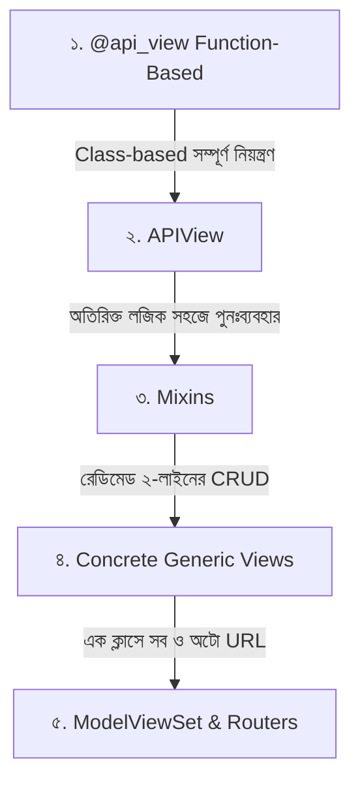

# Django REST Framework APIView ও Generic Views 🏛️⚡

Django REST Framework (DRF)-এ API এন্ডপয়েন্ট তৈরি করার জন্য একাধিক স্তর বা আর্কিটেকচার রয়েছে। আপনি যেমন একটি সাধারণ ফাংশন দিয়ে শুরু করতে পারেন, তেমনই একটি সম্পূর্ণ ক্লাসে সম্পূর্ণ নিয়ন্ত্রণ রাখতে পারেন, অথবা মাত্র ২ লাইনের **Generic Views** ব্যবহার করে সম্পূর্ণ CRUD (Create, Read, Update, Delete) সিস্টেম তৈরি করে ফেলতে পারেন।

এই গাইডে আমরা শিখব DRF ভিউয়ের ক্রমবিকাশ, `APIView`-এর সম্পূর্ণ নিয়ন্ত্রণ, `Generic Views`-এর ম্যাজিকাল গতি এবং কখন কোনটি বেছে নেবেন।

---

## ১. DRF Views-এর শ্রেণিবিভাগ (View Hierarchy)



| স্তর | ভিউয়ের ধরন | কোডের পরিমাণ | কাস্টম নিয়ন্ত্রণের সুযোগ | উপযুক্ত ব্যবহারের ক্ষেত্র |
| :--- | :--- | :--- | :--- | :--- |
| **Level 1** | `@api_view` | মাঝারি | বেশি | ছোট ফাংশনাল টাস্ক, ড্যাশবোর্ড স্ট্যাটাস |
| **Level 2** | `APIView` | বেশি | সর্বোচ্চ (১০০%) | জটিল বিজনেস লজিক, থার্ড-পার্টি পেমেন্ট গেটওয়ে |
| **Level 3** | `Generic Views` | খুব কম | মাঝারি | স্ট্যান্ডার্ড মডেল ভিত্তিক CRUD অপারেশন |
| **Level 4** | `ModelViewSet` | সর্বনিম্ন | কম (কনফিগারেশন ভিত্তিক) | স্ট্যান্ডার্ড ই-কমার্স, ব্লগ, ইউজার ম্যানেজমেন্ট |

---

## ২. `APIView` (সম্পূর্ণ নিয়ন্ত্রণ ও কাস্টমাইজেশন)

`APIView` হলো সাধারণ Django-র `View` ক্লাসের একটি শক্তিশালী সাবক্লাস। এটি স্বয়ংক্রিয়ভাবে DRF-এর `Request` অবজেক্ট পার্স করে, কনটেন্ট নেগোশিয়েশন (JSON রেন্ডারিং) করে এবং পারমিশন ও অথেনটিকেশন চেক চালায়।

### `APIView` দিয়ে সম্পূর্ণ CRUD অপারেশন:

```python
# blog/views.py
from rest_framework.views import APIView
from rest_framework.response import Response
from rest_framework import status
from django.shortcuts import get_object_or_404
from .models import Post
from .serializers import PostSerializer

# ১. লিস্ট দেখা ও নতুন তৈরি করার ভিউ:
class PostListCreateAPIView(APIView):
    def get(self, request):
        # সব পোস্টের তালিকা JSON আকারে পাঠানো
        posts = Post.objects.all().order_by('-created_at')
        serializer = PostSerializer(posts, many=True)
        return Response(serializer.data, status=status.HTTP_200_OK)

    def post(self, request):
        # নতুন পোস্ট তৈরি করা
        serializer = PostSerializer(data=request.data)
        if serializer.is_valid():
            serializer.save(author=request.user)
            return Response(serializer.data, status=status.HTTP_201_CREATED)
        return Response(serializer.errors, status=status.HTTP_400_BAD_REQUEST)

# ২. একক পোস্ট দেখা, আপডেট ও ডিলিট করার ভিউ:
class PostDetailAPIView(APIView):
    def get_object(self, pk):
        return get_object_or_404(Post, pk=pk)

    def get(self, request, pk):
        post = self.get_object(pk)
        serializer = PostSerializer(post)
        return Response(serializer.data)

    def put(self, request, pk):
        # পুরো পোস্ট আপডেট করা
        post = self.get_object(pk)
        serializer = PostSerializer(post, data=request.data)
        if serializer.is_valid():
            serializer.save()
            return Response(serializer.data)
        return Response(serializer.errors, status=status.HTTP_400_BAD_REQUEST)

    def patch(self, request, pk):
        # আংশিক (Partial) আপডেট করা
        post = self.get_object(pk)
        serializer = PostSerializer(post, data=request.data, partial=True)
        if serializer.is_valid():
            serializer.save()
            return Response(serializer.data)
        return Response(serializer.errors, status=status.HTTP_400_BAD_REQUEST)

    def delete(self, request, pk):
        post = self.get_object(pk)
        post.delete()
        return Response({"message": "পোস্ট মুছে ফেলা হয়েছে।"}, status=status.HTTP_204_NO_CONTENT)
```

---

## ৩. `Generic Views` (DRY Principle — মাত্র কয়েক লাইনে পুরো CRUD!) 🚀

লক্ষ্য করুন, ওপরের `APIView`-তে আমরা প্রতিটি মেথডে প্রায় একই রকম কোড (কোয়েরিসেট খোঁজা, সিরিয়ালাইজ করা, ভ্যালিডেট করা) বারবার লিখেছি।

DRF-এর **Generic Views** এই সাধারণ কোডগুলোকে রেডিমেড বানিয়ে দিয়েছে। উপরের প্রায় ৫০ লাইনের কোড Generic Views দিয়ে **মাত্র ১০ লাইনে** লেখা যায়!

```python
# blog/views.py
from rest_framework import generics, permissions
from .models import Post
from .serializers import PostSerializer

# ১. লিস্ট ও তৈরি করা (GET & POST) — মাত্র ৩ লাইন!
class PostListCreateView(generics.ListCreateAPIView):
    queryset = Post.objects.all().order_by('-created_at')
    serializer_class = PostSerializer
    permission_classes = [permissions.IsAuthenticatedOrReadOnly]

    # কারেন্ট লগইন ইউজারকে লেখক হিসেবে স্বয়ংক্রিয়ভাবে সেট করার মেথড:
    def perform_create(self, serializer):
        serializer.save(author=self.request.user)

# ২. একক অবজেক্ট দেখা, আপডেট ও ডিলিট (GET, PUT, PATCH, DELETE) — মাত্র ২ লাইন!
class PostDetailView(generics.RetrieveUpdateDestroyAPIView):
    queryset = Post.objects.all()
    serializer_class = PostSerializer
    permission_classes = [permissions.IsAuthenticatedOrReadOnly]
```

### প্রধান প্রধান Generic API Views তালিকা:

| ক্লাস | সমর্থিত HTTP মেথডস | কাজ |
| :--- | :--- | :--- |
| `ListAPIView` | `GET` | শুধুমাত্র সব রেকর্ডের তালিকা প্রদর্শন |
| `CreateAPIView` | `POST` | শুধুমাত্র নতুন রেকর্ড তৈরি |
| `ListCreateAPIView` | `GET`, `POST` | তালিকা প্রদর্শন এবং নতুন তৈরি দুটোই |
| `RetrieveAPIView` | `GET` | আইডি দিয়ে একক রেকর্ড প্রদর্শন |
| `UpdateAPIView` | `PUT`, `PATCH` | একক রেকর্ড সম্পাদন/আপডেট |
| `DestroyAPIView` | `DELETE` | একক রেকর্ড মুছে ফেলা |
| `RetrieveUpdateAPIView` | `GET`, `PUT`, `PATCH` | দেখা ও আপডেট |
| `RetrieveUpdateDestroyAPIView` | `GET`, `PUT`, `PATCH`, `DELETE` | দেখা, আপডেট ও ডিলিট (সব একসাথে) |

---

## ৪. `ModelViewSet` এবং `DefaultRouter` (পরম সংক্ষেপ 🪄)

Generic Views-এও আমাদের দুটি ক্লাস ও দুটি URL লিখতে হয় (`ListCreate` এবং `Detail`)।

কিন্তু **`ModelViewSet`** ব্যবহার করলে এই সব কাজ **১টি মাত্র ক্লাসে** হয়ে যায় এবং URL-ও লিখতে হয় না!

### ধাপ ১: ViewSet তৈরি (`views.py`)

```python
# blog/views.py
from rest_framework import viewsets, permissions
from .models import Post
from .serializers import PostSerializer

class PostViewSet(viewsets.ModelViewSet):
    """
    এই একটি ক্লাস স্বয়ংক্রিয়ভাবে ৫টি অ্যাকশন পরিচালনা করবে:
    - GET /api/posts/ (তালিকা)
    - POST /api/posts/ (নতুন তৈরি)
    - GET /api/posts/1/ (একক তথ্য)
    - PUT/PATCH /api/posts/1/ (আপডেট)
    - DELETE /api/posts/1/ (মুছে ফেলা)
    """
    queryset = Post.objects.all().order_by('-created_at')
    serializer_class = PostSerializer
    permission_classes = [permissions.IsAuthenticatedOrReadOnly]

    def perform_create(self, serializer):
        serializer.save(author=self.request.user)
```

---

### ধাপ ২: Router দিয়ে স্বয়ংক্রিয় URL তৈরি (`urls.py`)

```python
# blog/urls.py
from django.urls import path, include
from rest_framework.routers import DefaultRouter
from .views import PostViewSet

# ১. রাউটার ইনস্ট্যান্স তৈরি করা
router = DefaultRouter()

# ২. ভিউসেট রেজিস্টার করা
router.register('posts', PostViewSet, basename='post')

# ৩. রাউটারের তৈরি URL গুলো যুক্ত করা
urlpatterns = [
    path('api/', include(router.urls)),
]
```

> 🎯 **ম্যাজিক:** `router.register('posts', PostViewSet)` লিখলেই Django নিজে থেকেই সব কয়টি এন্ডপয়েন্ট (`/api/posts/`, `/api/posts/<id>/`) এবং তাদের সঠিক রিভার্স নাম তৈরি করে ফেলে!

---

## ৫. কোনটি কখন ব্যবহার করবেন? (Decision Guide)

1. **`ModelViewSet` ব্যবহার করুন:** যখন আপনার একটি সাধারণ ডেটাবেজ মডেলের ওপর সাধারণ CRUD অপারেশন চালাতে হবে (যেমন: ব্লগ পোস্ট, প্রোডাক্ট, ক্যাটাগরি)।
2. **`Generic Views` ব্যবহার করুন:** যখন আপনার কাস্টম কুয়েরি ফিল্টারিং বা কিছুটা কাস্টমাইজড আচরণ দরকার কিন্তু নতুন করে কোড লিখতে চান না।
3. **`APIView` ব্যবহার করুন:** যখন আপনার একাধিক মডেলের ডেটা প্রসেস করতে হবে, থার্ড পার্টি পেমেন্ট গেটওয়ের কলব্যাক রিসিভ করতে হবে বা জটিল বিজনেস ক্যালকুলেশন চালাতে হবে যা সাধারণ মডেলের সাথে সরাসরি মেলে না।

---

## 🎯 আজকের Key Takeaways

1. **`APIView`** ডেভেলপারকে প্রতিটি HTTP মেথডের (`get`, `post`, `put`, `patch`, `delete`) ওপর ১০০% কাস্টম নিয়ন্ত্রণের সুযোগ দেয়।
2. **`Generic Views`** সাধারণ CRUD কোডগুলো প্রস্তুত করে রাখে; `ListCreateAPIView` ও `RetrieveUpdateDestroyAPIView` দিয়ে খুব দ্রুত API তৈরি করা যায়।
3. কারেন্ট ইউজারকে ব্যাকএন্ড থেকে মডেলে ইনজেক্ট করতে Generic Views-এর `perform_create(self, serializer)` মেথড ওভাররাইড করতে হয়।
4. **`ModelViewSet`** ও **`DefaultRouter`** সবচেয়ে দ্রুততম উপায় — এক ক্লাস ও এক লাইনের রাউটারে সম্পূর্ণ CRUD API প্রস্তুত হয়ে যায়।
5. আংশিক ডেটা আপডেটের জন্য `PUT`-এর বদলে `PATCH` (`partial=True`) মেথড ব্যবহার করা হয়।

---

## ❓ অনুশীলনী প্রশ্ন

1. DRF-এ `APIView` এবং সাধারণ Django `View` ক্লাসের মধ্যে মূল পার্থক্য কী?
2. `PUT` এবং `PATCH` রিকোয়েস্টের মধ্যে টেকনিক্যাল পার্থক্য কী?
3. `ListCreateAPIView` ক্লাসটি কোন দুটি HTTP মেথড সাপোর্ট করে?
4. Generic Views-এ নতুন রেকর্ড সেভের সময় লগইন করা ইউজারকে লেখক হিসেবে সংযুক্ত করতে কোন মেথডটি ওভাররাইড করতে হয়?
5. `ModelViewSet` ব্যবহার করলে আলাদাভাবে `urls.py`-এ প্রতিটি এন্ডপয়েন্টের জন্য `path()` না লিখে কোন টুলটি ব্যবহার করা হয়?
6. একটি পেমেন্ট গেটওয়ে (যেমন SSLCommerz বা Stripe) থেকে ডেটা রিসিভ করার জন্য `APIView` এবং `Generic Views`-এর মধ্যে কোনটি বেশি উপযুক্ত এবং কেন?
7. `status.HTTP_201_CREATED` এবং `status.HTTP_204_NO_CONTENT` স্ট্যাটাস কোড দুটি কোন কোন অপারেশনের পর রিটার্ন করা আদর্শ?
8. Generic Views-এ শর্ত অনুযায়ী কুয়েরিসেট ফিল্টার করতে কোন মেথডটি ওভাররাইড করতে হয়?
9. `DefaultRouter` ব্যবহারের ফলে ব্রাউজেবল এপিআই-তে অতিরিক্ত কোন সুবিধা পাওয়া যায়?
10. শুধুমাত্র লগইন করা ইউজাররা যাতে কোনো Generic View ব্যবহার করতে পারে, তার জন্য কোন অ্যাট্রিবিউট ব্যবহার করতে হয়?
