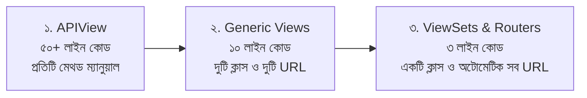

# Django REST Framework ViewSets ও Routers 🪄🛣️

Django REST Framework (DRF)-এর সবচেয়ে শক্তিশালী, মার্জিত ও দ্রুততম কোডিং কৌশল হলো **ViewSets** এবং **Routers**।

আমরা যখন Generic Views ব্যবহার করতাম, তখনও আমাদের প্রতিটি মডেলের জন্য দুটি ক্লাস (`ListCreateAPIView` এবং `RetrieveUpdateDestroyAPIView`) এবং `urls.py`-এ দুটি করে পাথ লিখতে হতো। 

**ViewSets** এবং **Routers** ব্যবহার করলে একটি মডেলের সম্পূর্ণ CRUD অপারেশন **১টি মাত্র ক্লাসে** লেখা যায় এবং কোনো ম্যানুয়াল URL না লিখে রাউটার দিয়ে স্বয়ংক্রিয়ভাবে সকল RESTful URL তৈরি করে ফেলা যায়!

---

## ১. ভিউয়ের বিবর্তন: কেন ViewSets?



### Handler মেথড বনাম Actions:
* সাধারণ ভিউতে আমরা HTTP মেথডের নামে ফাংশন লিখতাম (`get()`, `post()`, `put()`, `delete()`)।
* কিন্তু ViewSet-এ এগুলো রূপান্তর হয় ব্যবসায়িক বা ইউজার অ্যাকশনে (**Actions**):
  - `list()`: সব অবজেক্টের তালিকা প্রদর্শন (`GET /api/posts/`)
  - `create()`: নতুন অবজেক্ট তৈরি করা (`POST /api/posts/`)
  - `retrieve()`: একক অবজেক্ট দেখা (`GET /api/posts/1/`)
  - `update()`: সম্পূর্ণ অবজেক্ট আপডেট করা (`PUT /api/posts/1/`)
  - `partial_update()`: আংশিক আপডেট করা (`PATCH /api/posts/1/`)
  - `destroy()`: অবজেক্ট মুছে ফেলা (`DELETE /api/posts/1/`)

---

## ২. ViewSets-এর প্রকারভেদ

DRF-এ মূলত ৪ ধরনের ViewSet থাকে:

| ViewSet ক্লাস | কী কী অ্যাকশন প্রদান করে? | কখন ব্যবহার করবেন? |
| :--- | :--- | :--- |
| **`ModelViewSet`** | `list`, `create`, `retrieve`, `update`, `partial_update`, `destroy` (সম্পূর্ণ CRUD) | স্ট্যান্ডার্ড মডেল ভিত্তিক সাধারণ CRUD অপারেশনের জন্য (৯০% ক্ষেত্রে এটিই সেরা) |
| **`ReadOnlyModelViewSet`**| শুধুমাত্র `list` এবং `retrieve` (রিড-অনলি) | যখন ইউজারদের শুধু ডেটা দেখার অনুমতি দিতে চান কিন্তু তৈরি/এডিট/ডিলিট বন্ধ রাখতে চান |
| **`GenericViewSet`** | কোনো অ্যাকশন ডিফল্ট থাকে না; Mixins দিয়ে নিজের মতো বানাতে হয় | যখন আপনার শুধু `list` এবং `destroy` দরকার, কিন্তু `update` বা `create` দরকার নেই |
| **`ViewSet`** | `APIView`-এর মতো কিন্তু অ্যাকশন ভিত্তিক | যখন ডেটাবেজ মডেলের বাইরে সম্পূর্ণ কাস্টম লজিক অ্যাকশন ভিত্তিক সাজাতে চান |

---

## ৩. `ModelViewSet` তৈরি করার নিয়ম

ধরা যাক আমাদের একটি `Post` মডেল আছে:

```python
# blog/views.py
from rest_framework import viewsets, permissions
from .models import Post
from .serializers import PostSerializer

class PostViewSet(viewsets.ModelViewSet):
    """
    মাত্র এই ৩ লাইনের ক্লাসে ৫টি অ্যাকশন প্রস্তুত:
    1. GET    /api/posts/          -> list
    2. POST   /api/posts/          -> create
    3. GET    /api/posts/{id}/     -> retrieve
    4. PUT    /api/posts/{id}/     -> update
    5. PATCH  /api/posts/{id}/     -> partial_update
    6. DELETE /api/posts/{id}/     -> destroy
    """
    queryset = Post.objects.all().order_by('-created_at')
    serializer_class = PostSerializer
    permission_classes = [permissions.IsAuthenticatedOrReadOnly]

    # কারেন্ট লগইন ইউজারকে লেখক হিসেবে স্বয়ংক্রিয়ভাবে সেট করা:
    def perform_create(self, serializer):
        serializer.save(author=self.request.user)
```

---

## ৪. Routers-এর জাদু (স্বয়ংক্রিয় URL কনফিগারেশন) 🛣️

ViewSets-এর সবচেয়ে বড় সুবিধা হলো এদের জন্য ম্যানুয়ালি `path('posts/', ...)` লিখতে হয় না। DRF-এর **`DefaultRouter`** নিজে থেকেই সকল RESTful স্ট্যান্ডার্ড URL তৈরি করে দেয়।

```python
# blog/urls.py
from django.urls import path, include
from rest_framework.routers import DefaultRouter
from .views import PostViewSet

# ১. রাউটার ইনস্ট্যান্স তৈরি করা
router = DefaultRouter()

# ২. ভিউসেট রেজিস্টার করা (prefix, viewset_class, basename)
router.register('posts', PostViewSet, basename='post')

# ৩. তৈরি হওয়া সব URL ইনক্লুড করা
urlpatterns = [
    path('api/', include(router.urls)),
]
```

### রাউটার কোন কোন URL তৈরি করে? (ম্যাপিং সারণী):

| URL পাথ | HTTP Method | Action | URL Name | বিবরণ |
| :--- | :--- | :--- | :--- | :--- |
| `/api/posts/` | `GET` | `list` | `post-list` | সকল পোস্টের তালিকা |
| `/api/posts/` | `POST` | `create` | `post-list` | নতুন পোস্ট তৈরি |
| `/api/posts/{pk}/` | `GET` | `retrieve` | `post-detail` | একক পোস্টের বিস্তারিত |
| `/api/posts/{pk}/` | `PUT` | `update` | `post-detail` | সম্পূর্ণ পোস্ট আপডেট |
| `/api/posts/{pk}/` | `PATCH` | `partial_update` | `post-detail` | আংশিক আপডেট |
| `/api/posts/{pk}/` | `DELETE` | `destroy` | `post-detail` | পোস্ট মুছে ফেলা |

> 💡 **`SimpleRouter` বনাম `DefaultRouter`:**
> * `SimpleRouter`: শুধুমাত্র মূল এন্ডপয়েন্টগুলো তৈরি করে।
> * `DefaultRouter`: মূল এন্ডপয়েন্টগুলোর পাশাপাশি একটি সুন্দর **API Root** ভিউ (যেখানে সব এন্ডপয়েন্টের লিংক একসাথে সাজানো থাকে) এবং অপশনাল ফরম্যাট সাফিক্স (`.json`) যুক্ত করে দেয়।

---

## ৫. Custom Actions (`@action` Decorator) 🎯

স্ট্যান্ডার্ড CRUD-এর বাইরে যদি বিশেষ কোনো অ্যাকশন দরকার হয় (যেমন: কোনো পোস্টে লাইক দেওয়া, পাসওয়ার্ড বদলানো, বা ফিচার্ড পোস্টের তালিকা আনা), তার জন্য **`@action`** ডেকোরেটর ব্যবহার করা হয়।

### ১. `detail=True` (একক অবজেক্টের ওপর কাজ):
URL হবে: `/api/posts/{id}/like/`

```python
from rest_framework.decorators import action
from rest_framework.response import Response
from rest_framework import status

class PostViewSet(viewsets.ModelViewSet):
    queryset = Post.objects.all()
    serializer_class = PostSerializer

    # একক পোস্টের ওপর লাইক অ্যাকশন:
    @action(detail=True, methods=['post'], permission_classes=[permissions.IsAuthenticated])
    def like(self, request, pk=None):
        post = self.get_object()  # কারেন্ট পোস্ট অবজেক্ট আনা
        # লাইক কাউন্ট বাড়ানো বা টগল লজিক:
        post.likes_count += 1
        post.save()
        return Response({"status": "liked", "total_likes": post.likes_count}, status=status.HTTP_200_OK)
```

---

### ২. `detail=False` (পুরো তালিকার ওপর কাজ):
URL হবে: `/api/posts/featured/`

```python
    # ফিচার্ড পোস্টের তালিকা দেখার অ্যাকশন:
    @action(detail=False, methods=['get'])
    def featured(self, request):
        featured_posts = Post.objects.filter(is_featured=True)
        serializer = self.get_serializer(featured_posts, many=True)
        return Response(serializer.data)
```

---

## ৬. অ্যাডভান্সড টেকনিক: ডাইনামিক পারমিশন ও সিরিয়ালাইজার

বাস্তব প্রজেক্টে প্রায়ই দরকার হয়:
> *"পোস্টের তালিকা সবাই দেখতে পাবে (`AllowAny`), কিন্তু ডিলিট শুধু অ্যাডমিন করতে পারবে (`IsAdminUser`)"*
> অথবা
> *"পোস্টের তালিকায় সাধারণ তথ্য দেখাবে, কিন্তু ডিটেইল ভিউতে সম্পূর্ণ নেস্টেড তথ্য দেখাবে।"*

ViewSet-এ মেথড ওভাররাইড করে এটি খুব সহজে করা যায়:

```python
class PostViewSet(viewsets.ModelViewSet):
    queryset = Post.objects.all()

    # ১. অ্যাকশন ভেদে আলাদা পারমিশন দেওয়া:
    def get_permissions(self):
        if self.action in ['create', 'update', 'partial_update']:
            permission_classes = [permissions.IsAuthenticated]
        elif self.action == 'destroy':
            permission_classes = [permissions.IsAdminUser]
        else:
            permission_classes = [permissions.AllowAny]
        return [perm() for perm in permission_classes]

    # ২. অ্যাকশন ভেদে আলাদা সিরিয়ালাইজার ব্যবহার:
    def get_serializer_class(self):
        if self.action == 'list':
            return PostSummarySerializer  # ছোট ও হালকা সিরিয়ালাইজার
        return PostDetailSerializer       # সম্পূর্ণ বিস্তারিত সিরিয়ালাইজার
```

---

## ৭. ReadOnlyModelViewSet (শুধুমাত্র রিড-অনলি ডেটা)

যখন সাধারণ ইউজারদের জন্য পণ্য ক্যাটালগ বা ব্লগ পোস্ট শুধু প্রদর্শনের জন্য উন্মুক্ত রাখতে চান:

```python
class PublicProductViewSet(viewsets.ReadOnlyModelViewSet):
    """
    এখানে শুধু GET /api/products/ এবং GET /api/products/1/ কাজ করবে।
    POST, PUT, DELETE সম্পূর্ণ বন্ধ থাকবে।
    """
    queryset = Product.objects.filter(is_active=True)
    serializer_class = ProductSerializer
```

---

## 🎯 আজকের Key Takeaways

1. **ViewSet** সাধারণ HTTP মেথডগুলোকে (`get`, `post`) ব্যবসায়িক অ্যাকশনে (`list`, `create`, `retrieve`, `update`, `destroy`) রূপান্তর করে।
2. **`ModelViewSet`** মাত্র এক ক্লাসে ৫টি সম্পূর্ণ CRUD অ্যাকশন পরিচালনা করে।
3. **`DefaultRouter`** ব্যবহার করলে কোনো ম্যানুয়াল URL পাথ লিখতে হয় না; রাউটার নিজে থেকেই সকল RESTful URL তৈরি করে।
4. কাস্টম অ্যাকশন তৈরির জন্য **`@action`** ডেকোরেটর ব্যবহার করা হয় (`detail=True` একক অবজেক্টের জন্য এবং `detail=False` তালিকার জন্য)।
5. অ্যাকশন ভেদে ভিন্ন পারমিশন দিতে `get_permissions()` এবং ভিন্ন সিরিয়ালাইজার দিতে `get_serializer_class()` মেথড ওভাররাইড করতে হয়।

---

## ❓ অনুশীলনী প্রশ্ন

1. DRF-এ Generic Views থাকা সত্ত্বেও কেন ViewSets এবং Routers ব্যবহার করা বেশি সুবিধাজনক?
2. `ModelViewSet`-এর ৫টি প্রধান বিল্ট-ইন অ্যাকশনের নাম কী কী?
3. `DefaultRouter` এবং `SimpleRouter`-এর মধ্যে মূল পার্থক্য কী?
4. `@action` ডেকোরেটরে `detail=True` এবং `detail=False`-এর মধ্যে পার্থক্য কী? উদাহরণ দিন।
5. একটি ViewSet-এ শুধুমাত্র `list` এবং `retrieve` অ্যাকশন চালু রাখতে কোন ক্লাসটি ব্যবহার করা হয়?
6. `router.register('users', UserViewSet, basename='user')`-এ `basename` আর্গুমেন্টটির কাজ কী?
7. একটি ViewSet-এ লগইন না থাকা ইউজাররা যাতে শুধু পোস্ট দেখতে পারে কিন্তু ডিলিট করতে অ্যাডমিন হতে হয়, তা কীভাবে `get_permissions()` দিয়ে কনফিগার করবেন?
8. একক পোস্টের জন্য `/api/posts/5/publish/` নামক একটি POST অ্যাকশন তৈরি করার কোড কেমন হবে?
9. ViewSets ব্যবহারের সময় `perform_create()` মেথডের ভূমিকা কী?
10. কোন কোন পরিস্থিতিতে ViewSet ব্যবহারের চেয়ে সাধারণ `APIView` ব্যবহার করা বুদ্ধিমানের কাজ?
