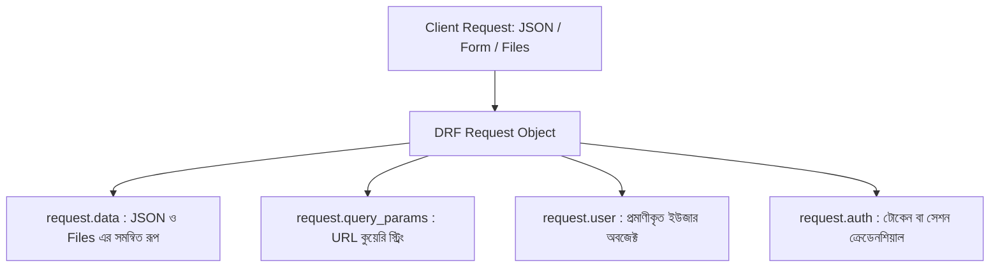

# Django REST Framework Request, Response ও পূর্ণাঙ্গ CRUD API 🔄⚡

Django REST Framework (DRF)-এর প্রাণকেন্দ্র হলো এর উন্নত **Request** এবং **Response** অবজেক্ট। সাধারণ Django-র সাথে DRF-এর সবচেয়ে বড় পার্থক্যের একটি হলো এটি ক্লায়েন্ট থেকে আসা যেকোনো ফরম্যাটের ডেটা (JSON, Form-Data, Multipart) সহজে পার্স করতে পারে এবং বিভিন্ন ফরম্যাটে প্রতিক্রিয়া পাঠাতে পারে।

এই পূর্ণাঙ্গ গাইডে আমরা শিখব DRF-এর `Request` ও `Response` অবজেক্টের অভ্যন্তরীণ ক্ষমতা, গুরুত্বপূর্ণ HTTP Status Codes এবং শুরু থেকে শেষ পর্যন্ত একটি সম্পূর্ণ **CRUD (Create, Read, Update, Delete) API** তৈরির প্রক্রিয়া।

---

## ১. DRF `Request` অবজেক্টের ক্ষমতা

সাধারণ Django-তে আমরা `django.http.HttpRequest` ব্যবহার করি। কিন্তু DRF-এ ভিউগুলোতে পাঠানো হয় একটি বর্ধিত অবজেক্ট: `rest_framework.request.Request`।



### প্রধান প্রধান অ্যাট্রিবিউট:

| অ্যাট্রিবিউট | সাধারণ Django-তে কী ছিল | DRF-এ সুবিধা |
| :--- | :--- | :--- |
| **`request.data`** | `request.POST` ও `request.FILES` | এটি একাই **JSON পে-লোড, ফর্ম ডেটা এবং ফাইল/ইমেজ** একসাথে পার্স করতে পারে! |
| **`request.query_params`** | `request.GET` | URL-এর কুয়েরি প্যারামিটার (যেমন: `?search=python&page=2`) সহজে রিড করে। |
| **`request.user`** | `request.user` | প্রমাণীকৃত ইউজার অথবা `AnonymousUser` রিটার্ন করে। |
| **`request.auth`** | নেই | ইউজারের বর্তমান অ্যাক্টিভ টোকেন বা অথেনটিকেশন অবজেক্ট রিটার্ন করে। |
| **`request.method`** | `request.method` | HTTP মেথড স্ট্রিং (`'GET'`, `'POST'`, `'PUT'`, `'DELETE'`)। |

> 💡 **কেন `request.data` জাদুকরী?**
> সাধারণ Django-তে ক্লায়েন্ট JSON পাঠালে `json.loads(request.body)` করে ম্যানুয়ালি পার্স করতে হতো। কিন্তু DRF-এ ক্লায়েন্ট JSON পাঠাক বা Form-data পাঠাক — `request.data` স্বয়ংক্রিয়ভাবে তা পাইথন ডিকশনারিতে কনভার্ট করে দেয়!

---

## ২. DRF `Response` অবজেক্ট ও HTTP Status Codes

DRF-এর `Response` অবজেক্ট সাধারণ HTML না পাঠিয়ে **Content Negotiation** পদ্ধতির মাধ্যমে ডেটা পাঠায়। অর্থাৎ ব্রাউজার থেকে রিকোয়েস্ট আসলে সুন্দর **Browsable API (HTML)** দেখাবে, আর Next.js বা মোবাইল অ্যাপ থেকে রিকোয়েস্ট আসলে পিওর **JSON** পাঠাবে!

```python
from rest_framework.response import Response
from rest_framework import status

return Response(data, status=status.HTTP_200_OK)
```

### বহুল ব্যবহৃত HTTP Status Codes:

```mermaid
graph LR
    subgraph 2xx Success "সফলতা"
        S1[200 OK: সফলভাবে ডেটা পাঠানো হয়েছে]
        S2[201 CREATED: নতুন রেকর্ড তৈরি সম্পন্ন]
        S3[204 NO CONTENT: সফলভাবে ডিলিট সম্পন্ন]
    end

    subgraph 4xx Client Error "ক্লায়েন্টের ভুল"
        E1[400 BAD REQUEST: ভ্যালিডেশন এরর বা ভুল ডেটা]
        E2[401 UNAUTHORIZED: লগইন বা টোকেন নেই]
        E3[403 FORBIDDEN: অনুমতি নেই]
        E4[404 NOT FOUND: রেকর্ড খুঁজে পাওয়া যায়নি]
    end
```

---

## ৩. হাতে-কলমে একটি পূর্ণাঙ্গ CRUD API তৈরি 🛠️

চলুন একটি সম্পূর্ণ বাস্তবসম্মত **Task / To-Do CRUD API** তৈরি করি।

### ধাপ ১: Model তৈরি করা (`models.py`)

```python
# accounts/models.py (বা tasks/models.py)
from django.db import models
from django.contrib.auth import get_user_model

User = get_user_model()

class Task(models.Model):
    user = models.ForeignKey(User, on_delete=models.CASCADE, related_name='tasks')
    title = models.CharField(max_length=200, verbose_name="কাজের শিরোনাম")
    description = models.TextField(blank=True, verbose_name="বিস্তারিত")
    is_completed = models.BooleanField(default=False, verbose_name="সম্পন্ন হয়েছে?")
    created_at = models.DateTimeField(auto_now_add=True)
    updated_at = models.DateTimeField(auto_now=True)

    def __str__(self):
        return self.title
```

ডেটাবেজ মাইগ্রেশন চালান:
```bash
python manage.py makemigrations
python manage.py migrate
```

---

### ধাপ ২: ModelSerializer তৈরি করা (`serializers.py`)

```python
# accounts/serializers.py
from rest_framework import serializers
from .models import Task

class TaskSerializer(serializers.ModelSerializer):
    class Meta:
        model = Task
        fields = ['id', 'user', 'title', 'description', 'is_completed', 'created_at', 'updated_at']
        read_only_fields = ['id', 'user', 'created_at', 'updated_at']

    # ভ্যালিডেশন: টাইটেল খালি বা অতিরিক্ত ছোট হতে পারবে না
    def validate_title(self, value):
        if len(value.strip()) < 3:
            raise serializers.ValidationError("কাজের শিরোনাম কমপক্ষে ৩ অক্ষরের হতে হবে!")
        return value
```

---

### ধাপ ৩: ViewSet দিয়ে CRUD তৈরি করা (`views.py`)

```python
# accounts/views.py
from rest_framework import viewsets, permissions, status
from rest_framework.decorators import action
from rest_framework.response import Response
from .models import Task
from .serializers import TaskSerializer

class TaskViewSet(viewsets.ModelViewSet):
    """
    সম্পূর্ণ CRUD API ViewSet:
    - GET    /api/v1/tasks/          -> সকল টাস্কের তালিকা
    - POST   /api/v1/tasks/          -> নতুন টাস্ক তৈরি
    - GET    /api/v1/tasks/{id}/     -> নির্দিষ্ট টাস্ক বিস্তারিত
    - PUT    /api/v1/tasks/{id}/     -> সম্পূর্ণ টাস্ক আপডেট
    - PATCH  /api/v1/tasks/{id}/     -> আংশিক আপডেট
    - DELETE /api/v1/tasks/{id}/     -> টাস্ক মুছে ফেলা
    """
    serializer_class = TaskSerializer
    permission_classes = [permissions.IsAuthenticatedOrReadOnly]

    # শুধুমাত্র বর্তমান ইউজারের টাস্ক ফিল্টার করে দেখানো (অথবা সব যদি লগইন না থাকে):
    def get_queryset(self):
        if self.request.user.is_authenticated:
            return Task.objects.filter(user=self.request.user).order_by('-created_at')
        return Task.objects.all().order_by('-created_at')

    # নতুন টাস্ক সেভ করার সময় লগইন করা ইউজারকে স্বয়ংক্রিয়ভাবে যুক্ত করা:
    def perform_create(self, serializer):
        serializer.save(user=self.request.user)

    # 🚀 কাস্টম অ্যাকশন: এক ক্লিকে টাস্ক সম্পূর্ণ/অসম্পূর্ণ টগল করা
    @action(detail=True, methods=['post'], permission_classes=[permissions.IsAuthenticated])
    def toggle(self, request, pk=None):
        task = self.get_object()
        task.is_completed = not task.is_completed
        task.save()
        return Response({
            "status": "success",
            "task_id": task.id,
            "is_completed": task.is_completed,
            "message": "টাস্ক স্ট্যাটাস সফলভাবে পরিবর্তিত হয়েছে।"
        }, status=status.HTTP_200_OK)
```

---

### ধাপ ৪: Routers দিয়ে URL যুক্ত করা (`urls.py`)

```python
# accounts/urls.py
from rest_framework.routers import DefaultRouter
from .views import TaskViewSet

router = DefaultRouter()
router.register('tasks', TaskViewSet, basename='task')

urlpatterns = [
    # অন্যান্য URLs...
    path('api/v1/', include(router.urls)),
]
```

---

## ৪. ব্রাউজার ও Postman/cURL দিয়ে CRUD টেস্ট করার গাইড 🌐

### ১. Create (নতুন টাস্ক তৈরি - POST):
* **URL:** `http://127.0.0.1:8000/api/v1/tasks/`
* **Method:** `POST`
* **Headers:** `Content-Type: application/json`
* **Request Body:**
  ```json
  {
      "title": "Django REST Framework শেখা",
      "description": "Serializer, ViewSet ও CRUD API সম্পূর্ণ শেষ করা।"
  }
  ```
* **Response (201 Created):**
  ```json
  {
      "id": 1,
      "user": 1,
      "title": "Django REST Framework শেখা",
      "description": "Serializer, ViewSet ও CRUD API সম্পূর্ণ শেষ করা।",
      "is_completed": false,
      "created_at": "2026-09-25T10:00:00Z",
      "updated_at": "2026-09-25T10:00:00Z"
  }
  ```

---

### ২. Read List (সকল টাস্কের তালিকা - GET):
* **URL:** `http://127.0.0.1:8000/api/v1/tasks/`
* **Method:** `GET`
* **Response (200 OK):** টাস্কগুলোর একটি JSON অ্যারে।

---

### ৩. Read Detail (একক টাস্ক দেখা - GET):
* **URL:** `http://127.0.0.1:8000/api/v1/tasks/1/`
* **Method:** `GET`
* **Response (200 OK):** ১ নম্বর আইডির টাস্ক অবজেক্ট।

---

### ৪. Update (আংশিক বা সম্পূর্ণ আপডেট - PATCH / PUT):
* **URL:** `http://127.0.0.1:8000/api/v1/tasks/1/`
* **Method:** `PATCH`
* **Body:**
  ```json
  {
      "is_completed": true
  }
  ```
* **Response (200 OK):** আপডেটেড ডেটা।

---

### ৫. Custom Action (স্ট্যাটাস টগল - POST):
* **URL:** `http://127.0.0.1:8000/api/v1/tasks/1/toggle/`
* **Method:** `POST`
* **Response (200 OK):**
  ```json
  {
      "status": "success",
      "task_id": 1,
      "is_completed": true,
      "message": "টাস্ক স্ট্যাটাস সফলভাবে পরিবর্তিত হয়েছে।"
  }
  ```

---

### ৬. Delete (টাস্ক মুছে ফেলা - DELETE):
* **URL:** `http://127.0.0.1:8000/api/v1/tasks/1/`
* **Method:** `DELETE`
* **Response (204 No Content):** কোনো বডি থাকবে না, শুধু `204 No Content` স্ট্যাটাস কোড।

---

## 🎯 আজকের Key Takeaways

1. **`request.data`** হলো DRF-এর সর্বাধুনিক ইনপুট হ্যান্ডলার যা JSON, Form-data ও Files সব স্বয়ংক্রিয়ভাবে প্রসেস করে।
2. URL-এর কুয়েরি প্যারামিটারগুলো (`?key=val`) পড়ার জন্য **`request.query_params`** ব্যবহার করা হয়।
3. **`Response(data, status=...)`** অবজেক্ট ক্লায়েন্টের চাহিদা অনুযায়ী স্বয়ংক্রিয়ভাবে JSON বা Browsable API HTML রেন্ডার করে।
4. সঠিক HTTP Status Code রিটার্ন করা RESTful API ডিজাইনের অপরিহার্য শর্ত (200, 201, 204, 400, 403, 404)।
5. **`ModelViewSet`** ও **`DefaultRouter`** ব্যবহার করে মাত্র ৫ মিনিটেই পূর্ণাঙ্গ ও নিরাপদ CRUD API প্রস্তুত করা সম্ভব।
6. কাস্টম অ্যাকশনের জন্য `@action(detail=True)` ব্যবহার করে অবজেক্ট ভিত্তিক কাস্টম অপারেশন (যেমন টগল বা লাইক) যুক্ত করা যায়।

---

## ❓ অনুশীলনী প্রশ্ন

1. সাধারণ Django-র `request.POST`-এর চেয়ে DRF-এর `request.data` কেন অনেক বেশি শক্তিশালী?
2. `request.GET` এবং `request.query_params`-এর মধ্যে পার্থক্য কী?
3. কোনো নতুন অবজেক্ট সফলভাবে ডেটাবেজে তৈরি হওয়ার পর কোন HTTP Status Code রিটার্ন করা উচিত?
4. কোনো রেকর্ড সফলভাবে ডিলিট হওয়ার পর কেন `204 NO CONTENT` স্ট্যাটাস কোড দেওয়া হয় এবং এতে রেসপন্স বডি কেমন থাকে?
5. `401 Unauthorized` এবং `403 Forbidden` স্ট্যাটাস কোডের মধ্যে পার্থক্য কী?
6. `ModelViewSet`-এ কীভাবে নিশ্চিত করবেন যে একজন ইউজার কেবল তার নিজের তৈরি টাস্কগুলোই দেখতে পাবে?
7. `perform_create()` মেথডের মাধ্যমে কীভাবে বর্তমান লগইন করা ইউজারকে নতুন রেকর্ডের মালিক হিসেবে সেভ করা হয়?
8. `@action(detail=True)` এবং `@action(detail=False)`-এর তৈরি করা URL পাথের কাঠামোর পার্থক্য কী?
9. ক্লায়েন্ট ভুল ফরম্যাটের ডেটা পাঠালে সিরিয়ালাইজার কোন স্ট্যাটাস কোড সহ এরর রিটার্ন করে?
10. cURL বা Postman দিয়ে DRF-এর ব্রাউজেবল এপিআই-এর বাইরে পিওর JSON ডেটা টেস্ট করার কমান্ড কেমন হয়?
