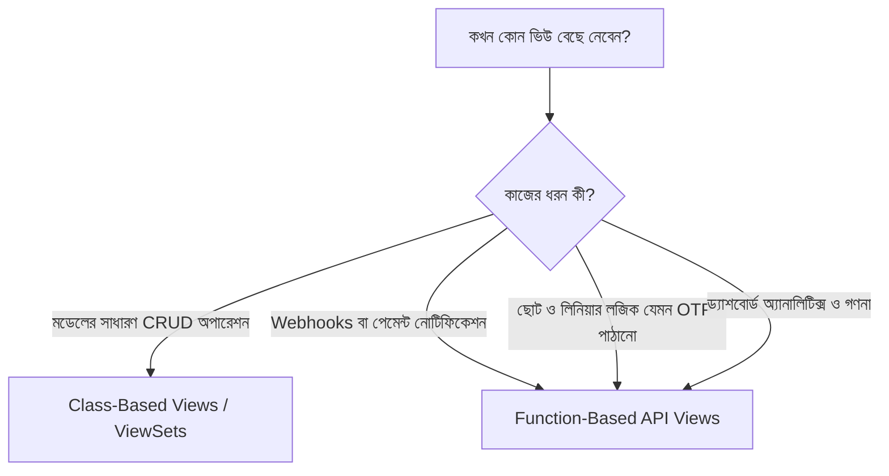

# Django REST Framework Function-Based API Views ⚙️🎯

Django REST Framework (DRF)-এ API তৈরির জন্য Class-Based Views (CBV) যেমন `APIView`, `Generic Views` বা `ModelViewSet` অত্যন্ত জনপ্রিয়, তেমনই সরলতা, দ্রুত কোডিং এবং সহজ লিনিয়ার ফ্লোর জন্য **Function-Based API Views (FBVs)** অতুলনীয়।

ওয়েবহুক (Webhooks) হ্যান্ডেল করা, ছোটখাটো সিঙ্গেল-অ্যাকশন API (যেমন: OTP পাঠানো, পাসওয়ার্ড যাচাই, ড্যাশবোর্ড পরিসংখ্যান তৈরি) বা থার্ড-পার্টি এপিআই ইন্টিগ্রেশনে কোনো ক্লাস তৈরি না করে সরাসরি ফাংশন দিয়ে কাজ করা বেশি স্বাভাবিক ও সহজ।

এই পূর্ণাঙ্গ গাইডে আমরা শিখব `@api_view` ডেকোরেটরের কাজ, পারমিশন ও অথেনটিকেশন ডেকোরেটর যুক্ত করার নিয়ম, FBV-তে সম্পূর্ণ CRUD তৈরি এবং পেজিনেশন হ্যান্ডলিং।

---

## ১. Function-Based Views (FBV) কেন এবং কখন ব্যবহার করবেন?



### FBV ব্যবহারের সুবিধা:
1. **সহজ ও স্পষ্ট ফ্লো (Readability):** কোনো ইনহেরিটেন্স বা লুকানো মেথড থাকে না। কোড উপর থেকে নিচে ধারাবাহিকভাবে পড়া যায়।
2. **ডেকোরেটরের স্বাধীনতা:** `@permission_classes`, `@authentication_classes`, `@throttle_classes` ইত্যাদি ডেকোরেটর দিয়ে খুব সহজেই ভিউ নিয়ন্ত্রণ করা যায়।
3. **ওয়েবহুকের জন্য পারফেক্ট:** স্ট্রাইপ বা এসএসএলকমার্জ যখন সার্ভারে ইভেন্ট পোস্ট করে, তখন কোনো মডেল অবজেক্ট ছাড়াই কাস্টম পে-লোড প্রসেস করতে FBV সেরা।

---

## ২. `@api_view` ডেকোরেটর (The Core of FBV)

সাধারণ Django ফাংশন ভিউতে `request` অবজেক্ট থাকে সাধারণ `HttpRequest`। কিন্তু ফাংশনের ওপর **`@api_view`** ডেকোরেটর বসালে DRF দুটি কাজ করে:
1. রিকোয়েস্ট অবজেক্টটিকে DRF-এর শক্তিশালী **`Request`** অবজেক্টে রূপান্তর করে (যাতে `request.data`, `request.query_params` পাওয়া যায়)।
2. সাধারণ `HttpResponse`-এর বদলে **`Response`** অবজেক্ট সাপোর্ট করে যা স্বয়ংক্রিয়ভাবে JSON ও Browsable API রেন্ডার করে।

```python
from rest_framework.decorators import api_view
from rest_framework.response import Response
from rest_framework import status

# শুধুমাত্র GET এবং POST গ্রহণ করবে:
@api_view(['GET', 'POST'])
def sample_api(request):
    if request.method == 'GET':
        return Response({"message": "GET রিকোয়েস্ট গৃহীত হয়েছে"})
    elif request.method == 'POST':
        name = request.data.get('name')
        return Response({"message": f"হ্যালো {name}!"}, status=status.HTTP_201_CREATED)
```

> ⚠️ **মনে রাখুন:** ক্লায়েন্ট যদি এমন কোনো মেথডে রিকোয়েস্ট পাঠায় যা `@api_view`-এর লিস্টে নেই (যেমন: `DELETE`), তবে DRF স্বয়ংক্রিয়ভাবে **`405 Method Not Allowed`** এরর রেসপন্স ফেরত দেবে।

---

## ৩. FBV-এর অন্যান্য গুরুত্বপূর্ণ ডেকোরেটরসমূহ 🛡️

ফাংশন-ভিত্তিক এপিআই ভিউতে পারমিশন, অথেনটিকেশন বা রেট-লিমিট (থ্রটলিং) সেট করতে DRF-এর বিশেষ ডেকোরেটর ব্যবহার করা হয়:

```python
from rest_framework.decorators import (
    api_view, 
    permission_classes, 
    authentication_classes, 
    throttle_classes
)
from rest_framework.permissions import IsAuthenticated
from rest_framework.authentication import SessionAuthentication, TokenAuthentication
from rest_framework.throttling import UserRateThrottle
from rest_framework.response import Response

@api_view(['GET'])
# ১. কোন কোন মাধ্যমে লগইন যাচাই হবে:
@authentication_classes([SessionAuthentication, TokenAuthentication])
# ২. শুধুমাত্র লগইন থাকা ইউজাররা অ্যাক্সেস পাবে:
@permission_classes([IsAuthenticated])
# ৩. রেট লিমিটিং (স্প্যামিং প্রতিরোধ):
@throttle_classes([UserRateThrottle])
def secure_dashboard_data(request):
    return Response({
        "user": request.user.username,
        "email": request.user.email,
        "secret_data": "শুধুমাত্র লগইন থাকা ব্যবহারকারীর জন্য!"
    })
```

---

## ৪. FBV দিয়ে সম্পূর্ণ CRUD API তৈরি করার প্যাটার্ন

একটি মডেলের ওপর ফাংশন দিয়ে কীভাবে পেশাদারভাবে CRUD অপারেশন হ্যান্ডেল করতে হয়:

### ১. তালিকা দেখা ও নতুন তৈরি (`GET` ও `POST`):
URL: `/api/tasks/`

```python
# accounts/views.py
from rest_framework.decorators import api_view, permission_classes
from rest_framework.permissions import IsAuthenticatedOrReadOnly
from rest_framework.response import Response
from rest_framework import status
from .models import Task
from .serializers import TaskSerializer

@api_view(['GET', 'POST'])
@permission_classes([IsAuthenticatedOrReadOnly])
def task_list_create_api(request):
    # ক. তালিকা দেখা (GET)
    if request.method == 'GET':
        tasks = Task.objects.all().order_by('-created_at')
        serializer = TaskSerializer(tasks, many=True)
        return Response(serializer.data, status=status.HTTP_200_OK)

    # খ. নতুন তৈরি করা (POST)
    elif request.method == 'POST':
        serializer = TaskSerializer(data=request.data)
        if serializer.is_valid():
            serializer.save(user=request.user)
            return Response(serializer.data, status=status.HTTP_201_CREATED)
        return Response(serializer.errors, status=status.HTTP_400_BAD_REQUEST)
```

---

### ২. একক অবজেক্ট দেখা, আপডেট ও ডিলিট (`GET`, `PUT`, `PATCH`, `DELETE`):
URL: `/api/tasks/<id>/`

```python
@api_view(['GET', 'PUT', 'PATCH', 'DELETE'])
@permission_classes([IsAuthenticatedOrReadOnly])
def task_detail_api(request, pk):
    try:
        task = Task.objects.get(pk=pk)
    except Task.DoesNotExist:
        return Response({"error": "টাস্ক খুঁজে পাওয়া যায়নি!"}, status=status.HTTP_404_NOT_FOUND)

    # ক. একক টাস্ক দেখা (GET)
    if request.method == 'GET':
        serializer = TaskSerializer(task)
        return Response(serializer.data)

    # খ. সম্পূর্ণ আপডেট (PUT)
    elif request.method == 'PUT':
        serializer = TaskSerializer(task, data=request.data)
        if serializer.is_valid():
            serializer.save()
            return Response(serializer.data)
        return Response(serializer.errors, status=status.HTTP_400_BAD_REQUEST)

    # গ. আংশিক আপডেট (PATCH)
    elif request.method == 'PATCH':
        serializer = TaskSerializer(task, data=request.data, partial=True)
        if serializer.is_valid():
            serializer.save()
            return Response(serializer.data)
        return Response(serializer.errors, status=status.HTTP_400_BAD_REQUEST)

    # ঘ. মুছে ফেলা (DELETE)
    elif request.method == 'DELETE':
        task.delete()
        return Response({"message": "টাস্ক সফলভাবে মুছে ফেলা হয়েছে।"}, status=status.HTTP_204_NO_CONTENT)
```

---

## ৫. FBV-তে Manual Pagination হ্যান্ডেল করা 📄

Class-Based View-তে `paginate_by = 10` লিখলেই হতো। কিন্তু FBV-তে পেজিনেশন করতে হলে DRF-এর পেজিনেটর ক্লাস সরাসরি ইনস্ট্যান্সিয়েট করতে হয়:

```python
from rest_framework.pagination import PageNumberPagination

@api_view(['GET'])
def paginated_task_list(request):
    tasks = Task.objects.all().order_by('-created_at')

    # ১. পেজিনেটর ইনস্ট্যান্স তৈরি করা
    paginator = PageNumberPagination()
    paginator.page_size = 5  # প্রতি পেজে ৫টি ডেটা

    # ২. পেজিনেট করা
    paginated_tasks = paginator.paginate_queryset(tasks, request)

    # ৩. সিরিয়ালাইজ করা
    serializer = TaskSerializer(paginated_tasks, many=True)

    # ৪. পেজিনেটেড রেসপন্স রিটার্ন (next, previous লিঙ্কসহ)
    return paginator.get_paginated_response(serializer.data)
```

---

## ৬. Function-Based Views (FBV) বনাম Class-Based Views (CBV)

| বৈশিষ্ট্য | Function-Based Views (FBV) | Class-Based Views (CBV) |
| :--- | :--- | :--- |
| **কোডের গঠন** | সাধারণ পাইথন ফাংশন ও `if/elif` শর্ত | ক্লাস ও অবজেক্ট ওরিয়েন্টেড মেথডস |
| **পঠনযোগ্যতা** | অত্যন্ত সহজ ও দৃশ্যমান | মেথড লুকানো থাকে (ইনহেরিটেন্স) |
| **পুনঃব্যবহারযোগ্যতা (DRY)** | কম (কোড বারবার লিখতে হতে পারে) | অনেক বেশি (Mixins ও Generic Views) |
| **ডেকোরেটরস** | সরাসরি ফাংশনের উপরে বসানো যায় | `method_decorator` ব্যবহার করতে হয় |
| **উপযুক্ত ক্ষেত্র** | Webhooks, Analytics, Simple Utilities | সাধারণ মডেল CRUD, E-commerce, Blog |

---

## 🎯 আজকের Key Takeaways

1. **`@api_view(['GET', 'POST'])`** ডেকোরেটর ফাংশন ভিউতে DRF-এর `Request` এবং `Response` অবজেক্ট সক্রিয় করে।
2. অননুমোদিত মেথডে রিকোয়েস্ট পাঠালে DRF স্বয়ংক্রিয়ভাবে **`405 Method Not Allowed`** রিটার্ন করে।
3. পারমিশন নিয়ন্ত্রণের জন্য **`@permission_classes`** এবং প্রমাণীকরণ যাচাইয়ের জন্য **`@authentication_classes`** ডেকোরেটর ব্যবহৃত হয়।
4. একক টাস্ক অপারেশনের ক্ষেত্রে অবজেক্ট খুঁজে না পেলে **`404 NOT FOUND`** এবং ডিলিট সফল হলে **`204 NO CONTENT`** রেসপন্স দেওয়া আদর্শ।
5. FBV-তে পেজিনেশন যুক্ত করতে `PageNumberPagination()` ক্লাসের `paginate_queryset()` এবং `get_paginated_response()` মেথড ব্যবহার করা হয়।

---

## ❓ অনুশীলনী প্রশ্ন

1. DRF-এ সাধারণ Django ফাংশন ভিউয়ের ওপর `@api_view` ডেকোরেটর ব্যবহারের প্রধান দুটি সুবিধা কী কী?
2. `@api_view(['GET'])` দেওয়া কোনো এন্ডপয়েন্টে ক্লায়েন্ট যদি POST রিকোয়েস্ট পাঠায়, তবে কী স্ট্যাটাস কোড আসবে?
3. Function-Based ভিউতে লগইন রিকোয়ার্ড পারমিশন যুক্ত করার ডেকোরেটরটির নাম কী এবং কীভাবে লিখতে হয়?
4. FBV-তে আংশিক (Partial) আপডেটের জন্য সিরিয়ালাইজারে কোন আর্গুমেন্ট পাস করতে হয়?
5. সাধারণ ডিলিট অপারেশনের পর ক্লায়েন্টকে কোন HTTP Status Code পাঠানো উচিত?
6. কেন Webhook হ্যান্ডলিংয়ের ক্ষেত্রে Class-Based ভিউয়ের চেয়ে Function-Based ভিউ বেশি পছন্দের?
7. FBV-তে কুয়েরিসেট পেজিনেট করে Next ও Previous লিঙ্কসহ ডেটা পাঠানোর নিয়ম কী?
8. `@authentication_classes` ডেকোরেটরের কাজ কী?
9. FBV এবং `ModelViewSet`-এর মধ্যে ডেভেলপমেন্ট গতির পার্থক্য কেমন?
10. একটি ফাংশনে একই সাথে GET এবং POST হ্যান্ডেল করার সময় রিকোয়েস্ট মেথড কীভাবে চেক করতে হয়?
