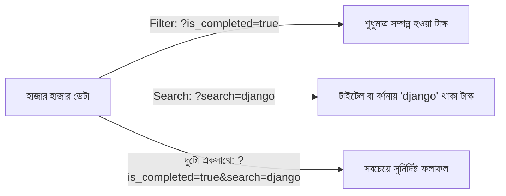

# Django REST Framework Filtering ও Search 🔍🎯

একটি রিয়েল-ওয়ার্ল্ড RESTful API-তে যখন হাজার হাজার বা লক্ষ লক্ষ রেকর্ড থাকে, তখন ক্লায়েন্ট বা ফ্রন্টএন্ডের (Next.js, React, Mobile Apps) জন্য প্রয়োজন অনুযায়ী সুনির্দিষ্ট ডেটা খুঁজে বের করার জন্য **Filtering** এবং **Search** অপরিহার্য।

Django REST Framework (DRF)-এ খুব শক্তিশালী এবং নমনীয় ফিল্টারিং সিস্টেম রয়েছে — যার মধ্যে সবচেয়ে জনপ্রিয় হলো DRF-এর বিল্ট-ইন **`SearchFilter`** এবং ইন্ডাস্ট্রি স্ট্যান্ডার্ড প্যাকেজ **`django-filter` (`DjangoFilterBackend`)**।

---

## ১. কেন Filtering এবং Search প্রয়োজন?



1. **সার্ভার ও নেটওয়ার্ক অপ্টিমাইজেশন:** অপ্রয়োজনীয় ডেটা পাঠানো বন্ধ করে নেটওয়ার্ক ব্যান্ডউইথ ও মেমরি সাশ্রয় করে।
2. **ডাটাবেজ ইনডেক্সিং সুবিধা:** সুনির্দিষ্ট ফিল্টারিং ডাটাবেজ ইনডেক্স ব্যবহার করে মিলিসেকেন্ডে কোয়েরি শেষ করতে পারে।
3. **উন্নত ইউজার এক্সপেরিয়েন্স:** ইউজাররা ক্যাটাগরি, স্ট্যাটাস, দাম বা কি-ওয়ার্ড দিয়ে নিমিষেই কাঙ্ক্ষিত পণ্য বা তথ্য খুঁজে পায়।

---

## ২. DRF-এ ফিল্টারিংয়ের ৩টি স্তর (The 3 Levels)

---

### স্তর ১: `get_queryset()` ওভাররাইড করে ম্যানুয়াল ফিল্টারিং

সবচেয়ে সহজ উপায় যেখানে কোনো থার্ড-পার্টি লাইব্রেরি লাগে না:

```python
from rest_framework import generics
from .models import Task
from .serializers import TaskSerializer

class TaskListView(generics.ListAPIView):
    serializer_class = TaskSerializer

    def get_queryset(self):
        queryset = Task.objects.all()
        
        # URL থেকে কুয়েরিপ্যারাম রিড করা:
        is_completed = self.request.query_params.get('is_completed')
        search = self.request.query_params.get('search')

        if is_completed is not None:
            queryset = queryset.filter(is_completed=(is_completed.lower() == 'true'))
        
        if search:
            queryset = queryset.filter(title__icontains=search)
            
        return queryset.order_by('-created_at')
```

---

### স্তর ২: DRF-এর বিল্ট-ইন `SearchFilter` (কি-ওয়ার্ড সার্চ)

DRF-এর নিজস্ব `SearchFilter` ক্লায়েন্টকে `?search=keyword` প্যারামিটার ব্যবহার করে একাধিক ফিল্ডে একসাথে সার্চ করার সুযোগ দেয়।

```python
from rest_framework import viewsets
from rest_framework.filters import SearchFilter
from .models import Task
from .serializers import TaskSerializer

class TaskViewSet(viewsets.ModelViewSet):
    queryset = Task.objects.all().order_by('-created_at')
    serializer_class = TaskSerializer

    # ১. ফিল্টার ব্যাকএন্ড যুক্ত করা:
    filter_backends = [SearchFilter]

    # ২. কোন কোন ফিল্ডে সার্চ চলবে তা নির্ধারণ করা:
    search_fields = ['title', 'description', 'user__username']
```

### ⚡ SearchFilter-এর বিশেষ প্রিফিক্স কৌশল (Search Prefixes):

`search_fields`-এ ফিল্ড নামের আগে বিশেষ চিহ্ন ব্যবহার করে সার্চের প্রকৃতি নিয়ন্ত্রণ করা যায়:

| প্রিফিক্স | ধরন | উদাহরণ | বিবরণ |
| :--- | :--- | :--- | :--- |
| **নেই (ডিফল্ট)** | `icontains` | `'title'` | অক্ষরের কেস ছাড়া যেকোনো স্থানে মিল পেলেই হবে |
| **`^`** | `istartswith` | `'^title'` | শুধুমাত্র শব্দের শুরুতে মিল থাকতে হবে |
| **`=`** | `exact` | `'=user__username'` | হুবহু একই হতে হবে (Strict Exact match) |
| **`$`** | `iregex` | `'$title'` | রেগুলার এক্সপ্রেশন (Regex) সার্চ |
| **`@`** | Full-text | `'@description'` | PostgreSQL-এর ফুল-টেক্সট সার্চ (শুধুমাত্র Postgres-এ কাজ করে) |

---

### স্তর ৩: `django-filter` / `DjangoFilterBackend` (ইন্ডাস্ট্রি স্ট্যান্ডার্ড 🏆)

সুনির্দিষ্ট ফিল্ড ধরে ধরে ফিল্টার করার (যেমন: `?is_completed=true&category=tech&user=2`) জন্য `django-filter` সবচেয়ে সেরা।

#### ধাপ ১: ইনস্টল করুন
```bash
pip install django-filter
```

#### ধাপ ২: `settings.py`-এ কনফিগার করুন
```python
# config/settings.py
INSTALLED_APPS = [
    # ...
    'django_filters',  # 👈 যুক্ত করুন
    'rest_framework',
]

REST_FRAMEWORK = {
    # গ্লোবালি ফিল্টার ব্যাকএন্ড রেজিস্টার করা:
    'DEFAULT_FILTER_BACKENDS': (
        'django_filters.rest_framework.DjangoFilterBackend',
        'rest_framework.filters.SearchFilter',
    ),
}
```

#### ধাপ ৩: ViewSet বা Generic View-এ ফিল্ড নির্ধারণ
```python
from rest_framework import viewsets
from django_filters.rest_framework import DjangoFilterBackend
from rest_framework.filters import SearchFilter

class TaskViewSet(viewsets.ModelViewSet):
    queryset = Task.objects.all()
    serializer_class = TaskSerializer

    # উভয় ফিল্টার একসাথে সাপোর্ট করা:
    filter_backends = [DjangoFilterBackend, SearchFilter]
    
    # 🎯 কোন ফিল্ডগুলোতে সরাসরি ড্রপডাউন/ইক্যুয়াল ফিল্টার হবে:
    filterset_fields = ['is_completed', 'user']
    
    # 🔍 কোন ফিল্ডগুলোতে কি-ওয়ার্ড সার্চ হবে:
    search_fields = ['title', 'description']
```

---

## ৩. অ্যাডভান্সড: কাস্টম `FilterSet` ক্লাস (রেঞ্জ ও ডেট ফিল্টারিং) 🚀

যদি আপনার সাধারণ `=`-এর বাইরে রেঞ্জ ফিল্টারিং দরকার হয় (যেমন: সর্বনিম্ন দাম, সর্বোচ্চ দাম, তারিখ রেঞ্জ):

```python
# accounts/filters.py
import django_filters
from .models import Task

class TaskFilter(django_filters.FilterSet):
    # টাইটেল আংশিক মিল
    title = django_filters.CharFilter(lookup_expr='icontains')
    
    # তৈরি হওয়ার তারিখের রেঞ্জ:
    created_after = django_filters.DateFilter(field_name='created_at', lookup_expr='gte')
    created_before = django_filters.DateFilter(field_name='created_at', lookup_expr='lte')

    class Meta:
        model = Task
        fields = ['is_completed', 'title', 'created_after', 'created_before']
```

### View-এ ব্যবহার:
```python
class TaskViewSet(viewsets.ModelViewSet):
    # filterset_fields-এর বদলে filterset_class দিতে হয়:
    filterset_class = TaskFilter
```

এখন ক্লায়েন্ট কল করতে পারবে:
`GET /api/v1/tasks/?created_after=2026-09-01&is_completed=true`

---

## ৪. ব্রাউজার ও Postman-এ টেস্ট করার বাস্তব উদাহরণ

### ১. স্ট্যাটাস অনুযায়ী ফিল্টারিং (Filtering):
* **সম্পন্ন হওয়া টাস্ক:**
  `GET http://127.0.0.1:8000/api/v1/tasks/?is_completed=true`
* **বাকি থাকা টাস্ক:**
  `GET http://127.0.0.1:8000/api/v1/tasks/?is_completed=false`

---

### ২. কি-ওয়ার্ড দিয়ে অনুসন্ধান (Search):
* **টাইটেল বা বর্ণনায় 'Django' শব্দ খোঁজা:**
  `GET http://127.0.0.1:8000/api/v1/tasks/?search=Django`

---

### ৩. ফিল্টারিং এবং সার্চ দুটো একসাথে:
* **সম্পন্ন হওয়া টাস্কগুলোর মধ্য থেকে 'Python' খোঁজা:**
  `GET http://127.0.0.1:8000/api/v1/tasks/?is_completed=true&search=Python`

---

## ৫. পারফরম্যান্স অপ্টিমাইজেশন ও বেস্ট প্র্যাকটিস 💡

1. **Database Indexes (`db_index=True`):** যেসব ফিল্ডে প্রতিনিয়ত ফিল্টার বা সার্চ করা হয় (যেমন: `is_completed`, `status`, `created_at`), সেই মডেল ফিল্ডগুলোতে `db_index=True` রাখুন। এতে ডেটাবেজ সার্চ বহুগুণ দ্রুত হয়।
2. **অপ্রয়োজনীয় ফিল্ডে সার্চ বন্ধ রাখুন:** বড় টেক্সট ফিল্ডে অযথা ওয়াইল্ডকার্ড সার্চ চালালে সার্ভার স্লো হয়; শুধুমাত্র প্রাসঙ্গিক ফিল্ডগুলো `search_fields`-এ রাখুন।

---

## 🎯 আজকের Key Takeaways

1. **Filtering** সুনির্দিষ্ট মানের ওপর ভিত্তি করে রেকর্ড ফিল্টার করে (যেমন: `?is_completed=true`)।
2. **SearchFilter** কি-ওয়ার্ড দিয়ে একাধিক ফিল্ডে একসাথে অনুসন্ধান চালায় (যেমন: `?search=django`)।
3. **`django-filter`** হলো DRF-এর সবচেয়ে জনপ্রিয় ফিল্টারিং লাইব্রেরি।
4. `filter_backends = [DjangoFilterBackend, SearchFilter]` সেট করলে একই সাথে ফিল্টারিং ও সার্চ দুটোই কাজ করে।
5. সার্চ প্রিফিক্স (`^`, `=`, `$`, `@`) দিয়ে সার্চের আচরণ সুনির্দিষ্টভাবে নিয়ন্ত্রণ করা যায়।
6. জটিল রেঞ্জ (যেমন: তারিখ বা দামের সীমা) ফিল্টারিংয়ের জন্য কাস্টম `FilterSet` ক্লাস ব্যবহার করা হয়।

---

## ❓ অনুশীলনী প্রশ্ন

1. RESTful API-তে সব ডেটা একসাথে না পাঠিয়ে Filtering এবং Search ব্যবহারের প্রধান দুটি সুবিধা কী কী?
2. DRF-এর `SearchFilter`-এ ডিফল্ট কুয়েরি প্যারামিটারের নাম কী থাকে? এটি কি পরিবর্তন করা যায়?
3. `search_fields = ['^title']` এবং `search_fields = ['=title']`-এর মধ্যে পার্থক্য কী?
4. `django-filter` লাইব্রেরির `DjangoFilterBackend` ব্যবহারের জন্য `settings.py`-এ কোন দুটি কনফিগারেশন করতে হয়?
5. `filterset_fields` এবং `search_fields` অ্যাট্রিবিউট দুটির কাজের মধ্যে পার্থক্য কী?
6. ব্যবহারকারী যাতে দামের রেঞ্জ (যেমন: `min_price` এবং `max_price`) দিয়ে ফিল্টার করতে পারে, তার জন্য কোন ক্লাস ব্যবহার করবেন?
7. ForeignKey ফিল্ডের (যেমন: `user__username`) ওপর ভিত্তি করে সার্চ ফিল্ড সংজ্ঞায়িত করার সঠিক নিয়ম কী?
8. ফিল্টারিং দ্রুত করার জন্য Django মডেলের ফিল্ডে কোন অপশনটি যুক্ত করা উচিত?
9. একটি এপিআই এন্ডপয়েন্টে ফিল্টারিং এবং সার্চ দুটোই একসাথে কাজ করাতে `filter_backends`-এ কী কী লিখতে হয়?
10. `get_queryset()` মেথড ওভাররাইড করে ম্যানুয়াল ফিল্টারিং করার ক্ষেত্রে `request.GET`-এর বদলে কোন অ্যাট্রিবিউট ব্যবহার করা উচিত?
