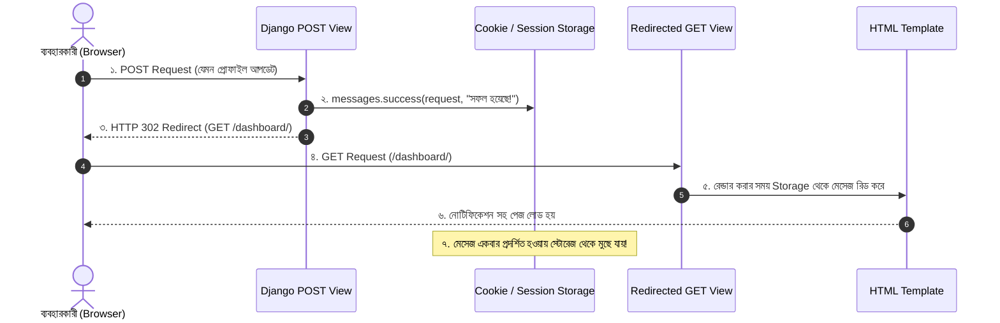

# Lesson 50: Django Messages Framework 💬✨

ওয়েব অ্যাপ্লিকেশনে ব্যবহারকারী যখন কোনো অ্যাকশন সম্পন্ন করেন (যেমন ফর্ম সাবমিট করা, প্রোফাইল আপডেট করা, ডেটা ডিলিট করা বা ভুল পাসওয়ার্ড দেওয়া), তখন তাকে সাময়িক একটি নোটিফিকেশন বা প্রতিক্রিয়া জানানো অত্যন্ত জরুরি।

Django-র **Messages Framework** (`django.contrib.messages`) এই কাজটি অত্যন্ত সহজে এবং পেশাদারভাবে হ্যান্ডেল করে। এটি মূলত **"Flash Messages"** মেকানিজমে কাজ করে—অর্থাৎ বার্তাটি একবার প্রদর্শিত হওয়ার পর স্বয়ংক্রিয়ভাবে স্টোরেজ থেকে মুছে যায়।

---

## ১. Messages Framework কীভাবে কাজ করে? (PRG Pattern)

সাধারণত ওয়েব ডেভেলপমেন্টে **Post/Redirect/Get (PRG)** আর্কিটেকচার অনুসরণ করা হয়:



> 💡 **কেন এই প্যাটার্ন জরুরি?**
> ব্যবহারকারী যদি কোনো ফর্ম সাবমিট করার পর পেজ রিলোড (`F5`) দেন, তাহলে রিডাইরেক্ট না করলে আবার ডুপ্লিকেট সাবমিট হতে পারে। Messages Framework সেশন বা কুকির মাধ্যমে রিডাইরেক্টের পরও মেসেজটি ধরে রাখে এবং পরবর্তী পেজ লোড হলে একবার দেখিয়ে মুছে ফেলে।

---

## ২. সেটিংস কনফিগারেশন (`settings.py`)

Django প্রোজেক্ট তৈরি করার সময় Messages Framework ডিফল্টভাবেই চালু থাকে। তবু যাচাই করে নিন `config/settings.py`-তে নিচের বিষয়গুলো উপস্থিত আছে কি না:

### ক. `INSTALLED_APPS` ও `MIDDLEWARE`
```python
INSTALLED_APPS = [
    # ...
    'django.contrib.messages',
]

MIDDLEWARE = [
    # ...
    'django.contrib.sessions.middleware.SessionMiddleware', # মেসেজ কুকি বা সেশনের উপর নির্ভরশীল
    'django.contrib.messages.middleware.MessageMiddleware',
]
```

### খ. `TEMPLATES` Context Processors
```python
TEMPLATES = [
    {
        'BACKEND': 'django.template.backends.django.DjangoTemplates',
        'DIRS': [BASE_DIR / 'templates'],
        'APP_DIRS': True,
        'OPTIONS': {
            'context_processors': [
                'django.template.context_processors.request',
                'django.contrib.auth.context_processors.auth',
                'django.contrib.messages.context_processors.messages', # টেমপ্লেটে {{ messages }} অ্যাক্সেস দেয়
            ],
        },
    },
]
```

### গ. গুরুত্বপূর্ণ টিপস: Bootstrap 5 এর সাথে Message Tags ম্যাপিং
Django-র ডিফল্ট মেসেজ লেভেল `ERROR`-এর ট্যাগ হলো `'error'`। কিন্তু Bootstrap-এ কোনো `alert-error` ক্লাস নেই, Bootstrap ব্যবহার করে `alert-danger`!

তাই `settings.py`-এর নিচে এই কোডটি যোগ করে নিন:

```python
from django.contrib.messages import constants as messages

MESSAGE_TAGS = {
    messages.DEBUG: 'secondary',
    messages.INFO: 'info',
    messages.SUCCESS: 'success',
    messages.WARNING: 'warning',
    messages.ERROR: 'danger', # 'error' এর বদলে Bootstrap এর 'danger'
}
```

---

## ৩. Message Levels ও শর্টকাট মেথড

Django-তে ৫টি প্রি-ডিফাইনড মেসেজ লেভেল রয়েছে:

| লেভেল | নিউমেরিক ভ্যালু | শর্টকাট মেথড | সাধারণ ব্যবহার |
| :--- | :---: | :--- | :--- |
| **`DEBUG`** | 10 | `messages.debug(request, msg)` | ডেভেলপমেন্টে ডিবাগিং তথ্যের জন্য |
| **`INFO`** | 20 | `messages.info(request, msg)` | সাধারণ তথ্য বা নোটিশ জানাতে |
| **`SUCCESS`** | 25 | `messages.success(request, msg)` | কোনো কাজ সফলভাবে সম্পন্ন হলে |
| **`WARNING`** | 30 | `messages.warning(request, msg)` | সতর্কতা (যেমন সাবস্ক্রিপশন মেয়াদ শেষ হচ্ছে) |
| **`ERROR`** | 40 | `messages.error(request, msg)` | অ্যাকশন ব্যর্থ হলে বা ইনভ্যালিড ডেটা থাকলে |

---

## ৪. Views-এ Messages তৈরি করা

### ক. Function Based Views (FBV)-এ ব্যবহার

```python
# accounts/views.py
from django.shortcuts import render, redirect
from django.contrib import messages
from django.contrib.auth.decorators import login_required

def update_profile(request):
    if request.method == 'POST':
        # প্রোফাইল আপডেট লজিক...
        messages.success(request, "আপনার প্রোফাইল সফলভাবে আপডেট করা হয়েছে!")
        return redirect('dashboard')
    
    return render(request, 'accounts/profile.html')

def delete_account(request):
    if request.method == 'POST':
        # একাউন্ট ডিলিট লজিক...
        messages.warning(request, "সতর্কতা: আপনার একাউন্টটি পার্মানেন্টলি ডিলিট হতে যাচ্ছে!")
        return redirect('home')
    
    messages.info(request, "একাউন্ট ডিলিট করার পূর্বে ব্যাকআপ ফাইল ডাউনলোড করে নিন।")
    return render(request, 'accounts/delete_confirm.html')
```

### খ. Class-Based Views (CBV)-এ ব্যবহার (`SuccessMessageMixin`)

```python
from django.urls import reverse_lazy
from django.contrib.messages.views import SuccessMessageMixin
from django.views.generic.edit import CreateView
from .models import Profile

class ProfileCreateView(SuccessMessageMixin, CreateView):
    model = Profile
    fields = ['bio', 'avatar', 'phone']
    template_name = 'accounts/profile_form.html'
    success_url = reverse_lazy('dashboard')
    success_message = "স্বাগতম %(user)s! আপনার প্রোফাইল তৈরি সম্পন্ন হয়েছে।"

    def get_success_message(self, cleaned_data):
        return self.success_message % dict(
            cleaned_data,
            user=self.request.user.username,
        )
```

### গ. এক্সট্রা ট্যাগ (Extra Tags) যুক্ত করা
```python
messages.success(request, "পেমেন্ট সফল হয়েছে!", extra_tags="payment-gateway urgent")
```
টেমপ্লেটে এটি `message.extra_tags` হিসেবে পাওয়া যাবে।

---

## ৫. HTML Templates-এ Messages রেন্ডার করা

সবচেয়ে ভালো উপায় হলো আপনার `templates/base.html` ফাইলে মেসেজ ব্লকটি রাখা, যেন প্রতিটি পেজেই নোটিফিকেশন স্বয়ংক্রিয়ভাবে প্রদর্শিত হয়।

### ক. Bootstrap 5 Dismissible Alert কোড:

```html
<!-- templates/includes/messages.html বা base.html এর মধ্যে -->

    <div class="container my-3">
        
            <div class="alert alert-{{ message.tags|default:'info' }} alert-dismissible fade show shadow-sm d-flex align-items-center" role="alert">
                <!-- আইকন সিলেকশন -->
                
                    <i class="bi bi-check-circle-fill me-2 fs-5"></i>
                
                    <i class="bi bi-exclamation-triangle-fill me-2 fs-5"></i>
                
                    <i class="bi bi-exclamation-circle-fill me-2 fs-5"></i>
                
                    <i class="bi bi-info-circle-fill me-2 fs-5"></i>
                

                <!-- মেসেজ টেক্সট -->
                <div class="flex-grow-1">
                    {{ message }}
                </div>

                <!-- ক্লোজ বাটন -->
                <button type="button" class="btn-close" data-bs-dismiss="alert" aria-label="Close"></button>
            </div>
        
    </div>

```

### খ. Toastr / SweetAlert2 বা কাস্টম জাভাস্ক্রিপ্ট অটো-ক্লোজ (Auto Dismiss)

```html
<script>
    // ৫ সেকেন্ড পর এলার্ট স্বয়ংক্রিয়ভাবে মিলিয়ে যাবে
    document.addEventListener("DOMContentLoaded", function () {
        setTimeout(function () {
            let alerts = document.querySelectorAll('.alert');
            alerts.forEach(function (alert) {
                let bsAlert = new bootstrap.Alert(alert);
                bsAlert.close();
            });
        }, 5000);
    });
</script>
```

---

## ৬. Message Storage Backends

Django মেসেজ সংরক্ষণের জন্য বেশ কয়েকটি ব্যাকএন্ড সরবরাহ করে:

1. **`FallbackStorage` (Default):**
   - প্রথমে কুকি (`CookieStorage`) ব্যবহার করে মেসেজ সংরক্ষণের চেষ্টা করে।
   - কুকির সাইজ লিমিট (সাধারণত ৪ কিলোবাইট) অতিক্রম করলে বা কুকি ডিসেবল থাকলে স্বয়ংক্রিয়ভাবে সেশনে (`SessionStorage`) সংরক্ষণ করে। এটিই সবচেয়ে দ্রুত এবং নিরাপদ।
2. **`CookieStorage`:**
   - ক্লায়েন্ট সাইড কুকিতে মেসেজ সংরক্ষণ করে (হ্যাশ সিকিউরিটি সহ)। সেশন টেবিলের উপর ডেটাবেজ প্রেশার কমে।
3. **`SessionStorage`:**
   - সার্ভার সাইড সেশনে ডেটা রাখে। ডেটাবেজে সেশন সেভ হলে অতিরিক্ত কোয়েরি হতে পারে।

আপনি চাইলে `settings.py`-তে ব্যাকএন্ড নির্দিষ্ট করে দিতে পারেন:
```python
MESSAGE_STORAGE = 'django.contrib.messages.storage.fallback.FallbackStorage'
```

---

## সারসংক্ষেপ (Quick Cheat Sheet)

1. **ইমপোর্ট:** `from django.contrib import messages`
2. **মেথড:** `messages.success(request, "বার্তা")`, `messages.error(request, "বার্তা")`
3. **টেমপ্লেট:** ` ...  {{ msg }} ... `
4. **Bootstrap Compatibility:** `settings.py`-তে `MESSAGE_TAGS` এ `messages.ERROR: 'danger'` সেট করা আবশ্যক।
