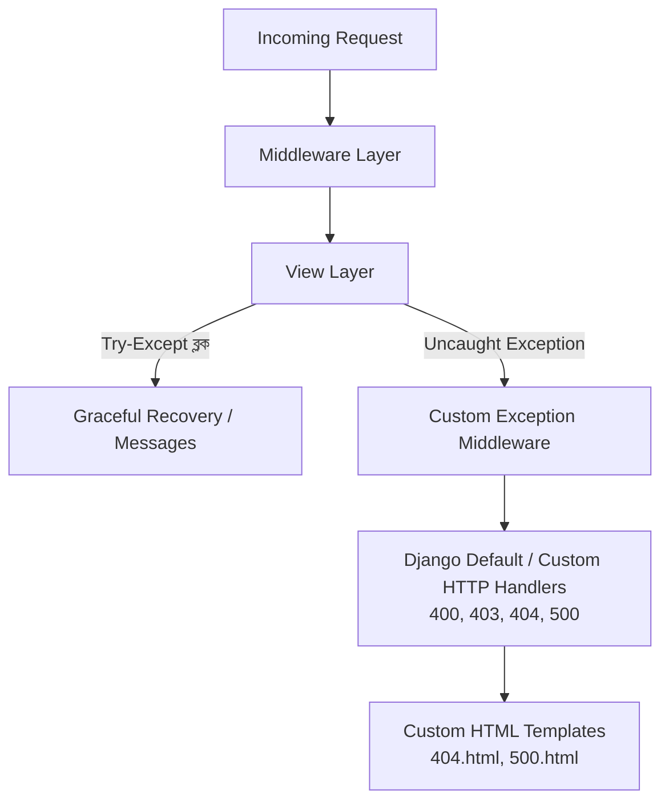

# Lesson 51: Django Logging ও Error Handling 📜🚨

প্রোডাকশন গ্রেড ওয়েব অ্যাপ্লিকেশনে বাগ ধরা, সিকিউরিটি ইনসিডেন্ট বিশ্লেষণ করা, পারফরম্যান্স ট্র্যাক করা এবং যেকোনো অনাকাঙ্ক্ষিত ক্র্যাশ সফলভাবে ম্যানেজ করার জন্য **Logging** এবং **Error Handling** অপরিহার্য।

লোকাল মেশিনে কোড লেখার সময় আমরা প্রায়ই `print()` স্টেটমেন্ট ব্যবহার করি। কিন্তু লাইভ প্রোডাকশনে `print()` ব্যবহার করা **চরম বিপজ্জনক ও অকার্যকর**, কারণ:
- `print()` কোনো ফাইল বা টাইমস্ট্যাম্প রাখে না।
- সার্ভার রিস্টার্ট হলে সমস্ত তথ্য চিরতরে হারিয়ে যায়।
- কোন ফাংশন বা লাইনে সমস্যা হয়েছে তা বোঝা যায় না।
- লাইভ সার্ভারের কনসোল মেমরি ও রিসোর্স অপচয় করে।

---

## ১. Logging আর্কিটেকচার (৪টি স্তম্ভ)

Python ও Django-র লগিং ব্যবস্থা মূলত ৪টি প্রধান উপাদানের সমন্বয়ে কাজ করে:

```mermaid
flowchart LR
    A[View / Logic\nlogger.error] --> B[Logger\nনাম ও লগ লেভেল চেক]
    B --> C{Filter\nশর্ত পূরণ করে?}
    C -->>|হ্যাঁ| D[Formatter\nটাইমস্ট্যাম্প ও ফরম্যাট যুক্ত করে]
    C -->>|না| Drop[বাতিল]
    D --> E[Handler\nConsole / File / Email]
```

1. **Loggers (লগার):** লগিং সিস্টেমের প্রধান প্রবেশদ্বার। এটি কোডের ভেতর থেকে মেসেজ গ্রহণ করে এবং মেসেজের লেভেল চেক করে হ্যান্ডলারের কাছে পাঠায়। (যেমন: `logging.getLogger(__name__)`)
2. **Handlers (হ্যান্ডলার):** লগের মেসেজটি কোথায় জমা হবে তা নির্ধারণ করে (যেমন: টার্মিনালে দেখানো, `.log` ফাইলে সেভ করা বা ইমেইলে পাঠানো)।
3. **Filters (ফিল্টার):** সূক্ষ্ম শর্তারোপ করে। যেমন: কেবল `DEBUG=True` থাকলে কনসোলে দেখাও, অন্যথায় দেখাবে না।
4. **Formatters (ফরম্যাটার):** লগের টেক্সট আউটপুট কেমন দেখাবে তার রূপরেখা তৈরি করে (যেমন: তারিখ, সময়, লেভেল, ফাইলের নাম ও লাইন নম্বর)।

---

## ২. Log Levels (লগ লেভেলসমূহ)

লগ মেসেজের গুরুত্ব অনুসারে ৫টি লেভেল রয়েছে:

| লেভেল | নিউমেরিক | উদ্দেশ্য | উদাহরণ |
| :--- | :---: | :--- | :--- |
| **`DEBUG`** | 10 | ডেভেলপমেন্টের বিস্তারিত তথ্য | ডেটাবেজ কোয়েরি প্যারামিটার, ফাংশন স্টেট |
| **`INFO`** | 20 | স্বাভাবিক সিস্টেম ইভেন্ট | নতুন ইউজার রেজিস্ট্রেশন, পেমেন্ট সফল |
| **`WARNING`** | 30 | অনাকাঙ্ক্ষিত কিছু যা এখনো ক্র্যাশ করেনি | ভুল পাসওয়ার্ডে লগইন চেষ্টা, ডিস্ক স্পেস ৮০% পূর্ণ |
| **`ERROR`** | 40 | কোনো নির্দিষ্ট কাজ ব্যর্থ হয়েছে | পেমেন্ট গেটওয়ে টাইমআউট, ডেটা সেভ হতে ব্যর্থ |
| **`CRITICAL`** | 50 | পুরো সিস্টেম বা সার্ভার বন্ধ হওয়ার উপক্রম | ডেটাবেজ ডাউন, ফাইল সিস্টেম ক্র্যাশ |

---

## ৩. `settings.py`-তে প্রফেশনাল Logging কনফিগারেশন

আপনার প্রোজেক্ট রুটে একটি `logs` ফোল্ডার তৈরি করুন এবং `config/settings.py` ফাইলে নিচের ডিকশনারিটি যোগ করুন:

```python
import os
from pathlib import Path

# logs ডিরেক্টরি নিশ্চিত করা
LOG_DIR = BASE_DIR / 'logs'
LOG_DIR.mkdir(parents=True, exist_ok=True)

LOGGING = {
    'version': 1,
    'disable_existing_loggers': False,
    
    # ১. Formatters (লগের টেক্সট ফরম্যাট)
    'formatters': {
        'verbose': {
            'format': '[{asctime}] [{levelname}] [{name}:{lineno}] - {message}',
            'style': '{',
            'datefmt': '%Y-%m-%d %H:%M:%S',
        },
        'simple': {
            'format': '[{levelname}] {message}',
            'style': '{',
        },
    },

    # ২. Filters (শর্ত)
    'filters': {
        'require_debug_true': {
            '()': 'django.utils.log.RequireDebugTrue',
        },
        'require_debug_false': {
            '()': 'django.utils.log.RequireDebugFalse',
        },
    },

    # ৩. Handlers (কোথায় লগ জমা হবে)
    'handlers': {
        # টার্মিনালে দেখার জন্য
        'console': {
            'level': 'DEBUG',
            'filters': ['require_debug_true'],
            'class': 'logging.StreamHandler',
            'formatter': 'simple',
        },
        # সমস্ত সাধারণ ও ইনফো লগ ফাইলের জন্য (Rotating: সাইজ ৫MB হলে নতুন ফাইল করবে)
        'file_general': {
            'level': 'INFO',
            'class': 'logging.handlers.RotatingFileHandler',
            'filename': LOG_DIR / 'general.log',
            'maxBytes': 1024 * 1024 * 5,  # 5 MB
            'backupCount': 5,             # সর্বোচ্চ ৫টি ব্যাকআপ ফাইল
            'formatter': 'verbose',
            'encoding': 'utf-8',
        },
        # শুধুমাত্র এরর ও ক্রিটিকাল লগ ফাইলের জন্য
        'file_error': {
            'level': 'ERROR',
            'class': 'logging.handlers.RotatingFileHandler',
            'filename': LOG_DIR / 'errors.log',
            'maxBytes': 1024 * 1024 * 5,  # 5 MB
            'backupCount': 5,
            'formatter': 'verbose',
            'encoding': 'utf-8',
        },
    },

    # ৪. Loggers (অ্যাপ্লিকেশন লগার)
    'loggers': {
        'django': {
            'handlers': ['console', 'file_general'],
            'level': 'INFO',
            'propagate': True,
        },
        'django.request': {
            'handlers': ['file_error', 'console'],
            'level': 'ERROR',
            'propagate': False,
        },
        # আমাদের কাস্টম অ্যাপ বা মডিউল
        'accounts': {
            'handlers': ['console', 'file_general', 'file_error'],
            'level': 'DEBUG',
            'propagate': False,
        },
    },
}
```

---

## ৪. ভিউ এবং কোডে Logging ব্যবহারের নিয়ম

লগ করার জন্য পাইথনের বিল্ট-ইন `logging` মডিউল ব্যবহার করতে হয়:

```python
# accounts/views.py
import logging
from django.shortcuts import render, redirect
from django.contrib import messages
from django.core.exceptions import ObjectDoesNotExist
from .models import Profile

# এই ফাইলের জন্য ডেডিকেটেড লগার ইন্সট্যান্স
logger = logging.getLogger(__name__)

def profile_view(request, user_id):
    logger.debug(f"User ID: {user_id} এর প্রোফাইল খোঁজা হচ্ছে।")
    
    try:
        profile = Profile.objects.get(user__id=user_id)
        logger.info(f"প্রোফাইল লোড সফল: {profile.user.username}")
        return render(request, 'accounts/profile.html', {'profile': profile})

    except ObjectDoesNotExist:
        logger.warning(f"অপ্রত্যাশিত রিকোয়েস্ট: User ID {user_id} এর কোনো প্রোফাইল নেই!")
        messages.error(request, "প্রোফাইলটি খুঁজে পাওয়া যায়নি।")
        return redirect('dashboard')

    except Exception as e:
        # exc_info=True দিলে এররের সম্পূর্ণ Stacktrace লগ ফাইলে লিপিবদ্ধ হবে!
        logger.error(f"প্রোফাইল লোড করার সময় গুরুতর ত্রুটি ঘটেছে: {str(e)}", exc_info=True)
        messages.error(request, "একটি ইন্টারনাল সার্ভার সমস্যা দেখা দিয়েছে।")
        return redirect('dashboard')
```

> 🎯 **পেশাদার পরামর্শ:** `logger.error(..., exc_info=True)` দিলে লগে কোন ফাইলে, কোন লাইনে এরর হয়েছে তার পুরো ট্রেসব্যাক সংরক্ষিত হয়। এটি পরবর্তীতে বাগ খুঁজে বের করতে ম্যাজিকের মতো সাহায্য করে।

---

## ৫. Django-তে Comprehensive Error Handling

একটি পরিপক্ব অ্যাপ্লিকেশনে এরর হ্যান্ডলিং বিভিন্ন স্তরে করা হয়:



---

### ক. কাস্টম HTTP Error Pages (404, 500, 403, 400)

প্রোডাকশনে (`DEBUG = False`) থাকলে Django ডিফল্ট টেকনিক্যাল স্ক্রিন না দেখিয়ে কাস্টম সুন্দর পেইজ প্রদর্শন করে।

#### ১. `config/urls.py`-তে হ্যান্ডলার রেজিস্টার করুন:
```python
# config/urls.py
from django.contrib import admin
from django.urls import path, include

urlpatterns = [
    path('admin/', admin.site.urls),
    path('', include('accounts.urls')),
]

# কাস্টম এরর হ্যান্ডলার ডিক্লেয়ারেশন
handler404 = 'accounts.views.custom_page_not_found_view'
handler500 = 'accounts.views.custom_server_error_view'
handler403 = 'accounts.views.custom_permission_denied_view'
handler400 = 'accounts.views.custom_bad_request_view'
```

#### ২. `accounts/views.py`-তে ভিউ তৈরি করুন:
```python
from django.shortcuts import render

def custom_page_not_found_view(request, exception=None):
    return render(request, '404.html', status=404)

def custom_server_error_view(request):
    return render(request, '500.html', status=500)

def custom_permission_denied_view(request, exception=None):
    return render(request, '403.html', status=403)

def custom_bad_request_view(request, exception=None):
    return render(request, '400.html', status=400)
```

#### ৩. `templates/404.html` ও `templates/500.html` তৈরি করুন:
```html
<!-- templates/404.html -->

404 - পেজ পাওয়া যায়নি


<div class="row justify-content-center text-center py-5">
    <div class="col-md-6">
        <h1 class="display-1 text-danger fw-bold">404</h1>
        <h3 class="mb-3">দুঃখিত! কাঙ্ক্ষিত পেজটি পাওয়া যায়নি</h3>
        <p class="text-muted">আপনি যে ইউআরএলটি খুঁজছেন তা মুছে ফেলা হয়েছে অথবা পরিবর্তন করা হয়েছে।</p>
        <a href="" class="btn btn-primary px-4 mt-2">
            <i class="bi bi-house-door me-1"></i> হোমপেজে ফিরে যান
        </a>
    </div>
</div>

```

---

### খ. কাস্টম Exception Middleware (Global Error Catcher)

কোনো ভিউতে যদি কোনো `try...except` ছাড়া অপ্রত্যাশিত এক্সেপশন ওঠে, তবে তা মিডলওয়্যারে ক্যাচ করে তাৎক্ষণিক লগ বা অ্যাডমিনের কাছে পাঠানো যায়:

```python
# accounts/middleware.py
import logging

logger = logging.getLogger(__name__)

class GlobalExceptionMiddleware:
    def __init__(self, get_response):
        self.get_response = get_response

    def __call__(self, request):
        return self.get_response(request)

    def process_exception(self, request, exception):
        # কোনো ভিউতে আনহ্যান্ডেলড এরর উঠলে এটি স্বয়ংক্রিয়ভাবে রান করবে
        user_info = request.user.username if request.user.is_authenticated else "Anonymous"
        logger.error(
            f"Uncaught Exception: {exception.__class__.__name__} - {str(exception)} "
            f"| Path: {request.path} | User: {user_info}",
            exc_info=True
        )
        return None # None দিলে Django তার স্বাভাবিক 500 হ্যান্ডলারে পাঠিয়ে দেবে
```

`config/settings.py`-এর `MIDDLEWARE` তালিকায় এটি যোগ করে দিন:
```python
MIDDLEWARE = [
    # ...
    'accounts.middleware.GlobalExceptionMiddleware',
]
```

---

### গ. Django REST Framework (DRF) Custom Exception Handler

আপনি যদি REST API তৈরি করেন, তবে এইচটিএমএল এরর পেজের বদলে স্ট্যান্ডার্ড JSON রেসপন্স রিটার্ন করতে হয়:

```python
# accounts/exceptions.py
from rest_framework.views import exception_handler
from rest_framework.response import Response
from rest_framework import status
import logging

logger = logging.getLogger(__name__)

def custom_drf_exception_handler(exc, context):
    # DRF ডিফল্ট হ্যান্ডলার কল করা
    response = exception_handler(exc, context)

    # ভিউ বা রিকোয়েস্টের তথ্য
    view = context.get('view', None)
    view_name = view.__class__.__name__ if view else "UnknownView"

    if response is not None:
        # ক্লায়েন্ট এরর (400, 401, 403, 404 ইত্যাদি)
        custom_data = {
            'success': False,
            'status_code': response.status_code,
            'message': 'রিকোয়েস্টে ভুল রয়েছে',
            'errors': response.data
        }
        response.data = custom_data
    else:
        # সার্ভার এরর (500) যা DRF ডিফল্টভাবে হ্যান্ডেল করতে পারে না
        logger.critical(f"Unhandled API Error in {view_name}: {str(exc)}", exc_info=True)
        response = Response({
            'success': False,
            'status_code': status.HTTP_500_INTERNAL_SERVER_ERROR,
            'message': 'সার্ভারে গুরুতর সমস্যা হয়েছে। টেকনিক্যাল টিমকে জানানো হয়েছে।'
        }, status=status.HTTP_500_INTERNAL_SERVER_ERROR)

    return response
```

`settings.py`-তে কনফিগার করুন:
```python
REST_FRAMEWORK = {
    # ...
    'EXCEPTION_HANDLER': 'accounts.exceptions.custom_drf_exception_handler',
}
```

---

### ঘ. প্রোডাকশন এরর মনিটরিং: Sentry

লাইভ প্রোডাকশন সাইটে শত শত ইউজারের ক্র্যাশ ট্র্যাক করার জন্য ইন্ডাস্ট্রি স্ট্যান্ডার্ড টুল হলো **Sentry**।
```bash
pip install sentry-sdk
```

`settings.py`-তে:
```python
import sentry_sdk
from sentry_sdk.integrations.django import DjangoIntegration

if not DEBUG:
    sentry_sdk.init(
        dsn="YOUR_SENTRY_DSN_KEY_HERE",
        integrations=[DjangoIntegration()],
        traces_sample_rate=1.0,
        send_default_pii=True
    )
```
যেকোনো এরর হলে সাথে সাথে আপনার ইমেইলে ও স্ল্যাক চ্যানেলে নোটিফিকেশন পৌঁছে যাবে।

---

## সারসংক্ষেপ (Best Practices)

1. **কখনই প্রোডাকশনে `print()` নয়**, সর্বদা `logging` ব্যবহার করুন।
2. এররের বিস্তারিত ট্র্যাক রাখতে `logger.error("বার্তা", exc_info=True)` ব্যবহার করুন।
3. `RotatingFileHandler` ব্যবহার করুন যাতে ডিস্ক স্পেস কখনও ফুল না হয়ে যায়।
4. `DEBUG=False` করার পর সুন্দর কাস্টম `404.html` ও `500.html` নিশ্চিত করুন।
5. এপিআইয়ের ক্ষেত্রে স্ট্যান্ডার্ড JSON স্ট্রাকচার বিশিষ্ট কাস্টম এক্সেপশন হ্যান্ডলার ব্যবহার করুন।
