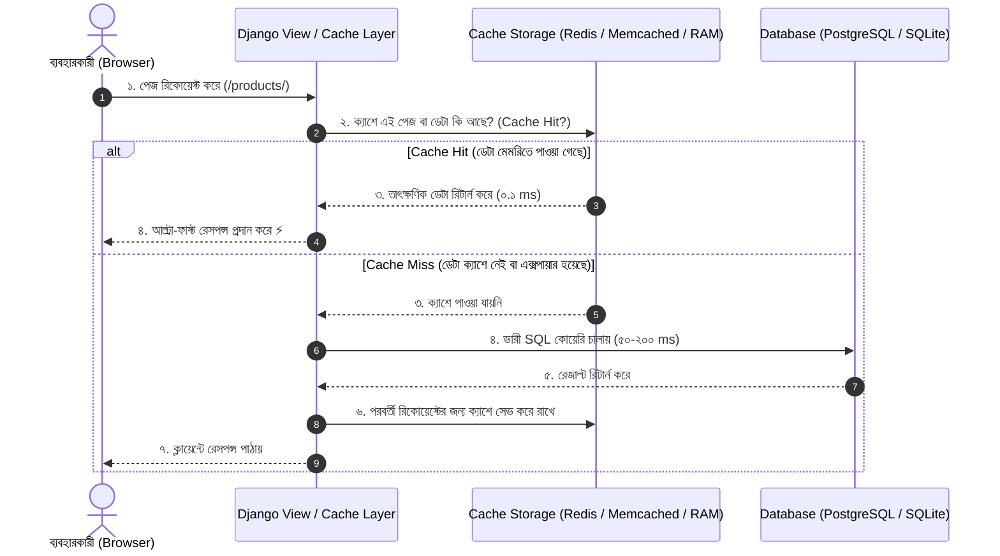

# Lesson 52: Django Caching Basics ⚡🏎️

ওয়েব অ্যাপ্লিকেশনে ট্রাফিক বৃদ্ধি পেলে সার্ভারের উপর ডেটাবেজ কোয়েরি এবং ডায়নামিক পেজ রেন্ডারিংয়ের চাপ আশঙ্কাজনকভাবে বেড়ে যায়। প্রতিবার একই ডেটা পুনরায় ডেটাবেজ থেকে ফেচ বা হিসাব না করে দ্রুত এক্সেসযোগ্য মেমরিতে সাময়িকভাবে সংরক্ষণ করে রাখার প্রক্রিয়াকে **Caching (ক্যাশিং)** বলা হয়।

Django-তে একটি অত্যন্ত শক্তিশালী ও ফ্লেক্সিবল বিল্ট-ইন ক্যাশিং ফ্রেমওয়ার্ক রয়েছে যা মাইক্রোসেকেন্ডের মধ্যে ডেটা পরিবেশন করে সাইটের স্পিড নাটকীয়ভাবে বৃদ্ধি করে।

---

## ১. ক্যাশিং কীভাবে কাজ করে? (Request Flow)



---

## ২. Django Cache Backends (`settings.py`)

Django বিভিন্ন ধরনের ক্যাশ ব্যাকএন্ড সমর্থন করে। আপনার প্রজেক্টের `config/settings.py` ফাইলে `CACHES` ডিকশনারির মাধ্যমে এটি কনফিগার করতে হয়।

### ক. Local-Memory Cache (`LocMemCache`) - ডিফল্ট ও ডেভেলপমেন্টের জন্য
লোকাল মেশিনে টেস্ট করার জন্য এটি উপযুক্ত। এটি পাইথনের নিজস্ব মেমরি (RAM) ব্যবহার করে এবং প্রসেস-সেফ।
```python
CACHES = {
    'default': {
        'BACKEND': 'django.core.cache.backends.locmem.LocMemCache',
        'LOCATION': 'unique-snowflake',
    }
}
```

### খ. Redis Cache - প্রোডাকশনের জন্য ইন্ডাস্ট্রি স্ট্যান্ডার্ড 🏆
Redis একটি ইন-মেমরি কি-ভ্যালু ডেটাস্টোর যা ডেটা পারসিস্টেন্স এবং এক্সট্রিম পারফরম্যান্স প্রদান করে।
```bash
pip install redis
```
```python
CACHES = {
    'default': {
        'BACKEND': 'django.core.cache.backends.redis.RedisCache',
        'LOCATION': 'redis://127.0.0.1:6379',
        'TIMEOUT': 300, # ডিফল্ট টাইমআউট ৩০০ সেকেন্ড (৫ মিনিট)
        'OPTIONS': {
            'db': '1',
        }
    }
}
```

### গ. Database Cache
মেমরির বিকল্প হিসেবে সরাসরি ডেটাবেজের একটি বিশেষ টেবিলে ক্যাশ রাখা যায়।
```python
CACHES = {
    'default': {
        'BACKEND': 'django.core.cache.backends.db.DatabaseCache',
        'LOCATION': 'my_cache_table',
    }
}
```
> 📌 **নোট:** ডেটাবেজ ক্যাশ চালুর পর কমান্ড চালাতে হয়:
> `python manage.py createcachetable`

### ঘ. File-based Cache
সার্ভারের ফাইল সিস্টেমে ক্যাশ ডেটা সেভ করে।
```python
CACHES = {
    'default': {
        'BACKEND': 'django.core.cache.backends.filebased.FileBasedCache',
        'LOCATION': BASE_DIR / 'cache_data',
    }
}
```

---

## ৩. Django-তে ক্যাশিংয়ের ৪টি স্তর (Levels of Caching)

Django আপনাকে বিভিন্ন গ্র্যানুলারিটিতে ক্যাশিং প্রয়োগের সুযোগ দেয়:

### ১. Per-Site Caching (সম্পূর্ণ সাইট ক্যাশ করা)
পুরো ওয়েবসাইটের প্রতিটি পেজ ক্যাশ করে ফেলে।
```python
# config/settings.py
MIDDLEWARE = [
    'django.middleware.cache.UpdateCacheMiddleware',  # তালিকার সবার উপরে
    'django.middleware.common.CommonMiddleware',
    # ... অন্যান্য মিডলওয়্যার ...
    'django.middleware.cache.FetchFromCacheMiddleware', # তালিকার সবার নিচে
]

CACHE_MIDDLEWARE_ALIAS = 'default'
CACHE_MIDDLEWARE_SECONDS = 600  # ১০ মিনিট
CACHE_MIDDLEWARE_KEY_PREFIX = 'my_site'
```

### ২. Per-View Caching (নির্দিষ্ট ভিউ ক্যাশ করা) 🎯
সবচেয়ে বেশি ব্যবহৃত পদ্ধতি। কোনো নির্দিষ্ট ভারী ভিউকে নির্দিষ্ট সময়ের জন্য ক্যাশ করতে `@cache_page` ডেকোরেটর ব্যবহার করা হয়।

```python
# accounts/views.py বা products/views.py
from django.shortcuts import render
from django.views.decorators.cache import cache_page
from django.views.decorators.vary import vary_on_cookie, vary_on_headers

# ১৫ মিনিটের জন্য (১৫ * ৬০ = ৯০০ সেকেন্ড) ক্যাশ করা হলো
@cache_page(60 * 15)
@vary_on_cookie  # ভিন্ন ইউজারের জন্য ভিন্ন ক্যাশ তৈরি করবে (লগইন করা বনাম সাধারণ ভিজিটর)
def product_list_view(request):
    products = Product.objects.all().order_by('-created_at')
    return render(request, 'products/list.html', {'products': products})
```

### ৩. Template Fragment Caching (টেমপ্লেটের নির্দিষ্ট অংশ ক্যাশ করা)
ধরুন একটি পেজে ইউজারের নাম ডায়নামিক, কিন্তু সাইডবার বা ক্যাটাগরি মেনু সবার জন্য একই এবং ডেটাবেজ থেকে আসে। সেক্ষেত্রে পুরো পেজ ক্যাশ না করে শুধু ঐ অংশটুকু ক্যাশ করা যায়:

```html
<!-- templates/products/list.html -->


<h1>স্বাগতম, {{ request.user.username }}</h1> <!-- এটি ক্যাশ হবে না -->

<!-- ক্যাটাগরি সাইডবার ৫০০ সেকেন্ডের জন্য ক্যাশ থাকবে -->

    <div class="sidebar">
        <h3>জনপ্রিয় ক্যাটাগরি</h3>
        <ul>
            
                <li>{{ cat.name }} ({{ cat.total_products }})</li>
            
        </ul>
    </div>

```

### ৪. Low-Level Cache API (প্রোগ্রামিং লজিকের ভেতর কাস্টম ক্যাশিং)
ডেটাবেজ কোয়েরি, বাহ্যিক থার্ড-পার্টি API রেসপন্স বা জটিল অ্যালগরিদমের ফলাফল ম্যানুয়ালি ক্যাশ করার জন্য সরাসরি `cache` অবজেক্ট ব্যবহার করা হয়:

```python
from django.core.cache import cache
import requests

def get_exchange_rates():
    cache_key = 'usd_to_bdt_rate'
    
    # ১. ক্যাশ থেকে ডাটা খোঁজা
    rate = cache.get(cache_key)
    
    if rate is None:
        # ২. ক্যাশে না থাকলে এক্সটারনাল API কল করা
        response = requests.get('https://api.exchangerate.host/latest?base=USD')
        rate = response.json().get('rates', {}).get('BDT', 120.0)
        
        # ৩. ক্যাশে ১ ঘণ্টার (৩৬০০ সেকেন্ড) জন্য সেভ করা
        cache.set(cache_key, rate, timeout=3600)
    
    return rate
```

#### আরও সুবিধাজনক মেথড: `cache.get_or_set()`
```python
def get_popular_posts():
    # ডেটা থাকলে ক্যাশ থেকে আনবে, না থাকলে ফাংশন এক্সিকিউট করে ক্যাশে রাখবে
    return cache.get_or_set(
        'popular_posts',
        lambda: list(Post.objects.filter(is_featured=True)[:10]),
        timeout=60 * 30  # ৩০ মিনিট
    )
```

---

## ৪. Cache Invalidation (ক্যাশ মুছে ফেলা বা আপডেট করা)

যখন নতুন কোনো প্রোডাক্ট যুক্ত বা আপডেট হবে, তখন পুরোনো ক্যাশ ডিলিট করতে হয় যাতে ইউজার নতুন তথ্য দেখতে পায়:

```python
# signals.py অথবা views.py
from django.db.models.signals import post_save, post_delete
from django.dispatch import receiver
from django.core.cache import cache
from .models import Product

@receiver([post_save, post_delete], sender=Product)
def invalidate_product_cache(sender, instance, **kwargs):
    # ক্যাশ কি মুছে ফেলা
    cache.delete('popular_products_list')
    print("Popular products cache cleared successfully!")
```

---

## সারসংক্ষেপ (Best Practices)

1. **সঠিক স্তর বাছাই:** ডায়নামিক সাইটের জন্য **Template Fragment** এবং **Low-Level Cache API** সবচেয়ে নিরাপদ।
2. **ভেরিফিকেশন:** লগইন করা ইউজারের জন্য ভিউ ক্যাশ করলে অবশ্যই `@vary_on_cookie` ব্যবহার করুন, নয়তো এক ইউজারের ডেটা অন্য ইউজার দেখতে পাবে!
3. **ক্যাশ ইনভ্যালিডেশন:** ডেটা আপডেট বা ডিলিট হলে সিগন্যাল (`signals`) ব্যবহার করে পুরোনো ক্যাশ কি ডিলিট করুন।
