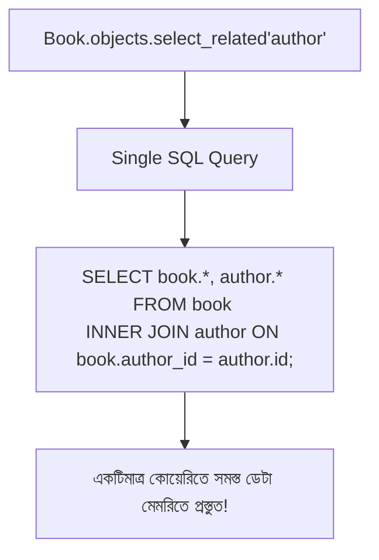

# Lesson 53: Database Query Optimization - select_related() ও prefetch_related() 🚀🗄️

Django ORM ডেভেলপমেন্টকে সহজ করলেও অসাবধানতাবশত কোড লিখলে তা ব্যাকগ্রাউন্ডে প্রচুর অপ্রয়োজনীয় ডেটাবেজ কোয়েরি তৈরি করে। এর ফলে অ্যাপ্লিকেশনের গতি অত্যন্ত ধীর হয়ে যায়। এই সমস্যার প্রধান কারণ হলো কুখ্যাত **N+1 Problem**।

Django ORM-এ ডেটাবেজ কোয়েরি অপ্টিমাইজেশনের জন্য সবচেয়ে শক্তিশালী দুটি অস্ত্র হলো:
1. `select_related()`
2. `prefetch_related()`

---

## ১. N+1 কোয়েরি সমস্যা কী? (The N+1 Problem)

ধরা যাক আমাদের দুটি মডেল আছে: `Author` এবং `Book` (প্রতিটি বইয়ের একজন লেখক আছে - `ForeignKey`)।

```python
# models.py
class Author(models.Model):
    name = models.CharField(max_length=100)

class Book(models.Model):
    title = models.CharField(max_length=200)
    author = models.ForeignKey(Author, on_delete=models.CASCADE, related_name='books')
```

এখন যদি আমরা ১০০টি বই এবং তাদের লেখকের নাম প্রিন্ট করতে চাই:

```python
# views.py - ❌ বাজে পদ্ধতি (N+1 Problem)
books = Book.objects.all()  # ১টি কোয়েরি (১০০টি বই আনবে)

for book in books:
    print(book.title, book.author.name)  # প্রতি লুপে ১টি করে অতিরিক্ত কোয়েরি! (১০০টি কোয়েরি)
```

### 🔴 কী ঘটেছিল এখানে?
- **১টি কোয়েরি:** `SELECT * FROM book;` (১০০টি বই পেল)
- **১০০টি অতিরিক্ত কোয়েরি:** প্রতিটি বইয়ের জন্য `SELECT * FROM author WHERE id = ...;`
- **মোট কোয়েরি:** `1 + 100 = 101টি কোয়েরি!` 😱

যদি ডেটাবেজে ১,০০০ বই থাকত, তবে ১,০০১টি ডেটাবেজ হিট হতো, যা সার্ভারকে ক্র্যাশ করিয়ে দিতে পারে।

---

## ২. `select_related()` - সিঙ্গেল অবজেক্ট রিলেশনশিপ (SQL JOIN)

`select_related()` ডেটাবেজ স্তরে **SQL `JOIN`** (সাধারণত `INNER JOIN` বা `LEFT OUTER JOIN`) তৈরি করে। এর ফলে প্যারেন্ট এবং চাইল্ড উভয়ের ডেটা **একটি মাত্র SQL কোয়েরিতে** চলে আসে!



### কখন ব্যবহার করবেন?
- `ForeignKey` (One-to-Many - যখন 'Many' এর দিক থেকে 'One' কে অ্যাক্সেস করা হয়)
- `OneToOneField` (উভয় দিক থেকেই)

### সমাধান কোড:
```python
# views.py - ✅ অপ্টিমাইজড পদ্ধতি
books = Book.objects.select_related('author').all()

for book in books:
    print(book.title, book.author.name) # কোনো অতিরিক্ত কোয়েরি হয় না!
```
> ⚡ **ফলাফল:** ১০১টি কোয়েরির জায়গায় মাত্র **১টি মাত্র কোয়েরিতে** সম্পূর্ণ কাজ সম্পন্ন হলো!

### Chained Relationship (একাধিক লেভেলে JOIN করা)
আপনি আন্ডারস্কোর (`__`) দিয়ে একাধিক গভীরতায় জয়েন করতে পারেন:
```python
# Book -> Author -> Profile
books = Book.objects.select_related('author__profile').all()
```

---

## ৩. `prefetch_related()` - মাল্টিপল অবজেক্ট রিলেশনশিপ

`select_related()` রিভার্স ফরেন কি বা Many-to-Many-র ক্ষেত্রে কাজ করে না, কারণ SQL JOIN করলে কোটি কোটি ডুপ্লিকেট সারি তৈরি হয় (কার্তেসিয়ান প্রোডাক্ট)।

এর বদলে Django সরবরাহ করে `prefetch_related()`। এটি **২টি পৃথক SQL কোয়েরি** চালায় এবং পাইথনের মেমরিতে তাদের চমৎকারভাবে রিলেট (ম্যাপিং) করে দেয়।

```python
# models.py
class Tag(models.Model):
    name = models.CharField(max_length=50)

class Book(models.Model):
    title = models.CharField(max_length=200)
    tags = models.ManyToManyField(Tag, related_name='books')
```

### কখন ব্যবহার করবেন?
- `ManyToManyField`
- Reverse `ForeignKey` (যেমন লেখকের দিক থেকে তার সব বই `author.books.all()`)

### উদাহরণ কোড:
```python
# ❌ বাজে পদ্ধতি (N+1 সমস্যা)
books = Book.objects.all()
for book in books:
    for tag in book.tags.all():  # প্রতি বইয়ের জন্য আলাদা কোয়েরি!
        print(tag.name)

# ✅ অপ্টিমাইজড পদ্ধতি (prefetch_related)
books = Book.objects.prefetch_related('tags').all()
for book in books:
    for tag in book.tags.all():  # ক্যাশড ডেটা থেকে আসবে, কোনো অতিরিক্ত কোয়েরি নয়!
        print(tag.name)
```

### 🔍 ব্যাকগ্রাউন্ডে কী ঘটেছে?
`prefetch_related('tags')` মূলত মাত্র ২টি কোয়েরি চালিয়েছে:
1. `SELECT * FROM book;`
2. `SELECT * FROM tag WHERE id IN (বইগুলোর সাথে যুক্ত সমস্ত ট্যাগ আইডি);`
এরপর Django পাইথনে তাদের ম্যাচ করিয়ে দিয়েছে। মোট কোয়েরি সংখ্যা **মাত্র ২টি**!

---

## ৪. অ্যাডভান্সড: `Prefetch()` অবজেক্ট দিয়ে কাস্টম ফিল্টারিং

কখনও কখনও আপনি রিলেটেড ডেটা প্রি-ফেচ করার সময় নির্দিষ্ট ফিল্টার বা সর্টিং যুক্ত করতে চাইতে পারেন। এর জন্য `Prefetch` অবজেক্ট ব্যবহার করা হয়:

```python
from django.db.models import Prefetch
from .models import Author, Book

# শুধুমাত্র প্রকাশিত বইগুলোকে প্রিফেচ করা এবং টাইটেল অনুসারে সাজানো
optimized_authors = Author.objects.prefetch_related(
    Prefetch(
        'books',
        queryset=Book.objects.filter(is_published=True).order_by('title')
    )
)

for author in optimized_authors:
    print(author.name)
    # এটি কোনো নতুন কোয়েরি করবে না এবং কেবল ফিল্টার করা বই দেখাবে
    for book in author.books.all():
        print(f" - {book.title}")
```

---

## ৫. উভয়টিকে একসাথে কম্বাইন করা (Real-World E-Commerce)

বাস্তব জীবনে প্রায়ই জটিল নেস্টেড অবজেক্ট থাকে। আপনি একই সাথে `select_related` এবং `prefetch_related` ব্যবহার করতে পারেন:

```python
# Order -> Customer (ForeignKey: select_related)
# Order -> OrderItems (Reverse ForeignKey: prefetch_related)
# OrderItems -> Product (ForeignKey: select_related)

orders = Order.objects.select_related('customer').prefetch_related(
    Prefetch(
        'items',
        queryset=OrderItem.objects.select_related('product')
    )
).all()
```
এই একটি স্টেটমেন্টের মাধ্যমে পুরো ই-কমার্স অর্ডার হিস্ট্রি পেজ লোড হয়ে যাবে মাত্র ২ থেকে ৩টি কোয়েরিতে!

---

## ৬. `select_related()` বনাম `prefetch_related()` পার্থক্য

| বৈশিষ্ট্য | `select_related()` | `prefetch_related()` |
| :--- | :--- | :--- |
| **কাজের ধরণ** | একক SQL `JOIN` কোয়েরি | একাধিক পৃথক কোয়েরি + পাইথন মেমরিতে ম্যাপিং |
| **মোট কোয়েরি সংখ্যা** | সর্বদা ১টি কোয়েরি | সাধারণত ২টি (অথবা ফিল্ড সংখ্যা + ১) |
| **রিলেশনশিপের ধরণ** | `ForeignKey`, `OneToOne` (Single object) | `ManyToManyField`, Reverse `ForeignKey` (Many objects) |
| **মেমরি ব্যবহার** | ডেটাবেজ লেভেলে ফিল্টার হয়, মেমরি কম লাগে | পাইথনে প্রচুর অবজেক্ট তৈরি হতে পারে, মেমরি বেশি লাগতে পারে |

---

## ৭. ডেটাবেজ অপ্টিমাইজেশনের আরও কিছু গুরুত্বপূর্ণ টিপস

### ক. শুধুমাত্র প্রয়োজনীয় কলাম আনা (`only()` ও `defer()`)
যদি আপনার টেবিলে বিশাল কোনো `TextField` (যেমন ব্লগ পোস্টের বডি) থাকে যা লিস্ট ভিউতে দরকার নেই:
```python
# 'content' ফিল্ড বাদ দিয়ে আনবে
posts = Post.objects.defer('content').all()

# শুধুমাত্র 'id' এবং 'title' আনবে
posts = Post.objects.only('id', 'title').all()
```

### খ. অবজেক্ট তৈরি এড়িয়ে ডিকশনারি/টিউটপল নেওয়া (`values()` ও `values_list()`)
Django মডেল ইন্সট্যান্স তৈরিতে কিছুটা CPU সময় খরচ হয়। শুধুমাত্র ডেটা দরকার হলে:
```python
# ডিকশনারির লিস্ট হিসেবে আসবে (অত্যন্ত দ্রুত)
users_data = User.objects.values('id', 'username', 'email')
```

### গ. অস্তিত্ব যাচাই ও গণনার সঠিক নিয়ম
- ❌ খারাপ: `if len(Book.objects.all()) > 0:`
- ✅ ভালো: `if Book.objects.exists():`
- ❌ খারাপ: `total = len(Book.objects.all())`
- ✅ ভালো: `total = Book.objects.count()`

### ঘ. বাল্ক অপারেশন (`bulk_create()` ও `bulk_update()`)
১,০০০ টি রো লুপ চালিয়ে `save()` না করে একবারে বাল্ক ইনসার্ট করুন:
```python
# ১টি মাত্র INSERT কোয়েরিতে ১০০০ অবজেক্ট সেভ হবে
new_books = [Book(title=f"Book {i}", author=author) for i in range(1000)]
Book.objects.bulk_create(new_books)
```

---

## কোয়েরি চেক করবেন কীভাবে?
কতগুলো কোয়েরি চলছে তা লোকাল মেশিনে দেখতে `django.db.connection.queries` প্রিন্ট করতে পারেন অথবা **Django Debug Toolbar** ইন্সটল করতে পারেন:

```python
from django.db import connection
print("মোট কোয়েরি:", len(connection.queries))
```
