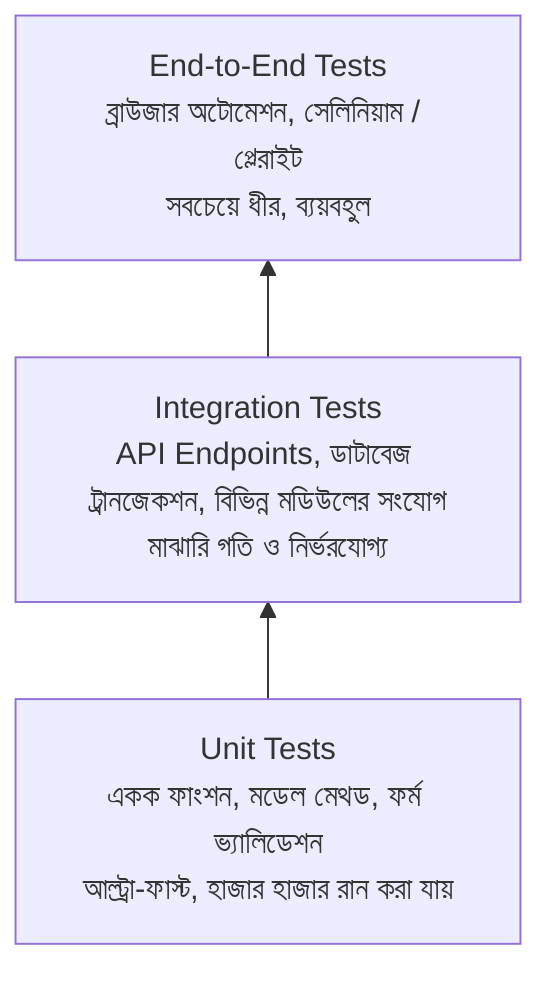

# Lesson 55: Django Unit Tests ও API Integration Tests 🧪🎯

একটি সফটওয়্যার অ্যাপ্লিকেশন বড় হওয়ার সাথে সাথে নতুন ফিচার যুক্ত করতে গিয়ে পুরোনো ফিচার ভেঙে যাওয়ার (Regression) ঝুঁকি তৈরি হয়। পেশাদার ব্যাকএন্ড ইঞ্জিনিয়ারিংয়ে কোনো কোড প্রোডাকশনে পাঠানোর পূর্বে তা শতভাগ স্বয়ংক্রিয়ভাবে টেস্ট করার জন্য **Automated Testing** অপরিহার্য।

এই গাইডে আমরা শিখব Django-র বিল্ট-ইন টেস্টিং ফ্রেমওয়ার্ক এবং Django REST Framework (DRF)-এর **`APITestCase`** ব্যবহার করে কীভাবে শক্তিশালী **Unit Tests** এবং পূর্ণাঙ্গ **API Integration Tests** লিখতে হয়।

---

## ১. টেস্ট পিরামিড (The Testing Pyramid)

টেস্টিং সাধারণত ৩টি স্তরে বিভক্ত থাকে:



- **Unit Test (ইউনিট টেস্ট):** অ্যাপ্লিকেশনের ক্ষুদ্রতম অংশকে (যেমন একটি মডেল মেথড বা একটি ফর্ম ক্লাস) সম্পূর্ণ বিচ্ছিন্ন অবস্থায় পরীক্ষা করা।
- **Integration Test (ইন্টিগ্রেশন টেস্ট):** একাধিক উপাদান যখন একসাথে কাজ করে (যেমন: ক্লায়েন্ট API কল করল -> মিডলওয়্যার চেক করল -> ভিউ প্রসেস হলো -> ডেটাবেজে সেভ হলো -> JSON রেসপন্স ফেরত দিল)।

---

## ২. Django Test Runner কীভাবে কাজ করে?

টার্মিনালে যখন আপনি নিচের কমান্ডটি চালান:
```bash
python manage.py test
```

Django স্বয়ংক্রিয়ভাবে নিচের ধাপগুলো সম্পন্ন করে:
1. আপনার মূল ডেটাবেজ (`db.sqlite3` বা PostgreSQL) স্পর্শ না করে সম্পূর্ণ আলাদা একটি মেমরি বা অস্থায়ী টেস্ট ডেটাবেজ (`test_db.sqlite3`) তৈরি করে।
2. সমস্ত মাইগ্রেশন রান করে টেবিল তৈরি করে।
3. প্রজেক্টের যে সমস্ত ফাইলের নাম `test*.py` সেগুলোর সব টেস্ট এক্সিকিউট করে।
4. প্রতিটি টেস্ট ফাংশন চলার পর ডেটাবেজ স্টেট রোলব্যাক করে আগের অবস্থায় ফিরিয়ে আনে (যাতে একটি টেস্টের ডেটা অন্য টেস্টকে প্রভাবিত না করে)।
5. টেস্ট শেষ হলে সাময়িক ডেটাবেজটি ধ্বংস (Teardown) করে দেয়।

---

## ৩. গুরুত্বপূর্ণ টেস্ট ক্লাস ও লাইফসাইকেল মেথড

Django-তে বেশ কিছু টেস্ট ক্লাস রয়েছে:

| ক্লাস | ডেটাবেজ সংযোগ | ট্রানজেকশন রোলব্যাক | ব্যবহারের ক্ষেত্র |
| :--- | :---: | :---: | :--- |
| **`SimpleTestCase`** | ❌ না | ❌ না | ফর্ম, হেল্পার ফাংশন ও ভিউ যাতে কোনো DB কোয়েরি নেই |
| **`TestCase`** | ✅ হ্যাঁ | ✅ হ্যাঁ (দ্রুত) | সাধারণ মডেল, ফর্ম ও ক্লাসিক ভিউ টেস্টে (সবচেয়ে বেশি ব্যবহৃত) |
| **`APITestCase`** | ✅ হ্যাঁ | ✅ হ্যাঁ | Django REST Framework-এর API Endpoint টেস্টের জন্য |

### টেস্ট লাইফসাইকেল:
- **`setUpTestData(cls)`**: ক্লাস লেভেলে মাত্র **একবার** ডেটাবেজে অবজেক্ট তৈরি করে। সমস্ত টেস্ট মেথড এই ডেটা শেয়ার করে। টেস্টের স্পিড শতগুণ বাড়িয়ে দেয়!
- **`setUp(self)`**: প্রতিটি টেস্ট ফাংশন রান হওয়ার **ঠিক পূর্বে** এক্সিকিউট হয়।
- **`tearDown(self)`**: প্রতিটি টেস্ট ফাংশন রান হওয়ার **ঠিক পরে** এক্সিকিউট হয়।

---

## ৪. Model ও Form-এর Unit Test লেখা

ধরা যাক আমাদের একটি `Task` মডেল রয়েছে:

```python
# accounts/models.py
from django.db import models
from django.contrib.auth import get_user_model

User = get_user_model()

class Task(models.Model):
    user = models.ForeignKey(User, on_delete=models.CASCADE, related_name='tasks')
    title = models.CharField(max_length=200)
    description = models.TextField(blank=True)
    is_completed = models.BooleanField(default=False)
    created_at = models.DateTimeField(auto_now_add=True)

    def __str__(self):
        return f"{self.title} ({'Done' if self.is_completed else 'Pending'})"

    def mark_as_completed(self):
        self.is_completed = True
        self.save()
```

### মডেল ইউনিট টেস্ট কোড:

```python
# accounts/tests/test_models.py বা accounts/tests.py
from django.test import TestCase
from django.contrib.auth import get_user_model
from accounts.models import Task

User = get_user_model()

class TaskModelUnitTest(TestCase):
    @classmethod
    def setUpTestData(cls):
        # পুরো ক্লাসের সমস্ত টেস্টের জন্য একবার ইউজার তৈরি
        cls.user = User.objects.create_user(
            username='developer',
            email='dev@example.com',
            password='TestPassword123!'
        )

    def setUp(self):
        # প্রতিটি টেস্টের পূর্বে একটি ফ্রেশ টাস্ক তৈরি
        self.task = Task.objects.create(
            user=self.user,
            title="Complete Unit Tests",
            is_completed=False
        )

    def test_task_string_representation(self):
        """__str__ মেথড প্রত্যাশিত ফরম্যাট রিটার্ন করে কিনা"""
        self.assertEqual(str(self.task), "Complete Unit Tests (Pending)")

    def test_mark_as_completed_method(self):
        """কাস্টম মেথড কল করলে স্ট্যাটাস True হয় কিনা"""
        self.assertFalse(self.task.is_completed)
        self.task.mark_as_completed()
        
        # ডাটাবেজ থেকে রিফ্রেশ করে মান যাচাই
        self.task.refresh_from_db()
        self.assertTrue(self.task.is_completed)
        self.assertEqual(str(self.task), "Complete Unit Tests (Done)")
```

---

## ৫. Django REST Framework (DRF) API Integration Tests 🚀

API Integration Test-এ আমরা সম্পূর্ণ HTTP চক্র পরীক্ষা করি: হেডার, অথেন্টিকেশন, পেলোড ভ্যালিডেশন, স্ট্যাটাস কোড এবং JSON রেসপন্স বডি।

আমরা ব্যবহার করব DRF-এর **`APITestCase`** এবং **`APIClient`**।

```python
# accounts/tests/test_api.py বা accounts/tests.py
from django.urls import reverse
from rest_framework import status
from rest_framework.test import APITestCase
from django.contrib.auth import get_user_model
from accounts.models import Task

User = get_user_model()

class TaskAPIIntegrationTests(APITestCase):
    @classmethod
    def setUpTestData(cls):
        # টেস্টের জন্য ২ জন ইউজার তৈরি (পারমিশন চেক করার জন্য)
        cls.user1 = User.objects.create_user(username='user1', password='Password123!')
        cls.user2 = User.objects.create_user(username='user2', password='Password123!')

    def setUp(self):
        # user1 এর জন্য একটি টাস্ক
        self.task1 = Task.objects.create(
            user=self.user1,
            title="User 1 Task",
            description="Initial description"
        )
        self.list_url = reverse('task-list')  # DefaultRouter থেকে তৈরি হওয়া URL নাম
        self.detail_url = reverse('task-detail', kwargs={'pk': self.task1.pk})

    # ১. আন-অথরাইজড রিকোয়েস্ট যাচাই (Security Test)
    def test_unauthenticated_user_cannot_access_tasks(self):
        """লগইন না করে রিকোয়েস্ট পাঠালে ৪০১ Unauthorized ফেরত দিতে হবে"""
        response = self.client.get(self.list_url)
        self.assertEqual(response.status_code, status.HTTP_401_UNAUTHORIZED)

    # ২. GET রিকোয়েস্ট (List API)
    def test_authenticated_user_can_list_tasks(self):
        """লগইন করা ইউজার সফলভাবে টাস্কের লিস্ট দেখতে পাবে"""
        # force_authenticate ব্যবহার করে দ্রুত লগইন সিমুলেট করা হয়
        self.client.force_authenticate(user=self.user1)
        response = self.client.get(self.list_url)

        self.assertEqual(response.status_code, status.HTTP_200_OK)
        # রেসপন্সে অন্তত ১টি টাস্ক পাওয়া যাবে
        self.assertEqual(len(response.data), 1)
        self.assertEqual(response.data[0]['title'], "User 1 Task")

    # ৩. POST রিকোয়েস্ট (Create API)
    def test_create_new_task_success(self):
        """ভ্যালিড পেলোড পাঠালে নতুন টাস্ক তৈরি হবে ও ২০১ Created কোড আসবে"""
        self.client.force_authenticate(user=self.user1)
        payload = {
            'title': 'Learn Pytest',
            'description': 'Write comprehensive integration tests',
            'is_completed': False
        }
        response = self.client.post(self.list_url, payload, format='json')

        self.assertEqual(response.status_code, status.HTTP_201_CREATED)
        self.assertEqual(response.data['title'], 'Learn Pytest')
        # ডাটাবেজে রেকর্ড যুক্ত হয়েছে কি না যাচাই
        self.assertTrue(Task.objects.filter(title='Learn Pytest').exists())

    # ৪. POST রিকোয়েস্টে ইনভ্যালিড ডেটা (Validation Test)
    def test_create_task_with_missing_title_fails(self):
        """টাইটেল ছাড়া টাস্ক তৈরির চেষ্টা করলে ৪০০ Bad Request আসবে"""
        self.client.force_authenticate(user=self.user1)
        payload = {'description': 'Only description, no title'}
        response = self.client.post(self.list_url, payload, format='json')

        self.assertEqual(response.status_code, status.HTTP_400_BAD_REQUEST)
        self.assertIn('title', response.data)  # 'title' ফিল্ডে ভ্যালিডেশন এরর থাকবে

    # ৫. PATCH রিকোয়েস্ট (Partial Update API)
    def test_update_task_status(self):
        """টাস্কের স্ট্যাটাস আপডেট করা"""
        self.client.force_authenticate(user=self.user1)
        patch_payload = {'is_completed': True}
        response = self.client.patch(self.detail_url, patch_payload, format='json')

        self.assertEqual(response.status_code, status.HTTP_200_OK)
        self.task1.refresh_from_db()
        self.assertTrue(self.task1.is_completed)

    # ৬. DELETE রিকোয়েস্ট (Delete API)
    def test_delete_task_success(self):
        """টাস্ক ডিলিট করলে ২০৪ No Content ফেরত দেবে ও ডাটাবেজ থেকে মুছে যাবে"""
        self.client.force_authenticate(user=self.user1)
        response = self.client.delete(self.detail_url)

        self.assertEqual(response.status_code, status.HTTP_204_NO_CONTENT)
        self.assertFalse(Task.objects.filter(pk=self.task1.pk).exists())
```

---

## ৬. এক্সটারনাল সার্ভিস মকিং (Mocking with `patch`)

বাস্তব জীবনে আপনার API কোনো থার্ড পার্টি পেমেন্ট গেটওয়ে (Stripe/SSLCommerz) বা SMS গেটওয়েকে কল করতে পারে। টেস্টের সময় আসল টাকা কাটা বা SMS পাঠানো বন্ধ করতে `unittest.mock.patch` ব্যবহার করে সার্ভিসটি মক করতে হয়:

```python
from unittest.mock import patch
from rest_framework.test import APITestCase
from rest_framework import status

class PaymentAPITest(APITestCase):
    @patch('accounts.services.sslcommerz.initiate_payment')
    def test_payment_endpoint(self, mock_payment):
        # মক ফাংশনের রিটার্ন ভ্যালু সেট করা
        mock_payment.return_value = {
            'status': 'SUCCESS',
            'sessionkey': 'mock_abc123',
            'GatewayPageURL': 'https://sandbox.sslcommerz.com/mock'
        }

        # API কল করা
        response = self.client.post('/api/v1/checkout/', {'amount': 500})
        
        self.assertEqual(response.status_code, status.HTTP_200_OK)
        # ফাংশনটি কল হয়েছিল কিনা যাচাই করা
        mock_payment.assert_called_once()
```

---

## ৭. টেস্ট কভারেজ মেজার করা (`coverage.py`)

আপনার কোডের কত শতাংশ অংশ টেস্টের আওতাভুক্ত হয়েছে তা জানার জন্য পাইথনের `coverage` টুল ব্যবহার করা হয়:

```bash
# ১. ইনস্টল করুন
pip install coverage

# ২. টেস্ট রান করুন কভারেজসহ
coverage run --source='.' manage.py test

# ৩. টার্মিনালে রিপোর্ট দেখুন
coverage report

# ৪. চমৎকার ইন্টারেক্টিভ HTML রিপোর্ট জেনারেট করুন
coverage html
```
এটি আপনার প্রজেক্টে `htmlcov/index.html` তৈরি করবে যা ব্রাউজারে খুললে কোন ফাইলের কোন কোন লাইন টেস্ট করা বাকি আছে তা লাল রঙে চিহ্নিত করে দেখায়!

---

## ৮. টেস্ট রান করার কমান্ড গাইড

```bash
# পুরো প্রজেক্টের সব টেস্ট চালানো
python manage.py test

# নির্দিষ্ট একটি অ্যাপের টেস্ট চালানো
python manage.py test accounts

# নির্দিষ্ট একটি টেস্ট ফাইলের টেস্ট চালানো
python manage.py test accounts.tests.test_api

# নির্দিষ্ট একটি টেস্ট ক্লাস বা মেথড চালানো
python manage.py test accounts.tests.TaskAPIIntegrationTests.test_create_new_task_success

# দ্রুত চালানোর জন্য প্যারালাল মোড (মাল্টিকোর সিপিইউ)
python manage.py test --parallel
```

---

## সারসংক্ষেপ (Best Practices)

1. **টেস্ট ডাটাবেজ বিচ্ছিন্ন:** টেস্ট রানার স্বয়ংক্রিয়ভাবে আলাদা `test_db` তৈরি ও ড্রপ করে, তাই আপনার প্রোডাকশন বা লোকাল আসল ডেটা কখনোই মুছে যাবে না।
2. **`setUpTestData` ব্যবহার করুন:** যেখানে সম্ভব `setUp()`-এর বদলে `setUpTestData()` ব্যবহার করলে টেস্ট রান টাইম ৮০% কমে যায়।
3. **হ্যাপি পাথ ও স্যাড পাথ উভয়ই টেস্ট করুন:** শুধুমাত্র সফল রেসপন্স (200, 201) নয়, ভুল ইনপুটের জন্য 400, 401, 403 এবং 404 ঠিকমতো হ্যান্ডেল হচ্ছে কিনা তা টেস্ট নিশ্চিত করুন।
4. **মকিং করুন:** কোনো এক্সটারনাল নেটওয়ার্ক কল টেস্টের ভেতরে রাখা যাবে না।
