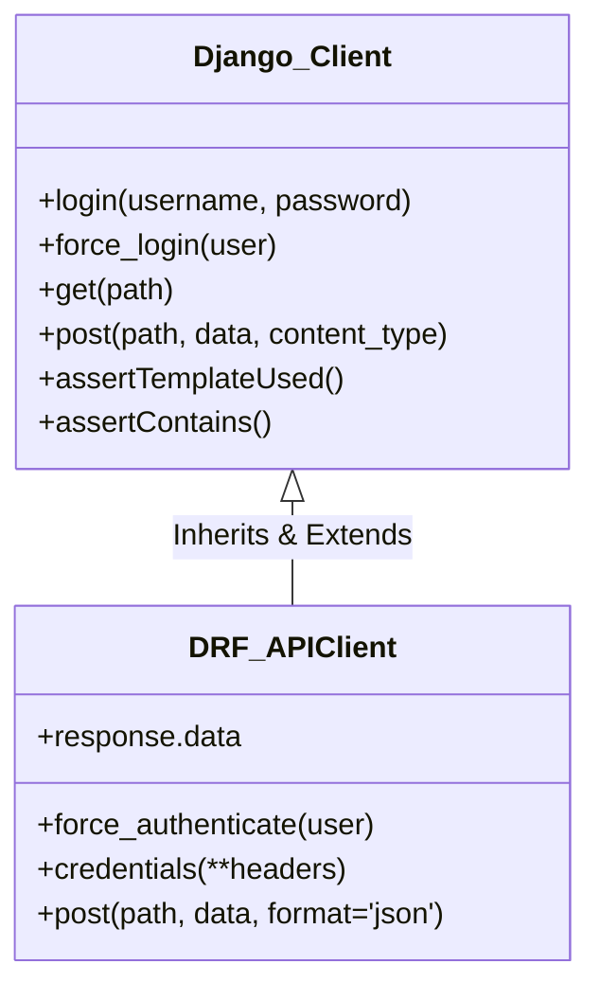

# Lesson 56: Django Test Client এবং DRF APITestCase 🔍🥊

Django ওয়েব অ্যাপ্লিকেশন ও REST API টেস্টিংয়ের সময় ডেভেলপাররা সবচেয়ে বেশি যে দুটি টুলের মুখোমুখি হন তা হলো Django-র নিজস্ব **`Client` (Test Client)** এবং Django REST Framework (DRF)-এর **`APIClient` / `APITestCase`**।

বাইরে থেকে এদের কাজ একই মনে হলেও—উভয়ই ডামি ব্রাউজার হিসেবে HTTP রিকোয়েস্ট পাঠিয়ে রেসপন্স যাচাই করে—কিন্তু তাদের অভ্যন্তরীণ কাজের ধরন, অথেনটিকেশন মেকানিজম, পেলোড হ্যান্ডলিং এবং রেসপন্স পার্সিং সম্পূর্ণ আলাদা।

---

## ১. কীভাবে এরা কাজ করে? (Behind The Scenes)

সাধারণ ওয়েব টেস্ট করার জন্য লাইভ সার্ভার রান করতে হয় না। Django-র Test Client এবং DRF-এর APIClient উভয়ই **WSGI / ASGI ইন্টারফেস লেভেলে** সরাসরি কাজ করে।

```mermaid
flowchart TD
    subgraph TestRunner [Test Execution]
        TC[Test Client / APIClient]
    end

    subgraph DjangoInternal [Django Request-Response Pipeline]
        MW[Middleware Stack]
        URL[URL Resolver]
        View[View / ViewSet]
        Resp[Response Object]
    end

    TC -->|সরাসরি WSGI Request ইনজেক্ট করে\n(কোনো নেটওয়ার্ক সকেট বা পোর্ট লাগে না)| MW
    MW --> URL --> View --> Resp
    Resp -->|তাৎক্ষণিক পাইথন অবজেক্ট রিটার্ন| TC
```

> ⚡ **সুবিধা:** যেহেতু কোনো আসল নেটওয়ার্ক পোর্ট বা সকেট ওপেন হয় না, তাই ১ সেকেন্ডের মধ্যে শত শত টেস্ট মেথড এক্সিকিউট করা সম্ভব হয়!

---

## ২. Django Test Client (`django.test.Client`)

এটি Django-র বিল্ট-ইন টেস্ট ক্লায়েন্ট। এটি মূলত **HTML Templates, Forms, Cookies, এবং Sessions** ভিত্তিক ক্লাসিক ওয়েব পেজ টেস্ট করার জন্য ডিজাইন করা হয়েছে।

### ক. লগইন ও অথেনটিকেশন কৌশল:
```python
from django.test import TestCase, Client
from django.contrib.auth import get_user_model
from django.urls import reverse

User = get_user_model()

class WebAuthTest(TestCase):
    def setUp(self):
        self.user = User.objects.create_user(username='tizul', password='Password123!')
        self.client = Client()

    def test_login_methods(self):
        # পদ্ধতি ১: আসল লগইন ভিউ কল করা (ধীরগতির, কিন্তু পাসওয়ার্ড হ্যাশিং টেস্ট হয়)
        self.client.login(username='tizul', password='Password123!')

        # পদ্ধতি ২: force_login() - 🚀 আল্ট্রা ফাস্ট (সরাসরি সেশনে ইউজার ইনজেক্ট করে)
        self.client.force_login(self.user)

        # লগআউট করা
        self.client.logout()
```

### খ. রেসপন্স ইন্সপেকশন (Inspection Assertions):
Django Test Client আপনাকে রেন্ডার হওয়া HTML এবং টেমপ্লেট কনটেক্সট সরাসরি চেক করার বিশেষ অ্যাসারশন দেয়:

```python
def test_dashboard_view(self):
    self.client.force_login(self.user)
    response = self.client.get(reverse('dashboard'))

    # ১. HTTP Status Code চেক
    self.assertEqual(response.status_code, 200)

    # ২. কোন টেমপ্লেট রেন্ডার হয়েছে তা যাচাই
    self.assertTemplateUsed(response, 'accounts/dashboard.html')

    # ৩. টেমপ্লেটের Context ডেটা যাচাই
    self.assertEqual(response.context['user'].username, 'tizul')

    # ৪. HTML-এর ভেতরে নির্দিষ্ট টেক্সট আছে কিনা
    self.assertContains(response, "Welcome, tizul!")

    # ৫. রিডাইরেকশন যাচাই
    logout_resp = self.client.post(reverse('logout'))
    self.assertRedirects(logout_resp, reverse('login'))
```

### গ. ফর্ম ভ্যালিডেশন এরর টেস্ট (`assertFormError`):
```python
def test_invalid_registration(self):
    response = self.client.post(reverse('register'), {
        'username': '', # ফাঁকা ইউজারনেম
        'email': 'invalid-email'
    })
    # নির্দিষ্ট ফিল্ডে কাঙ্ক্ষিত এরর এসেছে কিনা যাচাই
    self.assertFormError(response, 'form', 'username', 'This field is required.')
```

---

## ৩. DRF `APIClient` এবং `APITestCase` 🚀

আপনি যখন Django REST Framework (DRF) দিয়ে REST API তৈরি করেন, তখন Django-র সাধারণ `Client` ব্যবহার করা অনেক কষ্টসাধ্য ও ক্লান্তিকর। এর সমাধান হিসেবে DRF সরবরাহ করে **`APIClient`** এবং **`APITestCase`**।

### ক. কেন সাধারণ Client-এর চেয়ে `APIClient` সেরা?

| কাজের ধরন | Django `Client` (কষ্টসাধ্য) | DRF `APIClient` (সহজ ও স্মার্ট) |
| :--- | :--- | :--- |
| **JSON ডেটা পাঠানো** | `client.post('/api/', json.dumps(data), content_type='application/json')` | `client.post('/api/', data, format='json')` |
| **JSON রেসপন্স রিড করা** | `data = json.loads(response.content.decode('utf-8'))` | `data = response.data` (স্বয়ংক্রিয় ডিকশনারি) |
| **API অথেনটিকেশন** | সেশন কুকি লাগে (যা টোকেন বেসড এপিআইতে কাজ করে না) | `client.force_authenticate(user=user)` |
| **JWT / Bearer হেডার** | `client.get('/api/', HTTP_AUTHORIZATION='Bearer ' + token)` | `client.credentials(HTTP_AUTHORIZATION='Bearer ' + token)` |

---

### খ. `APITestCase` ও `APIClient`-এর বাস্তব উদাহরণ:

```python
from django.urls import reverse
from rest_framework import status
from rest_framework.test import APITestCase
from django.contrib.auth import get_user_model
from accounts.models import Task

User = get_user_model()

class TaskAPITest(APITestCase):
    def setUp(self):
        self.user = User.objects.create_user(username='api_dev', password='SecretPassword!')
        self.task = Task.objects.create(user=self.user, title="API Architecture")
        self.url = reverse('task-list')

    def test_create_task_with_json_format(self):
        # ১. force_authenticate: কোনো সেশন বা কুকি ছাড়াই DRF ভিউতে request.user সেট করে
        self.client.force_authenticate(user=self.user)

        payload = {
            'title': 'Build Scalable APIs',
            'is_completed': False
        }

        # format='json' বলে দিলে স্বয়ংক্রিয়ভাবে JSON Serialization এবং Content-Type সেট হয়
        response = self.client.post(self.url, payload, format='json')

        self.assertEqual(response.status_code, status.HTTP_201_CREATED)

        # response.data সরাসরি পাইথন ডিকশনারি হিসেবে পাওয়া যায়! (json.loads করার প্রয়োজন নেই)
        self.assertEqual(response.data['title'], 'Build Scalable APIs')
        self.assertIn('id', response.data)

    def test_jwt_bearer_token_authentication(self):
        # রিয়েল JWT টোকেন টেস্ট করার কৌশল
        token_url = reverse('token_obtain_pair')
        token_response = self.client.post(token_url, {
            'username': 'api_dev',
            'password': 'SecretPassword!'
        }, format='json')
        
        access_token = token_response.data['access']

        # credentials() মেথড পরবর্তী সমস্ত রিকোয়েস্টের সাথে স্থায়ীভাবে হেডার যুক্ত রাখে
        self.client.credentials(HTTP_AUTHORIZATION=f'Bearer {access_token}')

        # এখন হেডার সহ রিকোয়েস্ট যাবে
        response = self.client.get(self.url)
        self.assertEqual(response.status_code, status.HTTP_200_OK)

        # হেডার রিসেট করতে চাইলে:
        self.client.credentials() # হেডার ক্লিয়ার
```

---

## ৪. হেড-টু-হেড তুলনা: `Client` বনাম `APIClient`



| তুলনার বিষয় | Django `Client` / `TestCase` | DRF `APIClient` / `APITestCase` |
| :--- | :--- | :--- |
| **মূল ক্ষেত্র** | Traditional Web Pages (HTML/Templates/Forms) | RESTful API Endpoints (JSON/XML) |
| **পেলোড ফরম্যাট** | ডিফল্ট `multipart/form-data` | `format='json'` বা `format='multipart'` |
| **রেসপন্স বডি** | `response.content` (কাঁচা বাইট স্ট্রিং) | `response.data` (পার্সড পাইথন ডিক্ট/লিস্ট) |
| **অথেনটিকেশন** | `force_login(user)` (Session Cookie ভিত্তিক) | `force_authenticate(user)` অথবা `credentials()` |
| **কাস্টম হেডার** | প্রতি কলে `HTTP_HEADER_NAME` দিতে হয় | `client.credentials()` দিয়ে গ্লোবালি সেট করা যায় |
| **টেমপ্লেট অ্যাক্সেস** | `response.context` ও `response.templates` আছে | REST API-তে টেমপ্লেট থাকে না, তাই থাকে না |

---

## ৫. সাধারণ ভুল ও সমাধানের সেরা প্র্যাকটিস

### ❌ ভুল ১: DRF ভিউ টেস্টে `force_login()` ব্যবহার করা
`client.force_login()` ব্রাউজার সেশন কুকি তৈরি করে। কিন্তু আপনার API ভিউ যদি শুধুমাত্র `JWTAuthentication` বা `TokenAuthentication` আশা করে, তাহলে `force_login()` করলেও API আপনাকে `401 Unauthorized` ফেরত দেবে!
- ✅ **সমাধান:** DRF API-এর জন্য সর্বদা `client.force_authenticate(user=user)` ব্যবহার করুন।

### ❌ ভুল ২: সাধারণ Django ভিউতে `response.data` খোঁজা
যদি ভিউটি সাধারণ Django ভিউ (`render(request, 'home.html')`) হয়, তবে তার রেসপন্স অবজেক্টে কোনো `.data` অ্যাট্রিবিউট থাকে না।
- ✅ **সমাধান:** সাধারণ ভিউতে `response.context` বা `response.content` ব্যবহার করুন।

### ❌ ভুল ৩: কাস্টম হেডার পাঠানোর নিয়ম ভুলে যাওয়া
Test Client-এ যেকোনো কাস্টম হেডার পাঠানোর সময় অবশ্যই নামের শুরুতে **`HTTP_`** এবং ক্যাপিটাল লেটার ব্যবহার করতে হয়:
```python
# ❌ ভুল:
client.get('/api/', headers={'X-Custom-Header': '123'})

# ✅ সঠিক:
client.get('/api/', HTTP_X_CUSTOM_HEADER='123')
# অথবা DRF APIClient-এ:
client.credentials(HTTP_X_CUSTOM_HEADER='123')
```

---

## সারসংক্ষেপ (Golden Rule)

> 🎯 **গোল্ডেন রুল:**
> - আপনার ভিউ যদি HTML রিটার্ন করে (`render()`), তাহলে ব্যবহার করুন **`django.test.TestCase`** এবং **`Client`**।
> - আপনার ভিউ যদি JSON API রিটার্ন করে (`Response()`), তাহলে ব্যবহার করুন **`rest_framework.test.APITestCase`** এবং **`APIClient`**।
