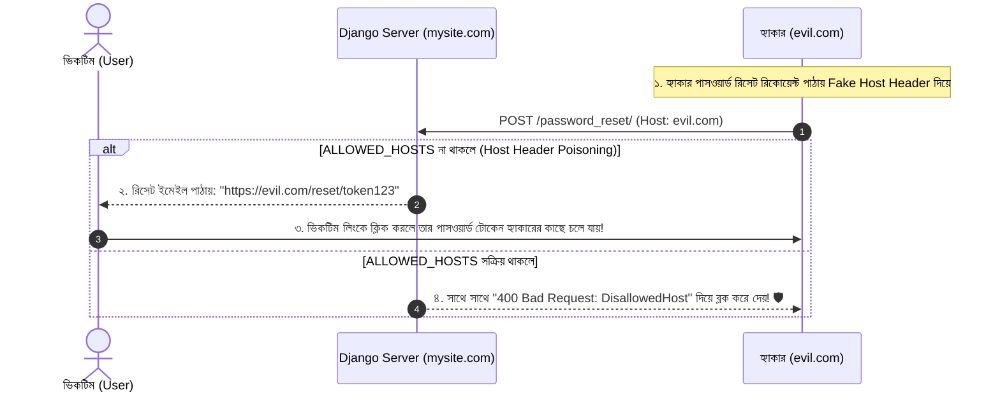

# Lesson 59: DEBUG=False এবং ALLOWED_HOSTS প্রোডাকশন গাইড 🛑🌐

Django প্রজেক্ট ডেভেলপমেন্ট শেষ করে লাইভ সার্ভারে ডিপ্লয় করার সময় যে দুটি সেটিংস পরিবর্তন করা সবচেয়ে প্রাথমিক ও বাধ্যতামূলক তা হলো **`DEBUG = False`** এবং **`ALLOWED_HOSTS`** কনফিগার করা।

এই দুটি সেটিংস সঠিকভাবে না বুঝলে প্রোডাকশনে একদিকে যেমন ভয়াবহ সিকিউরিটি ফাঁস (Data Leak) হতে পারে, অন্যদিকে সাইট ডিপ্লয় করার সাথে সাথেই `400 Bad Request` অথবা CSS/JS ফাইল হারিয়ে যাওয়ার (404 Static Files) মতো সাধারণ সমস্যায় পড়তে হয়।

---

## ১. `DEBUG = False` কেন বাধ্যতামূলক? 🚨

লোকাল মেশিনে কোড লেখার সময় `DEBUG = True` রাখা হয় যেন কোনো লাইনে এরর হলে সুন্দর হলুদ স্ক্রিনে বিস্তারিত এরর স্ট্যাকট্রেস (Traceback) দেখা যায়।

### ❌ লাইভ প্রোডাকশনে `DEBUG = True` রাখলে কী ভয়াবহ বিপদ ঘটে?
1. **সংবেদনশীল ডেটা ফাঁস:** ব্যবহারকারীর কোনো এরর হলে Django পুরো পাইথন স্ক্রিপ্টের সমস্ত লোকাল ভেরিয়েবল ব্রাউজারে দেখিয়ে দেয়। হ্যাকাররা সেকেন্ডের মধ্যে আপনার `SECRET_KEY`, ডেটাবেজের পাসওয়ার্ড, AWS/Stripe API Key এবং সেশন ডেটা চুরি করে নেবে!
2. **সার্ভার মেমরি শেষ (Memory Leak):** `DEBUG = True` থাকলে Django প্রতিটি ডেটাবেজ কোয়েরি RAM-এ (`connection.queries`) জমিয়ে রাখে। লাইভ সার্ভারে হাজার হাজার ভিজিটর এলে সার্ভারের পুরো RAM ক্র্যাশ করে।
3. **ইউজার অভিজ্ঞতা নষ্ট:** ব্যবহারকারী একটি কুৎসিত টেকনিক্যাল কোড দেখতে পায় যা সাইটের পেশাদারিত্ব নষ্ট করে।

---

### `DEBUG = False` করার সাথে সাথে Django-তে কী কী পরিবর্তন ঘটে?

| বৈশিষ্ট্য | `DEBUG = True` (Development) | `DEBUG = False` (Production) |
| :--- | :--- | :--- |
| **এরর স্ক্রিন** | বিস্তারিত হলুদ Traceback স্ক্রিন | সাধারণ কাস্টম `500.html` বা `404.html` পেজ |
| **স্ট্যাটিক ফাইলস (CSS/JS)** | Django নিজে নিজে সার্ভ করে | **Django নিজে কোনো স্ট্যাটিক ফাইল সার্ভ করে না!** (WhiteNoise বা Nginx লাগে) |
| **`ALLOWED_HOSTS`** | খালি থাকলেও চলে (`localhost` ধরে নেয়) | **বাধ্যতামূলক!** খালি থাকলে সাইট রানই করবে না (400 Bad Request) |
| **কোয়েরি লগিং** | প্রতিটি SQL কোয়েরি মেমরিতে রাখে | মেমরি বাঁচায়, কোনো কোয়েরি লগ করে না |
| **ইমেইল নোটিফিকেশন** | কোনো এরর ইমেইল পাঠায় না | 500 ক্র্যাশ হলে `ADMINS` লিস্টের ডেভেলপারদের ইমেইল পাঠায় |

---

## ২. `ALLOWED_HOSTS` কী এবং কেন প্রয়োজন? 🛡️

`ALLOWED_HOSTS` হলো সেই সমস্ত ডোমেন নাম এবং আইপি অ্যাড্রেসের একটি সুরক্ষিত তালিকা (Whitelist) যা দিয়ে ব্যবহারকারীরা আপনার Django অ্যাপ্লিকেশনে প্রবেশ করতে পারবে।

### HTTP Host Header Attack কী?
একটি ব্রাউজার যখন কোনো ওয়েবসাইটে রিকোয়েস্ট পাঠায়, তখন সে একটি হেডার পাঠায়: `Host: example.com`। হ্যাকাররা চালাকি করে এই হেডারটি বদলে দিতে পারে (যেমন: `Host: evil-hacker.com`)।



---

## ৩. `ALLOWED_HOSTS` কনফিগার করার সঠিক নিয়ম

[config/settings.py](file:///d:/Next%20Level%202/next.js/Django/config/settings.py) ফাইলে এটি ডিক্লেয়ার করতে হয়:

```python
# ❌ চরম বিপজ্জনক (কখনোই প্রোডাকশনে এমন ওয়াইল্ডকার্ড দেবেন না!)
ALLOWED_HOSTS = ['*']  # এটি দিলে Host Header আক্রমণ প্রতিরোধ সম্পূর্ণ নিষ্ক্রিয় হয়ে যায়!

# ✅ সঠিক ও নিরাপদ কনফিগারেশন:
ALLOWED_HOSTS = [
    'myshop.com',             # প্রধান ডোমেন
    'www.myshop.com',         # www সাবডোমেন
    '.myshop.com',            # ডট (.) দিলে সমস্ত সাবডোমেন (api.myshop.com, blog.myshop.com) ম্যাচ করবে
    '159.65.120.45',          # আপনার প্রোডাকশন সার্ভারের পাবলিক আইপি (IP)
    '127.0.0.1',              # লোকাল টেস্টিং
    'localhost',
]
```

### পরিবেশ ভেরিয়েবল (.env) থেকে ডায়নামিক লোড করা:
```python
import os

# .env ফাইলে থাকবে: ALLOWED_HOSTS=myshop.com,www.myshop.com,127.0.0.1
ALLOWED_HOSTS = [host.strip() for host in os.getenv('ALLOWED_HOSTS', '127.0.0.1,localhost').split(',')]
```

---

## ৪. `DEBUG = False` করার পর যে ৩টি সমস্যা ঘটে ও তার সমাধান 🛠️

### সমস্যা ১: স্ট্যাটিক ফাইল (CSS/JS/Images) লোড না হওয়া (404 Error)
`DEBUG = False` করলে Django নিজে কোনো স্ট্যাটিক ফাইল পরিবেশন করে না। 

#### 🏆 আধুনিক সমাধান: `WhiteNoise`
WhiteNoise ব্যবহার করলে Nginx ছাড়াই পাইথন অ্যাপ নিজেই স্ট্যাটিক ফাইল দ্রুত ও নিরাপদে সার্ভ করতে পারে (Gzip ও Brotli কম্প্রেশন সহ):

```bash
pip install whitenoise
```

`settings.py`-তে কনফিগার করুন:
```python
MIDDLEWARE = [
    'django.middleware.security.SecurityMiddleware',
    'whitenoise.middleware.WhiteNoiseMiddleware',  # SecurityMiddleware এর ঠিক নিচে
    # ... অন্যান্য মিডলওয়্যার ...
]

# প্রোডাকশনের সমস্ত স্ট্যাটিক ফাইল যেখানে একীভূত হবে
STATIC_ROOT = BASE_DIR / 'staticfiles'

# WhiteNoise কম্প্রেশন ও ইউনিক হ্যাশিং
STATICFILES_STORAGE = 'whitenoise.storage.CompressedManifestStaticFilesStorage'
```

এরপর টার্মিনালে কমান্ড চালান:
```bash
python manage.py collectstatic --noinput
```

---

### সমস্যা ২: `400 Bad Request (DisallowedHost)` এরর
সার্ভারে সাইট ডিপ্লয় করার পর ব্রাউজারে `Bad Request (400)` স্ক্রিন আসার মানে হলো:
- আপনি যে ডোমেন বা আইপি দিয়ে ব্রাউজারে সাইটটি ওপেন করছেন, সেটি `ALLOWED_HOSTS`-এ নেই।
- অথবা Nginx রিভার্স প্রক্সির কনফিগারেশনে `proxy_set_header Host $host;` লাইনটি মিসিং রয়েছে।

```nginx
# Nginx কনফিগারেশন (/etc/nginx/sites-available/django)
location / {
    proxy_set_header Host $host;
    proxy_set_header X-Real-IP $remote_addr;
    proxy_set_header X-Forwarded-For $proxy_add_x_forwarded_for;
    proxy_set_header X-Forwarded-Proto $scheme;
    proxy_pass http://unix:/run/gunicorn.sock;
}
```

---

### সমস্যা ৩: কুৎসিত বা ব্ল্যাঙ্ক এরর স্ক্রিন
`DEBUG = False` থাকলে ইউজার যাতে কোনো ব্যাকএন্ড কোড না দেখে সুন্দর পেইজ দেখতে পায়, সেজন্য আপনার `templates/` ফোল্ডারে দুটি ফাইল তৈরি করুন:
1. **`templates/404.html`** (কোনো পেজ খুঁজে না পেলে)
2. **`templates/500.html`** (সার্ভারে কোনো আনহ্যান্ডেলড এরর ঘটলে)

---

## ৫. লোকাল কম্পিউটারে `DEBUG=False` টেস্ট করার কৌশল

আপনার লোকাল মেশিনে `DEBUG = False` ঠিকমতো কাজ করছে কিনা তা দেখতে নিচের কমান্ডটি ব্যবহার করুন:

```bash
# --insecure ফ্ল্যাগ দিলে লোকাল টেস্টের জন্য Django সাময়িকভাবে স্ট্যাটিক ফাইল সার্ভ করবে
python manage.py runserver --insecure
```

> ⚠️ **মনে রাখবেন:** `--insecure` ফ্ল্যাগটি শুধুমাত্র লোকাল মেশিনে টেস্টিংয়ের জন্য। প্রোডাকশনে Gunicorn বা Nginx দিয়ে ফাইল সার্ভ করতে হয়।

---

## প্রোডাকশন চেকলিস্ট 📋

1. ✅ `DEBUG = False` নিশ্চিত করা হয়েছে।
2. ✅ `ALLOWED_HOSTS` তালিকায় শুধুমাত্র আপনার আসল ডোমেন ও সার্ভারের আইপি রয়েছে (কখনোই `['*']` নয়)।
3. ✅ `WhiteNoise` ইনস্টল করা হয়েছে এবং `python manage.py collectstatic` সফলভাবে রান হয়েছে।
4. ✅ `templates/404.html` ও `templates/500.html` তৈরি আছে।
5. ✅ `python manage.py check --deploy` কমান্ড চালিয়ে সব ওয়ার্নিং শূন্য (Zero) করা হয়েছে।
