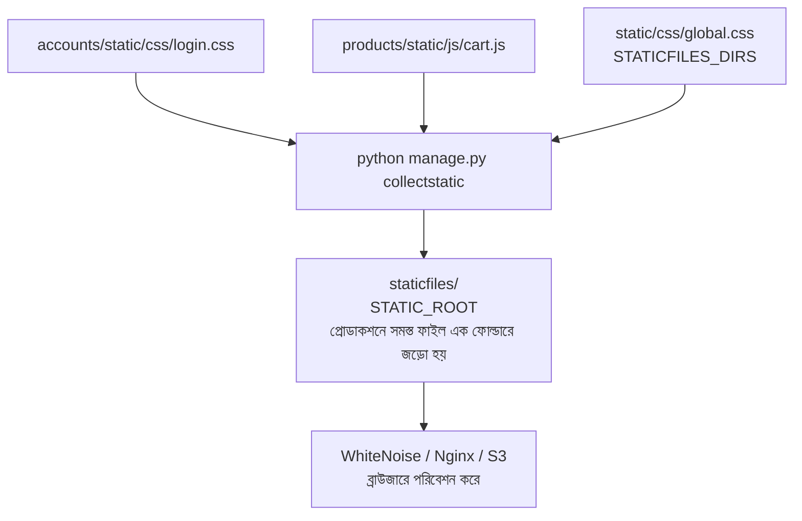

# Lesson 61: Static Files - WhiteNoise ও আধুনিক Static Hosting গাইড 📦⚡

ওয়েব অ্যাপ্লিকেশনের CSS, JavaScript, ফন্ট এবং লোগো বা আইকনগুলোকে বলা হয় **Static Files**।

লোকাল ডেভেলপমেন্টে `python manage.py runserver` চালানোর সময় Django প্রতিটি অ্যাপের ভেতর থেকে স্বয়ংক্রিয়ভাবে স্ট্যাটিক ফাইল খুঁজে বের করে ব্রাউজারে পরিবেশন করে। কিন্তু প্রোডাকশনে যখন আপনি **`DEBUG = False`** করেন, তখন নিরাপত্তার কারণে Django নিজে নিজে স্ট্যাটিক ফাইল সার্ভ করা সম্পূর্ণ বন্ধ করে দেয়।

প্রোডাকশনে স্ট্যাটিক ফাইল দক্ষতার সাথে হোস্ট করার জন্য আধুনিক ওয়েব ডেভেলপমেন্টে বেশ কিছু বিকল্প রয়েছে:
1. **WhiteNoise** (ছোট থেকে মাঝারি প্রজেক্ট, PaaS এবং ডকারের জন্য সবচেয়ে আধুনিক ও সহজ সমাধান)
2. **Nginx Static Serving** (ট্রেডিশনাল VPS বা ডেডিকেটেড সার্ভারের জন্য)
3. **AWS S3 / Cloudflare R2 + CDN** (মাল্টি-সার্ভার, অটো-স্কেলিং ও বিশাল এন্টারপ্রাইজ সিস্টেমের জন্য)

---

## ১. স্ট্যাটিক ফাইলের মৌলিক ৩টি সেটিংস

যেকোনো হোস্টিং পদ্ধতি ব্যবহারের পূর্বে [config/settings.py](file:///d:/Next%20Level%202/next.js/Django/config/settings.py)-এ ৩টি ডিরেক্টরি সেটিংস পরিষ্কারভাবে বুঝতে হবে:



1. **`STATIC_URL = '/static/'`**: ব্রাউজারে যে URL দিয়ে ফাইলগুলো কল করা হবে (যেমন: `https://site.com/static/style.css`)।
2. **`STATICFILES_DIRS`**: প্রজেক্ট রুটের যে ফোল্ডারে আপনার গ্লোবাল CSS/JS রাখা থাকে।
3. **`STATIC_ROOT`**: `python manage.py collectstatic` কমান্ড দিলে সমস্ত অ্যাপের ফাইলগুলো একীভূত হয়ে যে সেন্ট্রাল ফোল্ডারে জমা হবে।

---

## ২. পদ্ধতি ১: WhiteNoise দিয়ে হোস্টিং (সবচেয়ে জনপ্রিয় ও আধুনিক) 🏆

**WhiteNoise** হলো এমন একটি পাইথন লাইব্রেরি যা কোনো জটিল Nginx বা Apache কনফিগারেশন ছাড়াই পাইথন অ্যাপের (Gunicorn/Uvicorn) ভেতর থেকেই স্ট্যাটিক ফাইল অতি দ্রুত পরিবেশন করতে পারে।

### WhiteNoise-এর দারুণ সুবিধাসমূহ:
- **Gzip ও Brotli কম্প্রেশন:** ফাইলের সাইজ ৭০% পর্যন্ত কমিয়ে দ্রুত লোড নিশ্চিত করে।
- **Cache-Busting (অদ্বিতীয় হ্যাশ):** ফাইলের নামের সাথে হ্যাশ যোগ করে (যেমন: `style.d41d8c.css`)। ফলে কোড আপডেট করলে ইউজারের ব্রাউজার বাধ্য হয়ে নতুন CSS লোড করে (পুরোনো ক্যাশ আটকে থাকে না)।
- **জিরো কনফিগারেশন:** কোনো আলাদা সার্ভার বা অতিরিক্ত সার্ভিস কিনতে হয় না।

---

### ধাপ ১: WhiteNoise ইনস্টলেশন
```bash
pip install whitenoise
```
*(Brotli কম্প্রেশন সাপোর্টের জন্য: `pip install "whitenoise[brotli]"`)।*

---

### ধাপ ২: `config/settings.py`-তে কনফিগারেশন

#### ক. Middleware যোগ করা:
`SecurityMiddleware`-এর ঠিক নিচে `WhiteNoiseMiddleware` বসাতে হবে:
```python
MIDDLEWARE = [
    'django.middleware.security.SecurityMiddleware',
    'whitenoise.middleware.WhiteNoiseMiddleware',  # ঠিক ২য় অবস্থানে থাকতে হবে
    'django.contrib.sessions.middleware.SessionMiddleware',
    # ... অন্যান্য মিডলওয়্যার ...
]
```

#### খ. Static ফাইল সেটিংস ও আধুনিক `STORAGES` কনফিগ (Django 4.2+ / Django 5 / 6):
```python
STATIC_URL = '/static/'

# গ্লোবাল স্ট্যাটিক ফোল্ডার (যদি থাকে)
STATICFILES_DIRS = [
    BASE_DIR / 'static',
]

# সমস্ত ফাইল collectstatic হয়ে এখানে জমা হবে
STATIC_ROOT = BASE_DIR / 'staticfiles'

# Django 4.2+ এর আধুনিক স্টোরেজ ডিকশনারি (কম্প্রেশন ও ক্যাশ-বাস্টিং সহ)
STORAGES = {
    "default": {
        "BACKEND": "django.core.files.storage.FileSystemStorage",
    },
    "staticfiles": {
        "BACKEND": "whitenoise.storage.CompressedManifestStaticFilesStorage",
    },
}
```

---

### ধাপ ৩: ফাইল সংগ্রহ করা (`collectstatic`)
```bash
python manage.py collectstatic --noinput
```
এই কমান্ডটি আপনার প্রজেক্টের সমস্ত স্ট্যাটিক ফাইলকে কম্প্রেস করে `staticfiles/` ফোল্ডারে হ্যাশ সহ সংরক্ষণ করবে।

---

## ৩. পদ্ধতি ২: Nginx দিয়ে সরাসরি সার্ভ করা (Traditional VPS)

আপনি যদি DigitalOcean বা AWS EC2-তে একটি লিনাক্স VPS সার্ভার চালান, তবে Nginx নিজেই সরাসরি ডিস্ক থেকে ফাইল রিড করে পাঠাতে পারে। এতে পাইথন বা গিউনিকর্ন পর্যন্ত রিকোয়েস্টই যায় না।

```nginx
# /etc/nginx/sites-available/myproject
server {
    listen 80;
    server_name myshop.com;

    # Nginx সরাসরি staticfiles ফোল্ডার পরিবেশন করবে
    location /static/ {
        alias /var/www/myproject/staticfiles/;
        expires 30d;
        add_header Cache-Control "public, no-transform";
    }

    # ইউজার আপলোড করা মিডিয়া ফাইল
    location /media/ {
        alias /var/www/myproject/media/;
        expires 30d;
    }

    # বাকি সব রিকোয়েস্ট Django Gunicorn-এ যাবে
    location / {
        proxy_pass http://unix:/run/gunicorn.sock;
        proxy_set_header Host $host;
        proxy_set_header X-Real-IP $remote_addr;
    }
}
```

---

## ৪. পদ্ধতি ৩: ক্লাউড স্টোরেজ (AWS S3 / Cloudflare R2) + CDN ☁️

যদি আপনার অ্যাপ্লিকেশনটি একাধিক সার্ভারে চলে (যেমন AWS Auto Scaling Group বা Kubernetes), তবে সার্ভারগুলো নিজে নিজে তৈরি ও ধ্বংস হয়। ফলে সার্ভারের লোকাল ডিস্কে ফাইল রাখা যায় না।

তখন সমস্ত স্ট্যাটিক ও মিডিয়া ফাইল সেন্ট্রাল ক্লাউড স্টোরেজে (`AWS S3` বা `Cloudflare R2`) আপলোড করতে হয় এবং সামনে **CloudFront** বা **Cloudflare CDN** বসানো হয়।

```bash
pip install django-storages boto3
```

`settings.py`-তে কনফিগারেশন:
```python
INSTALLED_APPS += ['storages']

AWS_ACCESS_KEY_ID = os.getenv('AWS_ACCESS_KEY_ID')
AWS_SECRET_ACCESS_KEY = os.getenv('AWS_SECRET_ACCESS_KEY')
AWS_STORAGE_BUCKET_NAME = 'my-django-bucket'
AWS_S3_CUSTOM_DOMAIN = f'{AWS_STORAGE_BUCKET_NAME}.s3.amazonaws.com'
AWS_S3_OBJECT_PARAMETERS = {'CacheControl': 'max-age=86400'}

# Static Storage
STORAGES = {
    "default": {
        "BACKEND": "storages.backends.s3boto3.S3Boto3Storage",  # মিডিয়া ফাইলের জন্য
    },
    "staticfiles": {
        "BACKEND": "storages.backends.s3boto3.S3StaticStorage", # স্ট্যাটিক ফাইলের জন্য
    },
}
```

---

## ৫. তুলনা: কখন কোনটি বেছে নেবেন?

| মাপকাঠি | WhiteNoise 🏆 | Nginx Static | AWS S3 + CDN ☁️ |
| :--- | :--- | :--- | :--- |
| **সেটআপের জটিলতা** | অতি সহজ (২ মিনিট) | মাঝারি (Nginx কনফিগ লাগে) | জটিল (AWS IAM ও বাকেট কনফিগ) |
| **সার্ভার প্রকার** | PaaS (Render, Heroku), Docker, VPS | নিজস্ব VPS (Ubuntu, Debian) | এন্টারপ্রাইজ / Kubernetes / Auto-scaling |
| **পারফরম্যান্স** | অত্যন্ত দ্রুত (ইন-মেমরি ক্যাশ) | সর্বোচ্চ দ্রুত (C-লেভেল কার্নেল) | বিশ্বজুড়ে দ্রুততম (Global Edge CDN) |
| **অতিরিক্ত খরচ** | $০ (বিনামূল্যে) | $০ (বিনামূল্যে) | ডেটা ট্রান্সফার ও বাকেট ফি প্রযোজ্য |
| **ক্যাশ বাস্টিং** | বিল্ট-ইন হ্যাশিং | নিজে কনফিগার করতে হয় | বিল্ট-ইন |

---

## ৬. সাধারণ সমস্যা ও সমাধান (Gotchas & Fixes) ⚠️

### সমস্যা: `Missing staticfiles manifest entry for 'css/style.css'`
WhiteNoise-এর `CompressedManifestStaticFilesStorage` ব্যবহার করলে যদি কোনো CSS ফাইলের ভেতরে কোনো ভাঙা ইমেজ বা ফন্টের লিংক থাকে (যেমন: `background: url('../img/missing.jpg')`), তখন `collectstatic` এরর দিতে পারে।

#### সমাধান:
১. CSS ফাইলের ভেতরের লিংক ঠিক করুন।
২. অথবা সাময়িকভাবে নন-ম্যানিফেস্ট স্টোরেজ ব্যবহার করুন:
```python
STORAGES = {
    # ...
    "staticfiles": {
        "BACKEND": "whitenoise.storage.CompressedStaticFilesStorage", # হ্যাশ ছাড়া শুধুই কম্প্রেশন
    },
}
```

---

## সারসংক্ষেপ (Best Practice Recommendation)

> 🎯 **সুপারিশ:**
> - আপনার প্রজেক্টের **Static Files** (কোডের CSS/JS)-এর জন্য **`WhiteNoise`** ব্যবহার করুন। এটি সেটআপ করা সবচেয়ে ঝামেলামুক্ত এবং আধুনিক।
> - আর ব্যবহারকারীর আপলোড করা **Media Files** (প্রোফাইল পিকচার, পিডিএফ ফাইল)-এর জন্য সরাসরি ক্লাউড স্টোরেজ যেমন **AWS S3** বা **Cloudinary** ব্যবহার করুন।
