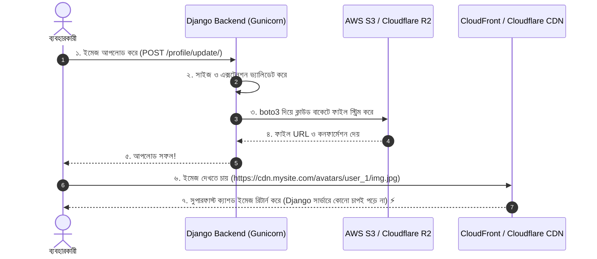

# Lesson 62: Media Storage Configuration (Local ও Cloud Production) 🖼️📁

ওয়েব অ্যাপ্লিকেশনে ব্যবহারকারীরা যে সমস্ত ফাইল আপলোড করেন (যেমন: প্রোফাইল পিকচার, প্রোডাক্ট ইমেজ, পিডিএফ ডকুমেন্ট, ইনভয়েস)—সেগুলোকে বলা হয় **Media Files**।

স্ট্যাটিক ফাইল (CSS/JS) এবং মিডিয়া ফাইলের মধ্যে সবচেয়ে বড় পার্থক্য হলো: স্ট্যাটিক ফাইল ডেভেলপার কোডের সাথে তৈরি করেন এবং তা অপরিবর্তনীয় থাকে। কিন্তু মিডিয়া ফাইল রানটাইমে ব্যবহারকারীর দ্বারা প্রতিনিয়ত তৈরি ও ডিলিট হয়।

এই গাইডে আমরা শিখব:
1. লোকাল ডেভেলপমেন্টে `MEDIA_ROOT` ও `MEDIA_URL` কনফিগারেশন
2. ফাইল আপলোডে নিরাপত্তা ভ্যালিডেশন (সাইজ লিমিট ও ফাইল টাইপ)
3. ইউনিক ফাইলনেম ও ডায়নামিক `upload_to` পাথ তৈরি
4. প্রোডাকশনে ক্লাউড স্টোরেজ (**AWS S3 / Cloudflare R2 / DigitalOcean Spaces**) কনফিগারেশন
5. প্রাইভেট/সংবেদনশীল মিডিয়া ফাইলের নিরাপত্তা (Pre-signed URLs)

---

## ১. Static Files বনাম Media Files-এর পার্থক্য

| বৈশিষ্ট্য | Static Files (CSS/JS) | Media Files (User Uploads) |
| :--- | :--- | :--- |
| **উৎস** | ডেভেলপার তৈরি করেন | ব্যবহারকারী আপলোড করেন |
| **পরিবর্তন** | কোড রিলিজের সময় পরিবর্তিত হয় | রানটাইমে যেকোনো মুহূর্তে বাড়ে বা কমে |
| **হোস্টিং মেকানিজম** | WhiteNoise বা Nginx দিয়ে সহজে সার্ভ হয় | **কখনোই WhiteNoise দিয়ে সার্ভ করা যাবে না!** (ক্লাউড স্টোরেজ আবশ্যক) |
| **সাইজ** | সাধারণত নির্দিষ্ট ও সীমিত | গিগাবাইট বা টেরাবাইট পর্যন্ত হতে পারে |

---

## ২. লোকাল ডেভেলপমেন্ট কনফিগারেশন (`settings.py` ও `urls.py`)

### ক. [config/settings.py](file:///d:/Next%20Level%202/next.js/Django/config/settings.py)-এ পাথ নির্ধারণ:

```python
from pathlib import Path

BASE_DIR = Path(__file__).resolve().parent.parent

# ১. ব্যবহারকারীর আপলোড করা ফাইলগুলো লোকাল কম্পিউটারে যে ফোল্ডারে সেভ হবে
MEDIA_ROOT = BASE_DIR / 'media'

# ২. ব্রাউজার থেকে এই ফাইলগুলো দেখার পাবলিক URL প্রিফিক্স
MEDIA_URL = '/media/'
```

### খ. [config/urls.py](file:///d:/Next%20Level%202/next.js/Django/config/urls.py)-এ মিডিয়া রাউটিং যুক্ত করা:
লোকাল টেস্টিংয়ের সময় Django যাতে ব্রাউজারে আপলোড করা ইমেজ প্রদর্শন করতে পারে, সেজন্য রুট URL ফাইলে নিচের অংশটি যোগ করতে হয়:

```python
# config/urls.py
from django.contrib import admin
from django.urls import path, include
from django.conf import settings
from django.conf.urls.static import static

urlpatterns = [
    path('admin/', admin.site.urls),
    path('', include('accounts.urls')),
]

# শুধুমাত্র লোকাল ডেভেলপমেন্টে (DEBUG = True) মিডিয়া সার্ভ করবে:
if settings.DEBUG:
    urlpatterns += static(settings.MEDIA_URL, document_root=settings.MEDIA_ROOT)
```

> ⚠️ **সতর্কতা:** `static(settings.MEDIA_URL)` শুধুমাত্র লোকাল মেশিনে `DEBUG = True` অবস্থায় কাজ করে। প্রোডাকশনে এটি কাজ করে না এবং নিরাপত্তা ঝুঁকির কারণে ব্যবহার করাও নিষিদ্ধ।

---

## ৩. মডেল ডিজাইন ও সিকিউর ফাইল আপলোড কৌশল 🛡️

সরাসরি ব্যবহারকারীর পাঠানো ফাইলনেমে ফাইল সেভ করা বিপজ্জনক (ফাইলনেমে স্পেস, বাংলা অক্ষর বা ক্ষতিকর এক্সটেনশন যেমন `.php`, `.exe` থাকতে পারে এবং পুরোনো ফাইল ওভাররাইট হয়ে যেতে পারে)।

### ক. ইউনিক ফাইলনেম জেনারেটর (UUID):
```python
# accounts/models.py
import os
import uuid
from django.db import models
from django.core.exceptions import ValidationError
from django.contrib.auth import get_user_model

User = get_user_model()

# ১. সর্বোচ্চ ৫ মেগাবাইট ফাইল সাইজ ভ্যালিডেটর
def validate_file_size(file):
    max_size_mb = 5
    if file.size > max_size_mb * 1024 * 1024:
        raise ValidationError(f"ফাইলের সাইজ সর্বোচ্চ {max_size_mb} MB হতে পারবে!")

# ২. ডায়নামিক ও ইউনিক আপলোড পাথ তৈরি
def user_avatar_path(instance, filename):
    # ফাইলের এক্সটেনশন আলাদা করা (.jpg, .png)
    ext = filename.split('.')[-1]
    # নতুন র্যান্ডম নাম তৈরি (যেমন: avatars/user_5/a8b9c2-d3e4.jpg)
    unique_filename = f"{uuid.uuid4().hex[:10]}.{ext}"
    return os.path.join(f"avatars/user_{instance.user.id}/", unique_filename)

class Profile(models.Model):
    user = models.OneToOneField(User, on_delete=models.CASCADE, related_name='profile')
    avatar = models.ImageField(
        upload_to=user_avatar_path,
        validators=[validate_file_size],
        default='avatars/default.png',
        blank=True
    )
    document = models.FileField(
        upload_to='documents/%Y/%m/',  # বছর ও মাস অনুযায়ী ফোল্ডার তৈরি হবে
        validators=[validate_file_size],
        blank=True
    )

    def __str__(self):
        return f"{self.user.username}'s Profile"
```

---

## ৪. প্রোডাকশন ক্লাউড স্টোরেজ আর্কিটেকচার ☁️

আধুনিক ডকার বা ক্লাউড সার্ভারে (Heroku, Render, AWS ECS, DigitalOcean App Platform) সার্ভার রিস্টার্ট দিলে লোকাল ডিস্কের সমস্ত ডেটা মুছে যায় (Ephemeral Storage)। তাছাড়া মাল্টি-সার্ভার ক্লাস্টারে প্রতিটি সার্ভারের নিজস্ব ডিস্ক আলাদা থাকে।

তাই প্রোডাকশনে সমস্ত আপলোড করা মিডিয়া ফাইল একটি সেন্ট্রাল ক্লাউড স্টোরেজে রাখা বাধ্যতামূলক।



---

## ৫. ক্লাউড স্টোরেজ কনফিগারেশন (`django-storages` + `boto3`)

AWS S3, DigitalOcean Spaces, কিংবা Cloudflare R2 (যার কোনো ইগ্রেস/ডাউনলোড ফি নেই)—সবগুলোই S3-কম্প্যাটিবল API দিয়ে কাজ করে।

### ধাপ ১: লাইব্রেরি ইনস্টল করুন
```bash
pip install django-storages boto3
```

### ধাপ ২: `.env` ফাইলে ক্রেডেনশিয়ালস রাখুন
```env
AWS_ACCESS_KEY_ID=your_access_key_here
AWS_SECRET_ACCESS_KEY=your_secret_key_here
AWS_STORAGE_BUCKET_NAME=my-django-media-bucket
AWS_S3_REGION_NAME=ap-southeast-1
AWS_S3_CUSTOM_DOMAIN=cdn.myshop.com
```

### ধাপ ৩: `settings.py`-তে আধুনিক `STORAGES` কনফিগারেশন (Django 4.2+ / 5 / 6):

```python
import os

# django-storages অ্যাপ যুক্ত করুন
INSTALLED_APPS += ['storages']

if not DEBUG:
    # AWS S3 / R2 সেটিংস
    AWS_ACCESS_KEY_ID = os.getenv('AWS_ACCESS_KEY_ID')
    AWS_SECRET_ACCESS_KEY = os.getenv('AWS_SECRET_ACCESS_KEY')
    AWS_STORAGE_BUCKET_NAME = os.getenv('AWS_STORAGE_BUCKET_NAME')
    AWS_S3_REGION_NAME = os.getenv('AWS_S3_REGION_NAME', 'ap-southeast-1')
    AWS_S3_CUSTOM_DOMAIN = os.getenv('AWS_S3_CUSTOM_DOMAIN')
    
    # ডুপ্লিকেট নামে ফাইল আপলোড হলে যাতে আগের ফাইল মুছে না যায়
    AWS_S3_FILE_OVERWRITE = False
    
    # ব্রাউজার ক্যাশ কন্ট্রোল (১ বছর ক্যাশ থাকবে)
    AWS_S3_OBJECT_PARAMETERS = {
        'CacheControl': 'max-age=31536000',
    }

    # আধুনিক Django 4.2+ STORAGES ডিকশনারি
    STORAGES = {
        # ১. মিডিয়া ফাইল ক্লাউডে যাবে
        "default": {
            "BACKEND": "storages.backends.s3boto3.S3Boto3Storage",
        },
        # ২. স্ট্যাটিক ফাইল WhiteNoise দিয়ে সার্ভ হবে
        "staticfiles": {
            "BACKEND": "whitenoise.storage.CompressedManifestStaticFilesStorage",
        },
    }

    MEDIA_URL = f"https://{AWS_S3_CUSTOM_DOMAIN}/"
```

---

## ৬. প্রাইভেট ও সংবেদনশীল মিডিয়া ফাইলের নিরাপত্তা 🔒

কিছু মিডিয়া ফাইল পাবলিক হওয়া উচিত নয় (যেমন: এনআইডি কার্ডের ছবি, পেইড কোর্সের ভিডিও বা ব্যাংক স্টেটমেন্টের পিডিএফ)। এগুলো যাতে সাধারণ লিংকে যে কেউ দেখতে না পারে, সেজন্য **Pre-signed URLs** ব্যবহার করা হয়।

```python
# স্যাম্পল প্রাইভেট ফাইল স্টোরেজ ক্লাস
from storages.backends.s3boto3 import S3Boto3Storage

class PrivateMediaStorage(S3Boto3Storage):
    location = 'private'
    default_acl = 'private'
    file_overwrite = False
    custom_domain = False  # সরাসরি বাকেট থেকে সাইনড লিংক দেবে
    querystring_auth = True  # লিংকটিতে গোপন টোকেন থাকবে
    querystring_expire = 900  # লিংকটির মেয়াদ থাকবে মাত্র ১৫ মিনিট (৯০০ সেকেন্ড)
```

মডেলে ব্যবহার:
```python
class ConfidentialDocument(models.Model):
    user = models.ForeignKey(User, on_delete=models.CASCADE)
    file = models.FileField(storage=PrivateMediaStorage())
```
ব্যবহারকারী যখন এই ফাইলের লিংকে ক্লিক করবেন, তখন একটি সাময়িক নিরাপদ URL তৈরি হবে:
`https://bucket.s3.amazonaws.com/private/doc.pdf?X-Amz-Signature=...&Expires=...` যা ১৫ মিনিট পর নিজে থেকেই অকেজো হয়ে যাবে!

---

## সারসংক্ষেপ ও চেকলিস্ট 📋

1. ✅ **কখনোই WhiteNoise দিয়ে মিডিয়া ফাইল সার্ভ করবেন না**; WhiteNoise শুধু স্ট্যাটিক ফাইলের জন্য।
2. ✅ ফাইলে সাইজ লিমিট (`validate_file_size`) এবং ক্ষতিকর এক্সটেনশন ফিল্টারিং নিশ্চিত করুন।
3. ✅ পুরোনো ফাইল ওভাররাইট হওয়া রোধ করতে `UUID` দিয়ে ইউনিক ফাইলনেম তৈরি করুন।
4. ✅ প্রোডাকশনে ডকার বা ক্লাউড সার্ভারের লোকাল ডিস্কে ফাইল না রেখে **AWS S3 / Cloudflare R2** ব্যবহার করুন।
5. ✅ সংবেদনশীল ফাইলের ক্ষেত্রে `Pre-signed URL` ব্যবহার করে নির্দিষ্ট সময়ের জন্য অথোরাইজড এক্সেস দিন।
