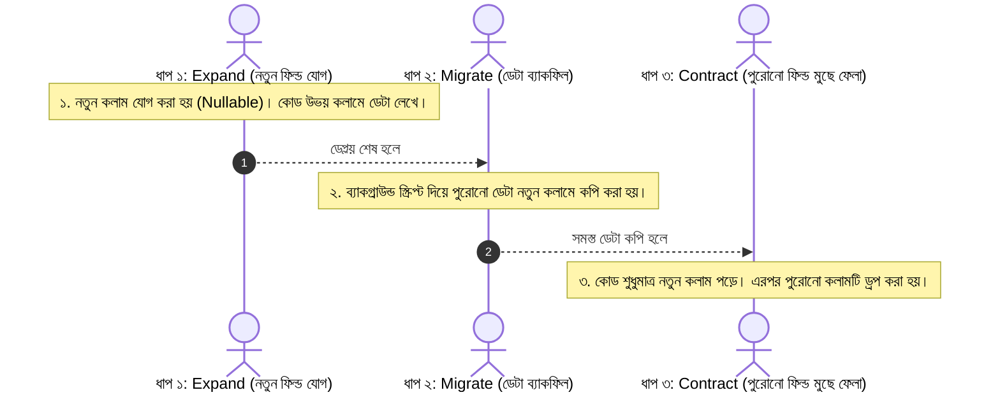
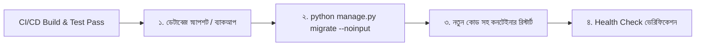

# Lesson 63: Database Migrations in Production (Zero-Downtime ও Best Practices) 🗄️⚡

লোকাল মেশিনে `python manage.py makemigrations` এবং `migrate` চালানো একটি সেকেন্ডের ব্যাপার। কিন্তু লাইভ প্রোডাকশনে—যেখানে হাজার হাজার অ্যাক্টিভ ব্যবহারকারী সাইট ব্রাউজ করছেন এবং ডেটাবেজে কোটি কোটি সারি (Rows) রয়েছে—সেখানে অসাবধানতামূলক একটি মাইগ্রেশন পুরো ডেটাবেজ লক করে সাইটকে ঘণ্টার পর ঘণ্টা ডাউন (504 Gateway Timeout) করে দিতে পারে।

পেশাদার ব্যাকএন্ড ইঞ্জিনিয়ারিংয়ে প্রোডাকশন মাইগ্রেশনের মূল লক্ষ্য হলো: **Zero-Downtime Deployment** এবং **ডেটা লস রোধ করা**।

---

## ১. প্রোডাকশনে মাইগ্রেশন কেন বিপজ্জনক? 🚨

1. **টেবিল লকিং (Exclusive Lock):** কিছু DDL অপারেশন (যেমন বড় টেবিলে ইনডেক্স তৈরি, কলাম টাইপ পরিবর্তন) চালানোর সময় PostgreSQL পুরো টেবিলকে লক করে ফেলে। ফলে কোনো ইউজার ঐ টেবিলে কোনো ডেটা পড়তে বা লিখতে পারে না।
2. **রোলিং ডিপ্লয়মেন্টে কোড বনাম স্কিমা অমিল:** আপনি যখন নতুন কোড পুশ করেন, সমস্ত সার্ভার একসাথে রিস্টার্ট হয় না। কিছু সার্ভারে পুরোনো কোড এবং কিছু সার্ভারে নতুন কোড চলে। মাইগ্রেশন যদি ব্যাকওয়ার্ড-কম্প্যাটিবল না হয়, পুরোনো কোড সাথে সাথে ক্র্যাশ করে।
3. **বিশাল ডেটা মাইগ্রেশনে মেমরি ক্র্যাশ:** লাখ লাখ ডেটা লুপ চালিয়ে আপডেট করতে গিয়ে সার্ভারের RAM শেষ হয়ে যেতে পারে।

---

## ২. গোল্ডেন রুল: Expand and Contract Pattern (জিরো-ডাউনটাইম) 🔄

প্রোডাকশনে কোনো ব্রেকিং পরিবর্তন (যেমন: কলামের নাম পরিবর্তন বা ফিল্ড ডিলিট) কখনোই **একক ডিপ্লয়মেন্টে করা যাবে না**। এটি ৩টি পৃথক ধাপে সম্পন্ন করতে হয়:



### বাস্তব উদাহরণ: `phone` কলামের নাম পরিবর্তন করে `phone_number` করা
- ❌ **ভুল طریقہ:** সরাসরি মডেলে `phone` মুছে `phone_number` লিখে মাইগ্রেশন চালানো। মাইগ্রেশন চলাকালীন লাইভ ইউজারদের ফর্ম এরর দেবে।
- ✅ **সঠিক طریقہ:**
  1. **রিলিজ ১:** নতুন ফিল্ড `phone_number = models.CharField(null=True)` যোগ করুন। সেভ মেথডে উভয় ফিল্ডে ডেটা লিখুন।
  2. **রিলিজ ২:** একটি ডেটা মাইগ্রেশন চালিয়ে পুরোনো সব ইউজারের `phone` ডেটা `phone_number`-এ কপি করুন।
  3. **রিলিজ ৩:** কোডে সমস্ত রেফারেন্স `phone_number`-এ পরিবর্তন করুন এবং অবশেষে পুরোনো `phone` ফিল্ডটি ড্রপ করুন।

---

## ৩. মাইগ্রেশন রান করার পূর্বে সেফটি কমান্ডস 🛡️

প্রোডাকশন সার্ভারে `migrate` কমান্ড দেওয়ার পূর্বে অবশ্যই নিচের কমান্ডগুলো দিয়ে যাচাই করুন:

### ১. আন-অ্যাপ্লাইড মাইগ্রেশন চেক করা:
```bash
python manage.py showmigrations
```
এটি দেখাবে কোন কোন মাইগ্রেশন এখনো রান হয়নি (চিহ্নিত থাকবে `[ ]` দিয়ে)।

### ২. এক্সিকিউশন প্ল্যান দেখা:
```bash
python manage.py migrate --plan
```
কোন ক্রমানুসারে কোন কোন মাইগ্রেশন চলবে তা আগে থেকেই প্রদর্শন করবে।

### ৩. কাঁচা SQL প্রিভিউ করা (`sqlmigrate`):
```bash
python manage.py sqlmigrate accounts 0004_add_phone_number
```
> 🎯 **প্রো টিপ:** এই কমান্ডটি ডেটাবেজে কোনো পরিবর্তন না করে দেখাবে ব্যাকগ্রাউন্ডে ঠিক কোন কোন SQL কুয়েরি (যেমন: `ALTER TABLE ...`) রান হবে। বড় টেবিলে লক হবে কিনা তা এই SQL দেখেই বোঝা যায়।

---

## ৪. PostgreSQL-এ নন-ব্লকিং ইনডেক্সিং (`AddIndexConcurrently`)

একটি ১০ লাখ সারির টেবিলে সাধারণ `db_index=True` দিলে পুরো টেবিল লক হয়ে যায়। PostgreSQL-এ কোনো টেবিল লক না করে ব্যাকগ্রাউন্ডে ইনডেক্স তৈরির জন্য **`CONCURRENTLY`** ব্যবহার করতে হয়:

```python
# accounts/migrations/0005_add_concurrent_index.py
from django.db import migrations
from django.contrib.postgres.operations import AddIndexConcurrently
from django.db.models import Index

class Migration(migrations.Migration):
    # কনকারেন্ট ইনডেক্স তৈরিতে atomic=False বাধ্যতামূলক
    atomic = False

    dependencies = [
        ('accounts', '0004_previous_migration'),
    ]

    operations = [
        AddIndexConcurrently(
            model_name='profile',
            index=Index(fields=['phone_number'], name='idx_profile_phone_num'),
        ),
    ]
```

---

## ৫. নিরাপদ ডেটা মাইগ্রেশন লেখার নিয়ম (Data Migrations)

লাখ লাখ ডেটা আপডেট করার জন্য কখনো `Profile.objects.all()` সরাসরি লোড করবেন না। মেমরি ক্র্যাশ এড়াতে ব্যাচ প্রসেসিং এবং `iterator()` ব্যবহার করুন:

```python
# accounts/migrations/0006_populate_full_name.py
from django.db import migrations

def populate_full_names(apps, schema_editor):
    # কখনোই সরাসরি 'from accounts.models import User' করবেন না!
    # সর্বদা apps.get_model ব্যবহার করতে হবে
    User = apps.get_model('auth', 'User')
    Profile = apps.get_model('accounts', 'Profile')

    batch_size = 1000
    profiles_to_update = []

    # iterator() পুরো টেবিল মেমরিতে না রেখে স্ট্রিম আকারে আনে
    for profile in Profile.objects.select_related('user').iterator(chunk_size=batch_size):
        profile.full_name = f"{profile.user.first_name} {profile.user.last_name}".strip()
        profiles_to_update.append(profile)

        if len(profiles_to_update) >= batch_size:
            Profile.objects.bulk_update(profiles_to_update, ['full_name'])
            profiles_to_update = []

    # অবশিষ্ট অবজেক্টগুলো আপডেট করা
    if profiles_to_update:
        Profile.objects.bulk_update(profiles_to_update, ['full_name'])

def reverse_code(apps, schema_editor):
    # রোলব্যাকের জন্য রিভার্স লজিক
    Profile = apps.get_model('accounts', 'Profile')
    Profile.objects.update(full_name='')

class Migration(migrations.Migration):
    dependencies = [
        ('accounts', '0005_add_concurrent_index'),
    ]

    operations = [
        migrations.RunPython(populate_full_names, reverse_code=reverse_code),
    ]
```

---

## ৬. CI/CD এবং ডিপ্লয়মেন্টে মাইগ্রেশনের সঠিক ক্রম ⚙️

ডকার বা অটোমেটেড পাইপলাইনে মাইগ্রেশন কখন চালাবেন?



- **আগে মাইগ্রেশন, পরে কোড রিস্টার্ট:** মাইগ্রেশন যদি ব্যাকওয়ার্ড-কম্প্যাটিবল হয়, তবে প্রথমে ডেটাবেজ মাইগ্রেশন রান করুন, তারপর নতুন কোডের কনটেইনার চালু করুন।
- **Heroku-তে:** `Procfile`-এ `release: python manage.py migrate --noinput` ফেজ ব্যবহার করুন।
- **Kubernetes-এ:** `initContainers` বা `Job` দিয়ে মাইগ্রেশন আলাদাভাবে রান করুন।

---

## ৭. ডিজাস্টার রিকভারি ও মাইগ্রেশন রোলব্যাক (Rollback)

যদি কোনো মাইগ্রেশন চলাকালীন সমস্যা দেখা দেয়:

### নির্দিষ্ট মাইগ্রেশনে রোলব্যাক করা:
```bash
# accounts অ্যাপকে 0003 নম্বর মাইগ্রেশনে ফিরিয়ে নিতে:
python manage.py migrate accounts 0003
```

### সমস্ত মাইগ্রেশন আন-ডু করা:
```bash
python manage.py migrate accounts zero
```

---

## প্রোডাকশন চেকলিস্ট 📋

1. ✅ মাইগ্রেশন রান করার ঠিক পূর্বে **ডেটাবেজের অটো-স্ন্যাপশট বা ব্যাকআপ** নিশ্চিত করা হয়েছে।
2. ✅ `python manage.py sqlmigrate` চালিয়ে জটিল লক তৈরি হবে কিনা তা পরীক্ষা করা হয়েছে।
3. ✅ বড় টেবিলে নতুন ফিল্ড যোগ করার সময় `null=True` বা নিরাপদ ডিফল্ট মান ব্যবহার করা হয়েছে।
4. ✅ ইনডেক্সিংয়ের জন্য `AddIndexConcurrently` ব্যবহার করা হয়েছে।
5. ✅ ডেটা মাইগ্রেশনে মেমরি ওভারফ্লো রোধে `iterator()` এবং `bulk_update(..., batch_size=1000)` ব্যবহৃত হয়েছে।
