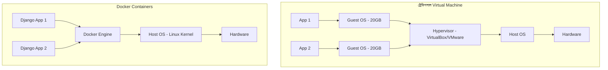

# Lesson 65: Docker Basics (Django ডেভেলপারদের জন্য সম্পূর্ণ গাইড) 🐳📦

সফটওয়্যার ইন্ডাস্ট্রিতে সবচেয়ে পরিচিত ও যন্ত্রণাদায়ক একটি বাক্য হলো: **"আমার কম্পিউটারে তো কোড ঠিকমতো চলে, সার্ভারে বা তোমার কম্পিউটারে কেন চলে না?!"** ("It works on my machine!")

বিভিন্ন অপারেটিং সিস্টেম (Windows, Mac, Linux), ভিন্ন পাইথন সংস্করণ, এবং লোকাল মেশিনের মিসিং সিস্টেম লাইব্রেরির কারণে এই সমস্যার উদ্ভব হয়। এই সমস্যার চূড়ান্ত ও বৈপ্লবিক সমাধান হলো **Docker**।

ডকার আপনার Django অ্যাপ্লিকেশন, পাইথন রানটাইম, ডেটাবেজ ড্রাইভার এবং সমস্ত ডিপেন্ডেন্সিকে একটি স্বয়ংসম্পূর্ণ ও সুরক্ষিত প্যাকেজ (Container)-এ বন্দি করে দেয়। ফলে সেই কনটেইনারটি যেকোনো কম্পিউটারে বা ক্লাউড সার্ভারে হুবহু একইভাবে রান করে।

---

## ১. Virtual Machine (VM) বনাম Docker Container 🥊



- **Virtual Machine:** প্রতিটি ভিএম-এর জন্য আলাদা সম্পূর্ণ অপারেটিং সিস্টেম (যেমন উইন্ডোজের ওপর আরেকটি উবুন্টু ওএস) ইনস্টল করতে হয়। এটি গিগাবাইট সাইজের মেমরি অপচয় করে এবং বুট হতে কয়েক মিনিট সময় নেয়।
- **Docker Container:** ডকার কোনো আলাদা ওএস চালায় না; এটি হোস্ট অপারেটিং সিস্টেমের কার্নেল শেয়ার করে। ফলে একটি কনটেইনারের সাইজ হয় মাত্র কয়েক মেগাবাইট এবং এটি **মিলিসেকেন্ডের মধ্যে** স্টার্ট হয়! ⚡

---

## ২. ডকারের ৪টি মৌলিক স্তম্ভ (The 4 Pillars) 🏛️

1. **Dockerfile (রেসিপি):** একটি সাধারণ টেক্সট ফাইল যাতে ধাপে ধাপে নির্দেশ লেখা থাকে যে কীভাবে আপনার অ্যাপ্লিকেশনটি তৈরি করতে হবে।
2. **Docker Image (ব্লুপ্রিন্ট/প্যাকেজ):** ডকারফাইল বিল্ড করার পর যে পোর্টেবল, অপরিবর্তনীয় (Immutable) ফাইল তৈরি হয়। এটি ক্লাস বা আইএসও ফাইলের মতো।
3. **Docker Container (জীবন্ত অবজেক্ট):** ইমেজ থেকে রান করা সচল অ্যাপ্লিকেশন। একটি ইমেজ থেকে আপনি চাইলে একসাথে ১০টি আইডেন্টিক্যাল কনটেইনার রান করতে পারেন।
4. **Docker Hub (রেজিস্ট্রি):** ক্লাউড লাইব্রেরি (যেমন গিটহাব)। এখান থেকে অফিসিয়াল পাইথন (`python:3.12-slim`), পোস্টগ্রেস (`postgres:16`) ইমেজ ডাউনলোড করা যায়।

---

## ৩. Django অ্যাপের জন্য অপ্টিমাইজড `Dockerfile` তৈরি

আপনার প্রজেক্টের রুট ডিরেক্টরিতে (যেখানে `manage.py` থাকে) কোনো এক্সটেনশন ছাড়া **`Dockerfile`** নামে একটি ফাইল তৈরি করুন:

```dockerfile
# ১. অফিশিয়াল পাইথন স্লিম ইমেজ (লাইটওয়েট ও সুরক্ষিত)
FROM python:3.12-slim

# ২. এনভায়রনমেন্ট ভেরিয়েবল সেট করা
# পাইথনকে .pyc ফাইল তৈরি করতে মানা করে (মেমরি বাঁচায়)
ENV PYTHONDONTWRITEBYTECODE=1
# কনসোলে সাথে সাথে লগ প্রিন্ট করার জন্য বাফারিং বন্ধ করে
ENV PYTHONUNBUFFERED=1

# ৩. কনটেইনারের ভেতরের ওয়ার্কিং ডিরেক্টরি নির্ধারণ
WORKDIR /app

# ৪. সিস্টেম লাইব্রেরি ইনস্টল (PostgreSQL ড্রাইভারের জন্য)
RUN apt-get update && apt-get install -y --no-install-recommends \
    gcc \
    libpq-dev \
    && rm -rf /var/lib/apt/lists/*

# ৫. লেয়ার ক্যাশিং অপ্টিমাইজেশন: প্রথমে শুধু requirements.txt কপি করে ইনস্টল করুন
# ফলে কোড এডিট করলেও প্রতিবার pip install রান হবে না! 🚀
COPY requirements.txt /app/
RUN pip install --no-cache-dir -r requirements.txt

# ৬. প্রজেক্টের বাকি সমস্ত কোড কপি করা
COPY . /app/

# ৭. পোর্ট উন্মুক্ত করা (Django-র ডিফল্ট ৮০০০)
EXPOSE 8000

# ৮. প্রোডাকশন সার্ভার স্টার্ট কমান্ড
CMD ["gunicorn", "--bind", "0.0.0.0:8000", "--workers", "3", "config.wsgi:application"]
```

---

## ৪. চরম গুরুত্বপূর্ণ ফাইল: `.dockerignore` 🚫

ডকার ইমেজের সাইজ ছোট রাখতে এবং গোপন ডেটা লিক ঠেকাতে প্রজেক্ট রুটে **`.dockerignore`** ফাইল থাকা আবশ্যক (এটি `.gitignore`-এর মতোই কাজ করে):

```text
# .dockerignore
venv/
.venv/
__pycache__/
*.pyc
*.pyo
*.pyd

# ডেটাবেজ ও গোপন ফাইল (কখনোই ইমেজের ভেতর ঢোকাবেন না)
db.sqlite3
.env
.git/
.gitignore

# স্ট্যাটিক ও লগ
staticfiles/
*.log
.vscode/
.idea/
```

---

## ৫. ডকারের সবচেয়ে গুরুত্বপূর্ণ কমান্ড চেকলিস্ট 💻

| কমান্ড | কী কাজ করে? |
| :--- | :--- |
| **`docker build -t mydjangoapp .`** | বর্তমান ফোল্ডারের ডকারফাইল থেকে `mydjangoapp` নামে একটি ইমেজ তৈরি করে। |
| **`docker images`** | আপনার কম্পিউটারে থাকা সমস্ত ইমেজের তালিকা দেখায়। |
| **`docker run -d -p 8000:8000 mydjangoapp`** | ব্যাকগ্রাউন্ডে (`-d`) পোর্ট ৮০00 ম্যাপ করে কনটেইনারটি রান করে। |
| **`docker ps`** | বর্তমানে রানিং সমস্ত কনটেইনারের তালিকা ও আইডি দেখায়। |
| **`docker ps -a`** | বন্ধ হয়ে যাওয়া সমস্ত কনটেইনারসহ পূর্ণ তালিকা দেখায়। |
| **`docker logs -f <container_id>`** | কনটেইনারের কনসোল আউটপুট বা এরর লাইভ স্ট্রিম করে দেখে। |
| **`docker stop <container_id>`** | রানিং কনটেইনার বন্ধ করে। |
| **`docker rm <container_id>`** | বন্ধ হওয়া কনটেইনার মুছে ফেলে। |
| **`docker rmi <image_id>`** | হার্ডডিস্ক থেকে ইমেজ ডিলিট করে স্পেস খালি করে। |

---

## ৬. পোর্ট ম্যাপিং ও ভলিউমস (Port & Volume) 🔌

### ক. পোর্ট ম্যাপিং (`-p 8000:8000`)
কনটেইনার একটি নিজস্ব আইসোলেটেড প্রাইভেট নেটওয়ার্কে চলে। বাইরের কম্পিউটার থেকে কনটেইনারের সাথে যোগাযোগ করতে পোর্ট ম্যাপ করতে হয়:
`-p <Host_Port>:<Container_Port>`
অর্থাৎ আপনার ব্রাউজারে `http://localhost:8000` লিখলে তা সরাসরি কনটেইনারের ৮০00 পোর্টে পৌঁছাবে।

### খ. ভলিউম মাউন্টিং (Volume Mounting `-v`):
ডেভেলপমেন্টের সময় কোড এডিট করার সাথে সাথে কনটেইনার যাতে আপডেট হয়:
```bash
docker run -d -p 8000:8000 -v ${PWD}:/app mydjangoapp
```
এর ফলে আপনার কম্পিউটারের ফাইল পরিবর্তন হওয়া মাত্রই কনটেইনারের ভেতর তা রিফ্লেক্ট হবে!

---

## ৭. কনটেইনারের ভেতরে Django কমান্ড চালানোর নিয়ম (`exec`) ⚡

কনটেইনারের ভেতর মাইগ্রেশন চালানো বা সুপারইউজার তৈরি করতে `docker exec` ব্যবহার করা হয়:

```bash
# মাইগ্রেশন চালানো
docker exec -it <container_name_or_id> python manage.py migrate

# সুপারইউজার তৈরি করা
docker exec -it <container_name_or_id> python manage.py createsuperuser

# কনটেইনারের ভেতরে ব্যাশ টার্মিনালে প্রবেশ করা
docker exec -it <container_name_or_id> /bin/bash
```

---

## সারসংক্ষেপ ও পরবর্তী ধাপ

1. ডকার ব্যবহার করলে যেকোনো সার্ভারে অ্যাপ্লিকেশন হুবহু একইভাবে চলে।
2. ইমেজের সাইজ ছোট রাখতে সর্বদা `python:slim` বেস ইমেজ ব্যবহার করুন।
3. লেয়ার ক্যাশিং সুবিধার জন্য `requirements.txt` আগে কপি করে ডিপেন্ডেন্সি ইনস্টল করুন।
4. একক কনটেইনারের জন্য ডকার যথেষ্ট হলেও, Django + PostgreSQL + Redis একসাথে এক ক্লিকে ম্যানেজ করতে আমরা ব্যবহার করি **Docker Compose** (যা পরবর্তী পাঠের আলোচ্য বিষয়)।
