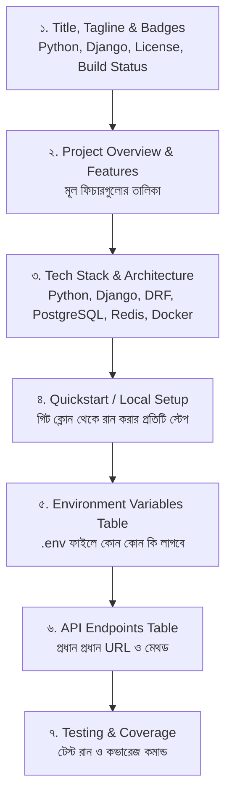

# Lesson 67: GitHub README ও API Documentation (Swagger / OpenAPI 3) 📖✨

একটি চমৎকার ব্যাকএন্ড প্রজেক্ট তৈরি করার পর যদি তার ডকুমেন্টেশন অগোছালো থাকে, তবে অন্য কোনো ডেভেলপার বা চাকরিদাতা (Recruiter) সেই প্রজেক্টের মাহাত্ম্য বুঝতে পারবে না। 

প্রফেশনাল সফটওয়্যার ইঞ্জিনিয়ারিংয়ে দুটি ডকুমেন্টেশন সবচেয়ে বেশি গুরুত্ব পায়:
1. **GitHub README.md:** প্রজেক্টের প্রথম দর্শন, আর্কিটেকচার, সেটাপ গাইড এবং রান করার নিয়মাবলী।
2. **Interactive API Documentation (Swagger / OpenAPI 3 / Redoc):** ফ্রন্টএন্ড ডেভেলপার (React, Next.js, Flutter) যাতে পোস্টম্যান ছাড়াই ব্রাউজার থেকে সরাসরি সমস্ত API টেস্ট করতে পারে।

---

## ১. একটি বিশ্বমানের GitHub README-এর শরীরস্থান (Anatomy) 🏛️

একটি প্রোডাকশন-গ্রেড GitHub README-তে নিচের সেকশনগুলো থাকা আবশ্যক:



---

## ২. Django + DRF প্রজেক্টের জন্য আদর্শ `README.md` টেমপ্লেট 📄

আপনার প্রজেক্টের রুট [README.md](file:///d:/Next%20Level%202/next.js/Django/README.md) ফাইলে এই টেমপ্লেটটি ব্যবহার করতে পারেন:

```markdown
# 🚀 Django & DRF Enterprise Backend

[](https://python.org)
[](https://djangoproject.com)
[](https://www.django-rest-framework.org)
[](https://opensource.org/licenses/MIT)

একটি আধুনিক, নিরাপদ এবং স্কেলেবল Django ব্যাকএন্ড সিস্টেম। এতে রয়েছে ইউজার অথেনটিকেশন, JWT সিকিউরিটি, টাস্ক ম্যানেজমেন্ট REST APIs, অ্যাডভান্সড কুয়েরি অপ্টিমাইজেশন এবং স্বয়ংক্রিয় সোয়াগার API ডকুমেন্টেশন।

---

## ✨ Features

- 🔐 **Authentication & Authorization:** সেশন এবং JWT ভিত্তিক সুরক্ষিত লগইন ও টোকেন ব্ল্যাকলিস্টিং।
- ⚡ **RESTful APIs:** DRF ViewSets ও Routers দিয়ে নির্মিত পূর্ণাঙ্গ CRUD API।
- 🔍 **Filtering & Search:** `django-filter` এবং Search backend সমন্বিত দ্রুত ফিল্টারিং।
- 🛡️ **Security Hardened:** CSRF, XSS, SQL Injection এবং Secure Cookies সুরক্ষা।
- 🚀 **Performance Optimized:** `select_related()` এবং `prefetch_related()` দিয়ে N+1 কোয়েরি প্রতিরোধ।
- 📖 **Interactive API Docs:** Swagger UI এবং Redoc সমন্বিত লাইভ এপিআই প্লেগ্রাউন্ড।
- 🧪 **Automated Testing:** ইউনিট টেস্ট ও `APITestCase` দিয়ে শক্তিশালী ইন্টিগ্রেশন টেস্ট।

---

## 🛠️ Tech Stack

- **Core:** Python 3.12, Django 6.1
- **API Engine:** Django REST Framework (DRF), SimpleJWT
- **Database:** PostgreSQL (Production) / SQLite (Dev)
- **Caching:** Redis / Local Memory
- **Documentation:** OpenAPI 3.0 via `drf-spectacular`
- **Deployment:** Docker, Gunicorn, WhiteNoise

---

## 🚀 Getting Started (Local Setup)

### ১. রিপোজিটরি ক্লোন করুন:
```bash
git clone https://github.com/your-username/django-project.git
cd django-project
```

### ২. ভার্চুয়াল এনভায়রনমেন্ট তৈরি ও সক্রিয় করুন:
```bash
# Windows
python -m venv venv
.\venv\Scripts\activate

# Linux / Mac
python3 -m venv venv
source venv/bin/activate
```

### ৩. ডিপেন্ডেন্সি ইনস্টল করুন:
```bash
pip install -r requirements.txt
```

### ৪. Environment Variables (.env) সেটআপ:
প্রজেক্ট রুটে একটি `.env` ফাইল তৈরি করুন:
```env
DEBUG=True
SECRET_KEY=your-local-secret-key-do-not-share
ALLOWED_HOSTS=127.0.0.1,localhost
```

### ৫. মাইগ্রেশন চালান ও সার্ভার রান করুন:
```bash
python manage.py migrate
python manage.py runserver
```
এখন ব্রাউজারে `http://127.0.0.1:8000/` ভিজিট করুন।

---

## 📖 API Documentation

সার্ভার রান থাকা অবস্থায় যেকোনো ব্রাউজার থেকে সরাসরি ইন্টারেক্টিভ API ডকুমেন্টেশন দেখুন:

| ডকুমেন্টেশন টাইপ | URL Endpoint | বিবরণ |
| :--- | :--- | :--- |
| **Swagger UI** | `/api/docs/` | সরাসরি ব্রাউজার থেকে API টেস্ট করার লাইভ ড্যাশবোর্ড |
| **Redoc UI** | `/api/redoc/` | পরিষ্কার, রেসপন্সিভ রিড-অনলি টেকনিক্যাল রেফারেন্স |
| **OpenAPI Schema** | `/api/schema/` | কাঁচা YAML/JSON স্কিমা ফাইল (Postman-এ ইম্পোর্টের জন্য) |

---

## 🧪 Running Automated Tests

```bash
# সমস্ত টেস্ট রান করতে
python manage.py test

# টেস্ট কভারেজ মেজার করতে
coverage run manage.py test
coverage report
```
```

---

## ৩. আধুনিক API Documentation: `drf-spectacular` (OpenAPI 3.0) 📖

পূর্বে `drf-yasg` ব্যবহার করা হলেও বর্তমানে Django ও DRF-এর অফিসিয়াল আধুনিক সুপারিশ হলো **`drf-spectacular`**। এটি সরাসরি OpenAPI 3.0 সমর্থন করে।

### ধাপ ১: লাইব্রেরি ইনস্টল করুন
```bash
pip install drf-spectacular
```

### ধাপ ২: `config/settings.py`-তে কনফিগারেশন:

```python
INSTALLED_APPS += [
    'drf_spectacular',
]

REST_FRAMEWORK = {
    # ডিফল্ট স্কিমা জেনারেটর হিসেবে drf-spectacular নির্ধারণ
    'DEFAULT_SCHEMA_CLASS': 'drf_spectacular.openapi.AutoSchema',
    # ... অন্যান্য সেটিংস ...
}

# সোয়াগার ড্যাশবোর্ড সেটিংস
SPECTACULAR_SETTINGS = {
    'TITLE': 'Django Task & Auth System API',
    'DESCRIPTION': 'Enterprise RESTful API with JWT Authentication and Task Management.',
    'VERSION': '1.0.0',
    'SERVE_INCLUDE_SCHEMA': False,
    'COMPONENT_SPLIT_REQUEST': True,
}
```

---

### ধাপ ৩: [config/urls.py](file:///d:/Next%20Level%202/next.js/Django/config/urls.py)-এ সোয়াগার রাউট যোগ করা:

```python
# config/urls.py
from django.urls import path, include
from drf_spectacular.views import (
    SpectacularAPIView,
    SpectacularRedocView,
    SpectacularSwaggerView
)

urlpatterns = [
    # আপনার এক্সিস্টিং রাউটসমূহ...
    path('', include('accounts.urls')),

    # OpenAPI 3 Schema & Interactive UIs
    path('api/schema/', SpectacularAPIView.as_view(), name='schema'),
    path('api/docs/', SpectacularSwaggerView.as_view(url_name='schema'), name='swagger-ui'),
    path('api/redoc/', SpectacularRedocView.as_view(url_name='schema'), name='redoc'),
]
```

এখন ব্রাউজারে `http://127.0.0.1:8000/api/docs/` ওপেন করলেই আপনি সম্পূর্ণ **Swagger UI** দেখতে পাবেন, যেখানে প্রতিটি মডেল, ফিল্ড টাইপ, রেসপন্স কোড এবং অথেনটিকেশন বাটন চলে আসবে!

---

## ৪. `@extend_schema` দিয়ে ডকুমেন্টেশন কাস্টমাইজেশন 🎨

সাধারণত সোয়াগার আপনার সিরিয়ালাইজার দেখে নিজেই স্কিমা তৈরি করে। তবে নির্দিষ্ট কোনো ভিউতে অতিরিক্ত ডেসক্রিপশন, কুয়েরি প্যারামিটার বা কাস্টম রেসপন্স যোগ করতে `@extend_schema` ডেকোরেটর ব্যবহার করা হয়:

```python
# accounts/views.py
from drf_spectacular.utils import extend_schema, OpenApiParameter, OpenApiExample
from rest_framework.views import APIView
from rest_framework.response import Response

class TaskStatsAPIView(APIView):
    @extend_schema(
        summary="ব্যবহারকারীর টাস্কের পরিসংখ্যান",
        description="লগইন করা ব্যবহারকারীর মোট, পেন্ডিং ও সম্পন্ন হওয়া টাস্কের সারাংশ ফেরত দেয়।",
        responses={200: dict},
        examples=[
            OpenApiExample(
                'সফল রেসপন্স উদাহরণ',
                value={
                    'total_tasks': 15,
                    'completed_tasks': 10,
                    'pending_tasks': 5,
                    'completion_rate': "66.7%"
                }
            )
        ]
    )
    def get(self, request):
        # লজিক...
        return Response({'total_tasks': 15})
```

---

## ৫. স্কিমা অফলাইনে এক্সপোর্ট করা (`schema.yml`)

পোস্টম্যান (Postman)-এ এক ক্লিকে সমস্ত API ইমপোর্ট করার জন্য স্কিমা ফাইল এক্সপোর্ট করার কমান্ড:

```bash
python manage.py spectacular --file schema.yml
```
এই `schema.yml` ফাইলটি পোস্টম্যানে ইমপোর্ট করলেই সমস্ত ফোল্ডার, এন্ডপয়েন্ট ও বডি ফরম্যাট চোখের পলকে তৈরি হয়ে যাবে!

---

## সারসংক্ষেপ চেকলিস্ট 📋

1. ✅ প্রজেক্ট রুটে ব্যাজ, ফিচার লিস্ট ও কুইকস্টার্ট গাইড সহ আকর্ষণীয় **`README.md`** রয়েছে।
2. ✅ এপিআই ডকুমেন্টের জন্য আধুনিক **`drf-spectacular` (OpenAPI 3)** ব্যবহৃত হয়েছে।
3. ✅ ফ্রন্টএন্ড ডেভেলপারদের জন্য **`/api/docs/` (Swagger)** এবং **`/api/redoc/`** রাউট সক্রিয় আছে।
4. ✅ জটিল বা কাস্টম এন্ডপয়েন্টে **`@extend_schema`** দিয়ে উদাহরণ ও প্যারামিটার যুক্ত করা হয়েছে।
